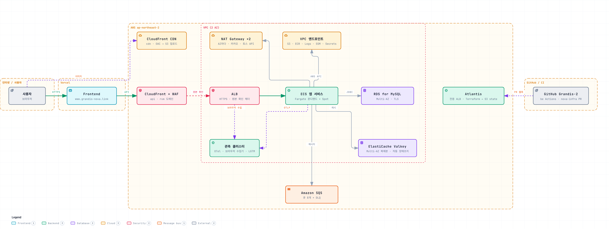
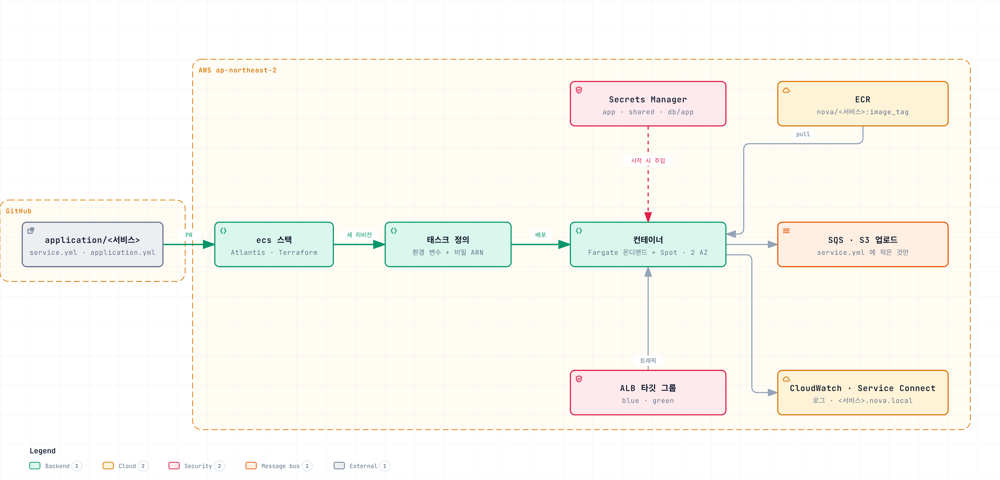
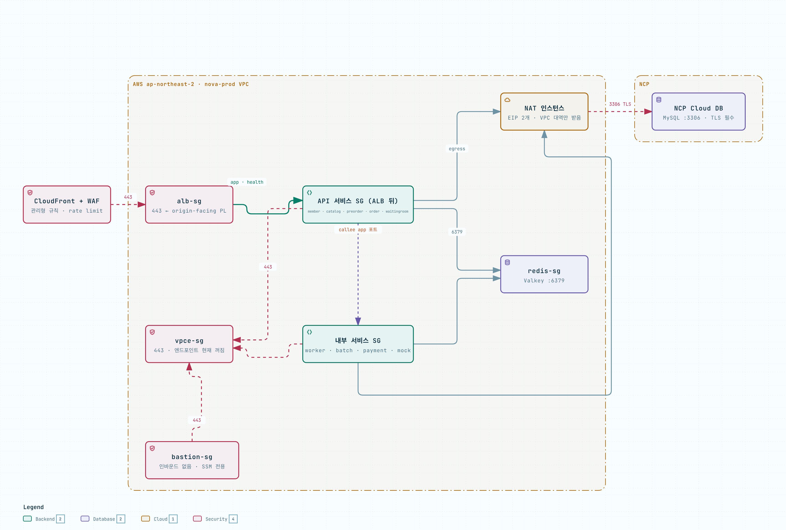
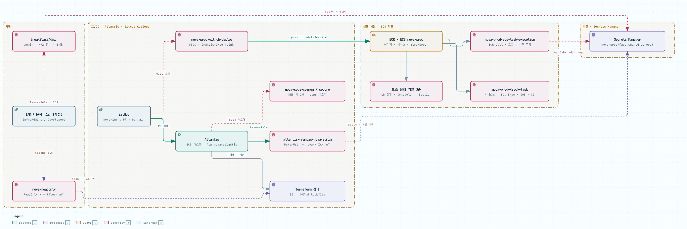
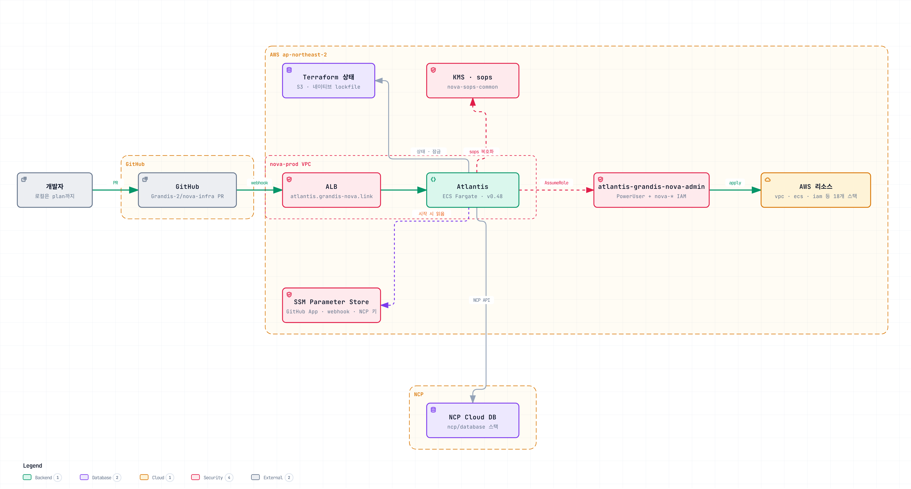

<div align="center">

# nova-infra

사전예약 커머스 서비스 **nova**의 인프라 · Terraform + Atlantis


</div>

## 목차

1. [전체 아키텍처](#전체-아키텍처)
2. [ECS 런타임과 설정 주입](#ecs-런타임과-설정-주입)
3. [네트워크와 보안 그룹](#네트워크와-보안-그룹)
4. [IAM](#iam)
5. [인프라 배포 (Atlantis)](#인프라-배포-atlantis)
6. [주요 설계](#주요-설계)
7. [구조](#구조) · [서비스](#서비스) · [사용법](#사용법)

## 전체 아키텍처

<picture>
  <source media="(prefers-color-scheme: dark)" srcset="docs/architecture/img/overview-dark.png">
  
</picture>

| 구간 | 구성 |
| --- | --- |
| 프런트엔드 | Vercel (`www.grandis-nova.link`) |
| API 진입 | CloudFront + WAF (`api.grandis-nova.link`) → ALB (HTTPS) → ECS |
| 브라우저 수집 | CloudFront + 전용 WAF (`rum.grandis-nova.link`) → ALB → 브라우저 수집기 → OTel 게이트웨이 |
| 이미지 | S3 업로드 버킷 → CloudFront (`cdn.grandis-nova.link`, OAC) |
| 애플리케이션 | ECS Fargate Spot, 2 AZ (2a · 2c) |
| 캐시 · 메시지 | ElastiCache Valkey 9.1 (TLS), SQS 큐 8개 + DLQ |
| DB | NCP Cloud DB for MySQL. NAT 인스턴스 2대의 고정 IP로만 접속 (TLS) |
| 서브넷 | public (ALB, NAT) · app (ECS) · db (Valkey), AZ마다 하나씩 총 6개 |

DB만 비용 때문에 NCP에 둡니다. AWS와 NCP 사이에는 사설망이 없습니다. 그래서 NCP DB 방화벽(ACG)은 NAT 고정 IP 두 개만 허용하고, JDBC 연결에는 TLS를 강제합니다.

## ECS 런타임과 설정 주입

<picture>
  <source media="(prefers-color-scheme: dark)" srcset="docs/architecture/img/runtime-dark.png">
  
</picture>

be 이미지에는 설정 파일이 없습니다. 설정과 비밀은 모두 태스크 정의로 넣습니다.

| 종류 | 주입 방식 | 출처 |
| --- | --- | --- |
| Spring 설정 | 환경 변수 `SPRING_APPLICATION_JSON` | `application.yml` + 인프라 값 (포트, DB URL, Valkey, 서비스 주소, JWKS) |
| DB 계정 | `SPRING_DATASOURCE_USERNAME/PASSWORD` | Secrets Manager `nova-prod/db/app/<서비스>` (ncp/database 스택이 생성) |
| 외부 키 (카카오, 토스) | 키 이름 그대로 환경 변수 | Secrets Manager `nova-prod/app/<서비스>` (sops 파일에서) |
| 생성 비밀 (JWT 키 등) | `generated_secrets`에 적은 환경 변수 | Secrets Manager `nova-prod/app/<서비스>/<키>`, `nova-prod/shared/<이름>` |

- 태스크 정의에는 비밀의 ARN만 들어갑니다. 값은 태스크가 시작할 때 **실행 역할**이 읽어 넣습니다.
- 앱 비밀에는 Parameter Store를 쓰지 않습니다. Parameter Store는 Atlantis 서버의 GitHub App 키에만 씁니다.
- `application.yml`에 비밀 값이나 `localhost`를 적으면 plan이 실패합니다.
- 설정을 바꾸면 apply가 새 태스크 정의로 다시 배포합니다.

| 항목 | 설정 |
| --- | --- |
| 배포 | ALB 뒤 서비스는 ECS Blue/Green (bake 5분), 나머지는 롤링. 둘 다 circuit breaker로 자동 롤백 |
| 용량 | Fargate Spot, 2 AZ에 분산 (AZ 재분배 켬) |
| 확장 | CPU 목표 추적. worker는 SQS 적체량에 따라 1~8개 |
| 서비스 간 호출 | ECS Service Connect 별칭 `http://<서비스>.nova.local:<포트>` (ALB를 거치지 않음) |
| 운영 | CloudWatch Logs (14일), ECS Exec. 태스크 수 · CPU · 메모리는 무료 `AWS/ECS` 지표로 보고 Container Insights는 끔 |

## 네트워크와 보안 그룹

<picture>
  <source media="(prefers-color-scheme: dark)" srcset="docs/architecture/img/security-groups-dark.png">
  
</picture>

| 보안 그룹 | 인바운드 | 아웃바운드 |
| --- | --- | --- |
| `alb` | CloudFront 관리형 prefix list, 443 | 서비스의 앱 · 헬스 포트, 브라우저 수집기 12347 · 13133 |
| `<서비스>` (서비스마다 하나) | ALB (앱 · 헬스 포트), 자신을 호출하는 서비스 (앱 포트) | 전체 (NAT 경유) |
| `redis` | 캐시를 쓰는 서비스, 6379 | — |
| `vpce` | 서비스, bastion, obs, migration, 443 | — |
| `bastion` | 없음 (SSM Session Manager로만 접속) | 전체 |
| `otel-gateway` (OTel 게이트웨이) | 서비스, 4317 · 4318 (OTLP). 엣지 로그 Lambda · 브라우저 수집기, 4318 | obs 3100 · 14317 · 9009, 443 |
| `rum-collector` (브라우저 수집기) | ALB, 12347 (Faro) · 13133 (헬스 체크) | OTel 게이트웨이 4318, 443 |
| `edge-logs` (엣지 로그 Lambda) | 없음 | OTel 게이트웨이 4318, 443 (S3 · 로그) |
| `obs` (관측 스택) | OTel 게이트웨이, 3100 · 14317 · 9009 (Loki · Tempo · Mimir). 프로파일을 켠 서비스(`profiling: true`), 4041. ALB, 3000 (Grafana — `https://grafana.grandis-nova.link`, Cognito 로그인. 사용자는 `cognito/.../users.sops.yml`) | 443, 3306 (NCP DB, mysqld_exporter) |
| `obs-instance` (관측 스택 EC2) | 없음 | 443 |
| `migration` (배포 전 마이그레이션 태스크) | 없음 | 3306 (NAT 경유 DB) · 443 |
| NAT (fck-nat) | VPC 대역 | 전체 (고정 IP 2개로 나감) |

- **진입 경로는 CloudFront 하나입니다.** ALB 보안 그룹은 CloudFront 대역만 받습니다. CloudFront가 붙이는 비밀 헤더가 없는 요청은 ALB가 404로 돌려보냅니다.
- **WAF**: CloudFront 한 곳에만 겁니다. AWS 관리형 규칙 3종(Common, Known Bad Inputs, IP Reputation)과 IP별 요청 제한(`/api/`, 5분에 3000회. 대기열 `/api/v1/preorders/queue`(줄 서기 · 조회)는 따로 5분에 300,000회)을 적용합니다. 본문 SSRF 규칙은 카카오 콜백 경로만 예외입니다.
- **TLS**: CloudFront는 TLS 1.2 이상, ALB는 `ELBSecurityPolicy-TLS13-1-2-2021-06`을 씁니다. Valkey와 DB 연결도 TLS입니다.
- **서비스 간 규칙**: `service.yml`의 `calls`와 `jwt: verify`(member의 JWKS 조회)로 만들어집니다. 여기에 적지 않은 서비스끼리는 통신할 수 없습니다.
- **VPC 엔드포인트**: S3는 게이트웨이 엔드포인트로 접근합니다. 인터페이스 엔드포인트(`vpce`)는 비용 때문에 꺼 두어서, ECR · Secrets Manager · 로그 호출은 NAT를 거칩니다.

## IAM

<picture>
  <source media="(prefers-color-scheme: dark)" srcset="docs/architecture/img/iam-dark.png">
  
</picture>

| 주체 | 역할 | 권한 |
| --- | --- | --- |
| 사람 (평소) | `nova-readonly` | 읽기 전용 + 상태 잠금 파일 쓰기. 로컬 plan용 |
| 사람 (비상) | `BreakGlassAdmin` | 관리자. MFA 필수, 1시간, InfraAdmins 그룹만 |
| Atlantis | `atlantis-grandis-nova-admin` | PowerUser + `nova-*` IAM 리소스 쓰기. 인프라 변경은 이 역할만 |
| be GitHub Actions | `nova-prod-github-deploy` | OIDC, `Grandis-2/be`의 main 브랜치만. ECR 푸시(mock 저장소 제외), ECS 재배포, 배포 전 마이그레이션 태스크 실행 (태스크 정의 변경 불가) |
| mock GitHub Actions | `nova-prod-github-deploy-mock` | OIDC, `Grandis-2/mock`의 main 브랜치만. `nova/mock` · `nova/mock-migration` 푸시, mock 서비스 재배포, mock 마이그레이션 태스크 실행 |
| ECS (공통) | `nova-prod-ecs-task-execution` | 이미지 pull, 로그, `app/*` · `shared/*` · `db/app/*` 비밀 읽기 |
| 마이그레이션 태스크 | `nova-prod-migration-execution` | 이미지 pull, 로그, `db/migrator` 비밀 읽기 |
| ECS (서비스별) | `nova-prod-<서비스>-task` | `service.yml`에 적은 큐와 업로드 버킷만 |
| ECS · 스케줄러 · bastion | `nova-prod-ecs-infrastructure-lb`, `nova-prod-scheduler-execution`, `nova-prod-bastion` | Blue/Green 리스너 전환, 배치 실행, SSM 접속 |
| sops | `nova-sops-common`, `nova-sops-secure` | KMS 복호화. Atlantis와 관리자만 맡을 수 있음 |

- **장기 액세스 키가 없습니다.** 사람은 역할을 맡아서 쓰고, CI는 OIDC, ECS와 Atlantis는 태스크 역할을 씁니다.
- 관리자용 비밀(`nova-prod/ops/*`, DB 관리자 계정)은 실행 역할도 읽을 수 없습니다.

## 인프라 배포 (Atlantis)

<picture>
  <source media="(prefers-color-scheme: dark)" srcset="docs/architecture/img/delivery-dark.png">
  
</picture>

1. `Grandis-2/nova-infra`에 PR을 올리면 Atlantis가 바뀐 스택만 plan 하고, 결과를 PR 댓글로 남깁니다.
2. `atlantis apply` 댓글로 적용합니다. 여러 스택이 바뀌면 아래층부터 순서대로 적용합니다.
3. 상태는 S3에 저장하고, S3 네이티브 잠금으로 동시 적용을 막습니다.

Atlantis 서버는 별도 저장소 **[Grandis-2/atlantis-deploy](https://github.com/Grandis-2/atlantis-deploy)** 에서 관리합니다. 두 저장소는 상태 버킷으로만 연결됩니다.

앱 배포는 Atlantis와 따로 진행됩니다. be의 GitHub Actions가 먼저 마이그레이션 태스크(`nova-prod-migration`)로 DB 스키마를 올리고, 이미지를 ECR에 올린 뒤 `ecs update-service --force-new-deployment`로 다시 배포합니다.

## 주요 설계

- **서비스 폴더 하나 = 서비스 하나**: `terraform/application/<서비스>/service.yml`에서 보안 그룹, IAM, DB 계정, ALB 경로, 오토스케일링이 모두 만들어집니다.
- **변경은 PR로만**: 로컬은 읽기 전용(plan까지)이고, apply는 Atlantis만 합니다.
- **비밀은 Terraform이 생성**: write-only 속성이라 상태 파일에 남지 않습니다. 외부 키만 sops로 암호화합니다.
- **최소 권한**: 서비스마다 보안 그룹과 태스크 역할을 따로 두고, `service.yml`에 적은 것만 허용합니다.
- **비용 절감**: Fargate Spot, NAT 인스턴스(fck-nat), NCP DB를 씁니다.

## 구조

```
├── atlantis.yaml              스택별 Atlantis 프로젝트
├── docs/architecture/         아키텍처 그림
├── functions/<함수>/          Lambda 코드(Python)와 단위 시험. 배포는 terraform/aws/lambda 가 한다
├── scripts/                   tf.sh(로컬 plan), validate-all.sh(전체 검사), link-global.sh(새 스택), app-secrets.sh(외부 비밀)
└── terraform/
    ├── application/<서비스>/  service.yml(인프라), application.yml(Spring 설정)
    ├── variables/             공용 변수, 서비스 목록
    ├── aws/<스택>/            init · kms · vpc · securitygroup · s3 · sqs · ecr · acm · cognito · secretsmanager
    │                          elasticache · iam · ecs · edge · cdn · scheduler · monitoring · lambda · bastion
    └── ncp/database/          Cloud DB for MySQL
```

## 서비스

| 서비스 | 포트 | 배포 |
| --- | --- | --- |
| waitingroom | 8085 | Blue/Green |
| preorder | 8083 | Blue/Green |
| order | 8084 | Blue/Green |
| catalog | 8082 | Blue/Green |
| member | 8080 | Blue/Green |
| payment | 8085 | 롤링 |
| worker · batch | — | 롤링 · 단일 |

서비스 정의 형식과 비밀 설정은 [`terraform/application/README.md`](terraform/application/README.md)에 있습니다.

## 사용법

```bash
cp .env.example .env
./scripts/tf.sh aws/vpc/nova_apnortheast2 plan   # 로컬은 plan까지
./scripts/validate-all.sh                        # PR 전에 전체 스택 fmt · validate
```
