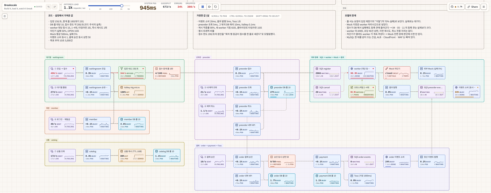

<div align="center">

# nova-infra

사전예약 커머스 서비스 **nova**의 AWS 인프라


</div>

nova는 판매를 시작하자마자 10초 사이에 예약 5,000건이 몰리는 사전예약 서비스입니다. 이 저장소는 그 부하를 감당하는 AWS 인프라를 Terraform으로 정의하고, 모든 변경을 PR과 Atlantis로 적용합니다.

**서비스 9개, Terraform 스택 22개, 부하 시나리오 12개로 병목 검증, AWS 장기 액세스 키 0개**

## 목차

1. [아키텍처](#아키텍처)
2. [핵심 설계 결정](#핵심-설계-결정)
3. [부하 시뮬레이션으로 찾은 병목](#부하-시뮬레이션으로-찾은-병목)
4. [비용과 목표 구조](#비용과-목표-구조)
5. [세부 구성](#세부-구성): 런타임, 관측, 네트워크, IAM, 배포
6. [저장소 구조](#저장소-구조), [서비스](#서비스), [사용법](#사용법)

## 아키텍처

<picture>
  <source media="(prefers-color-scheme: dark)" srcset="docs/architecture/img/overview-dark.png">
  
</picture>

- **요청 경로**: 사용자의 API 요청은 CloudFront와 WAF를 지나 ALB로 들어오고, ECS Fargate의 서비스가 처리합니다. ALB는 CloudFront가 붙인 비밀 헤더가 있는 요청만 받으므로, CloudFront를 우회해서 들어올 수 없습니다.
- **데이터 계층**: RDS for MySQL과 ElastiCache Valkey는 db 서브넷에 Multi-AZ로 둡니다. 서비스끼리는 SQS 큐 10개로 이벤트를 주고받습니다.
- **관측과 배포**: 관측 스택은 앱과 분리된 ECS 클러스터에서, Atlantis는 별도 저장소와 전용 ALB로 운영합니다.

## 핵심 설계 결정

### 1. 판매 오픈의 몰림은 대기열과 큐에서 흡수합니다

판매가 열리면 짧은 시간에 요청이 몰리는데, 외부 예약 시스템은 한 건에 평균 0.5초가 걸리고 5%는 실패합니다. 그래서 대기열(waitingroom)이 입장 속도를 평소 초당 50건, 많아야 150건으로 제한하고, 외부 예약 등록은 SQS에 넣은 뒤 worker가 처리하게 했습니다. 외부 시스템이 느려져도 사용자의 예약 응답은 영향을 받지 않습니다.

대신 등록이 끝났는지를 곧바로 알 수 없습니다. 그래서 worker는 큐에 쌓인 양에 맞춰 대수를 늘리고, 적체와 처리 실패는 경보로 지켜봅니다.

### 2. 서비스 하나는 폴더 하나입니다

서비스마다 보안 그룹, IAM 역할, DB 계정, ALB 경로를 손으로 맞추면 금방 어긋납니다. 그래서 `terraform/application/<서비스>/service.yml` 파일 하나에 필요한 것을 적으면 여러 스택이 이 파일을 읽어 리소스를 만들도록 했습니다.

반대로 이 파일에 적지 않은 것은 모두 막힙니다. 호출 대상(`calls`)으로 적지 않은 서비스와는 통신할 수 없고, `queues`에 적지 않은 큐에는 접근할 수 없습니다. 그래서 따로 챙기지 않아도 권한이 최소로 유지됩니다. 대신 형식에 없는 요구가 생기면 공통 모듈을 고쳐야 합니다. 형식은 [application 문서](terraform/application/README.md)에 있습니다.

### 3. 비밀은 상태 파일에 남기지 않고, 장기 키를 두지 않습니다

Terraform 상태 파일이 유출되면 그 안의 비밀도 함께 유출됩니다. 그래서 비밀은 Terraform이 만들되 상태 파일에 남지 않는 쓰기 전용 속성으로 Secrets Manager에 넣고, 외부에서 받은 키는 sops로 암호화한 파일만 커밋합니다. 사람과 CI, ECS는 모두 IAM 역할로 권한을 얻습니다.

상태 파일에 값이 없으니 Terraform은 비밀이 바뀌었는지 알지 못합니다. 키를 교체하려면 버전 번호를 올려 새 값을 만들게 합니다.

### 4. 관측 데이터는 저장소와 떨어진 게이트웨이가 받습니다

관측 저장소는 재배포할 때 몇 분 동안 멈춥니다. 그동안 앱이 보낸 데이터를 잃지 않도록, 데이터를 받는 OTel 게이트웨이를 별도 서비스로 두고 최대 15분 동안 다시 보내게 했습니다.

게이트웨이는 저장하기 전에 개인정보를 지우고, APM 지표는 샘플링하기 전의 스팬 전부로 계산합니다. 대신 운영할 서비스가 하나 늘고 데이터가 한 단계를 더 거칩니다. 자세한 내용은 [관측 스택 문서](terraform/aws/monitoring/lgtm/nova_apnortheast2/config/README.md)에 있습니다.

### 5. 관측과 배포 도구는 앱에서 분리합니다

앱 배포 역할이 관측 서비스까지 재배포할 수 있으면, 앱을 배포하다가 관측이 멈출 수 있습니다. 이를 막으려고 관측 서비스는 별도 ECS 클러스터에 두고, 앱 배포 역할에는 앱 클러스터 조건을 걸었습니다.

Atlantis도 같은 이유로 별도 저장소([atlantis-deploy](https://github.com/Grandis-2/atlantis-deploy))에서 전용 ALB로 운영합니다. Atlantis가 자기 진입로를 apply 하는 순환이 생기지 않고, 앱 쪽 진입로가 망가져도 그것을 고칠 Atlantis에는 접속할 수 있습니다. 대신 그 저장소만은 사람이 직접 apply 합니다.

## 부하 시뮬레이션으로 찾은 병목

[](https://breakscale.tech/?s=7tGxkph8lHw8Zw#k=KthNFGUv-0li7sD8oZla7Q)

**[Breakscale에서 직접 돌려 보기](https://breakscale.tech/?s=7tGxkph8lHw8Zw#k=KthNFGUv-0li7sD8oZla7Q)**

be, 인프라, mock의 실제 설정값(입장 속도, DB 풀, worker 동시 처리 수, 오토스케일 범위, 차단기)을 그대로 반영한 이산 사건 시뮬레이션입니다. 시나리오 12개를 각각 300초 동안 실행해서 다음 세 가지를 확인했습니다.

1. **가장 먼저 막히는 곳은 외부 예약 등록입니다.** worker 4대의 처리량(초당 128건)이 입장 속도(초당 150건)보다 낮아서, 요청이 계속 들어오면 등록 큐가 300초 동안 24,212건까지 쌓입니다.
2. **판매 오픈 순간의 몰림은 감당합니다.** 10초 동안 들어온 5,000건을 대기열이 33초에 걸쳐 나누어 들여보내고, 등록 큐는 약 90초 뒤에 모두 비워집니다.
3. **접수 한도는 서버 대수가 아니라 DB 잠금에서 정해지는 것으로 보입니다.** 입장 속도를 올리면 접수가 초당 약 190건에서 막히고, preorder를 3대로 늘려도 그대로입니다. 회차 행 잠금을 원인으로 추정하고, 부하 시험으로 확인할 가설로 남겼습니다.

이 모델에는 ALB, CloudFront, WAF가 빠져 있고 일부 처리 시간은 가정한 값이라, 실제 부하 시험으로 보정해야 합니다.

## 비용과 목표 구조

이 문서는 비용을 따지지 않고 설계한 목표 구조를 설명합니다. 실제 운영 환경에서는 비용을 줄이기 위해 12개 항목을 더 저렴한 방식으로 바꿔 두었습니다. 예를 들어 NAT Gateway 대신 NAT 인스턴스를 쓰고, VPC 인터페이스 엔드포인트를 끄고, Fargate는 전부 Spot으로 띄웁니다.

항목마다 무엇을 감수하는지, 어떤 변수를 바꾸면 목표 구조로 돌아가는지를 [COST-SAVINGS.md](COST-SAVINGS.md)에 정리했습니다. 모두 합하면 한 달에 약 670달러를 절감합니다.

## 세부 구성

<details>
<summary><b>ECS 런타임과 설정 주입</b></summary>

<picture>
  <source media="(prefers-color-scheme: dark)" srcset="docs/architecture/img/runtime-dark.png">
  
</picture>

be 이미지에는 설정 파일이 없습니다. 설정과 비밀은 모두 태스크 정의로 넣습니다.

| 종류 | 주입 방식 | 출처 |
| --- | --- | --- |
| Spring 설정 | 환경 변수 `SPRING_APPLICATION_JSON` | `application.yml` + 인프라 값 (포트, DB URL, Valkey, 서비스 주소, JWKS) |
| DB 계정 | `SPRING_DATASOURCE_USERNAME/PASSWORD` | Secrets Manager `nova-prod/db/app/<서비스>` |
| 외부 키 (카카오, 토스) | 키 이름 그대로 환경 변수 | Secrets Manager `nova-prod/app/<서비스>` (sops 파일에서) |
| 생성 비밀 (JWT 키 등) | `generated_secrets`에 적은 환경 변수 | Secrets Manager `nova-prod/app/<서비스>/<키>`, `nova-prod/shared/<이름>` |

- 태스크 정의에는 비밀의 ARN만 들어갑니다. 값은 태스크가 시작할 때 실행 역할이 읽어서 넣습니다.
- `application.yml`에 비밀 값이나 `localhost`를 적으면 plan이 실패합니다.
- 설정을 바꾸면 apply가 새 태스크 정의로 다시 배포합니다.

| 항목 | 설정 |
| --- | --- |
| 배포 | ALB 뒤의 서비스는 ECS Blue/Green(새 버전을 5분 지켜본 뒤 전환), 나머지는 롤링. 둘 다 실패하면 자동으로 되돌림 |
| 용량 | 서비스마다 온디맨드 1개를 두고, 늘어나는 태스크는 Fargate Spot. 2 AZ에 나누어 배치 |
| 확장 | 평상시는 CPU 목표 추적(worker는 SQS 적체량도). 순간 폭주는 1분 지표로 바로 늘리고 Slack에 알림 — CPU 70% 2분, 태스크당 요청 수 1분, 태스크당 적체량 1분. 지금 대수의 +100~200%. 최대 대수에서도 CPU가 3분 넘게 높으면 증설 한계 경보. waitingroom과 preorder는 회차 오픈 15분 전에 앱이 최소 대수를 직접 올림 |
| 서비스 간 호출 | ECS Service Connect 별칭 `http://<서비스>.nova.local:<포트>` (ALB를 거치지 않음) |
| 운영 | CloudWatch Logs (14일), ECS Exec, Container Insights |

</details>

<details>
<summary><b>관측</b></summary>

<picture>
  <source media="(prefers-color-scheme: dark)" srcset="docs/architecture/img/observability-dark.png">
  
</picture>

| 구성 요소 | 하는 일 |
| --- | --- |
| OTel 게이트웨이 (Fargate) | 앱의 OTLP를 받아 개인정보를 지우고, 샘플링 전에 APM 지표를 만들고, 트레이스를 tail sampling 합니다 |
| 브라우저 수집기 (Fargate, 1~3대) | 프런트 Faro SDK가 보낸 웹 바이탈, 오류, 브라우저 트레이스를 받아 게이트웨이로 넘깁니다 |
| obs (EC2 + 데이터 EBS) | Loki, Tempo, Mimir, Pyroscope, Grafana. 오래 둘 데이터는 S3에 저장합니다 |


경보는 Grafana가 판단해서 SNS와 AWS Chatbot을 거쳐 Slack으로 보내고, 경보마다 대응 순서 문서로 가는 링크를 붙입니다. 대시보드, 경보 규칙, SLO는 [관측 스택 문서](terraform/aws/monitoring/lgtm/nova_apnortheast2/config/README.md)에 있습니다.

</details>

<details>
<summary><b>네트워크와 보안 그룹</b></summary>

<picture>
  <source media="(prefers-color-scheme: dark)" srcset="docs/architecture/img/security-groups-dark.png">
  
</picture>

| 보안 그룹 | 인바운드 | 아웃바운드 |
| --- | --- | --- |
| `alb` | CloudFront 관리형 prefix list, 443 | 서비스의 앱 · 헬스 포트, 브라우저 수집기 12347 · 13133, Grafana 3000 |
| `<서비스>` (서비스마다 하나) | ALB (앱 · 헬스 포트), 자신을 호출하는 서비스 (앱 포트) | 같은 VPC의 대상, 외부 API (NAT 경유) |
| `db` (RDS) | DB를 쓰는 서비스, migration, obs (exporter), bastion, 3306 | 없음 |
| `redis` | 캐시를 쓰는 서비스, 6379 | 없음 |
| `vpce` | 서비스, bastion, obs, migration, 443 | 없음 |
| `bastion` | 없음 (SSM Session Manager로만 접속) | DB 3306, 443 |
| `otel-gateway` | 서비스, 4317 · 4318 (OTLP). 엣지 로그 Lambda · 브라우저 수집기, 4318 | obs 3100 · 14317 · 9009 |
| `rum-collector` | ALB, 12347 (Faro) · 13133 (헬스 체크) | OTel 게이트웨이 4318 |
| `edge-logs` (Lambda) | 없음 | OTel 게이트웨이 4318, 443 (S3) |
| `obs` | OTel 게이트웨이, 3100 · 14317 · 9009. 프로파일을 켠 서비스, 4041. ALB, 3000 (Grafana) | 443, DB 3306 (mysqld_exporter) |
| `obs-instance` | 없음 | 443 |
| `migration` | 없음 | DB 3306, 443 |

- WAF는 CloudFront에만 겁니다. API에는 AWS 관리형 규칙 3종과 IP별 요청 제한(`/api/` 5분에 3,000회, 대기열 경로는 5분에 300,000회)을 적용합니다. 부하 시험 헤더(`x-nova-loadtest`, 값은 Secrets Manager)를 보낸 요청은 요청 제한만 건너뜁니다. 브라우저 수집 주소에는 전용 WAF를 두어 `/collect`의 POST와 OPTIONS만 받습니다.
- 본문은 8KB까지 받습니다. 주문 생성은 64KB, 관리자 API는 512KB, 사진 업로드는 11MB까지 받습니다. WAF가 막은 요청에는 앱과 같은 형식의 오류 응답(`REQUEST_BLOCKED`, `TOO_MANY_REQUESTS`, 413)을 돌려줍니다.
- CloudFront는 TLS 1.2 이상, ALB는 `ELBSecurityPolicy-TLS13-1-2-2021-06`을 씁니다. RDS와 Valkey 연결도 TLS입니다.
- S3는 게이트웨이 엔드포인트, ECR · CloudWatch Logs · Secrets Manager · SSM은 인터페이스 엔드포인트로 접근합니다. NAT Gateway는 AZ마다 하나씩 두어, 외부 API를 호출할 때만 씁니다.
- VPC Flow Logs로 거부된 연결과 이상 트래픽을 기록합니다.

</details>

<details>
<summary><b>IAM</b></summary>

<picture>
  <source media="(prefers-color-scheme: dark)" srcset="docs/architecture/img/iam-dark.png">
  
</picture>

| 주체 | 역할 | 권한 |
| --- | --- | --- |
| 사람 (평소) | `nova-readonly` | 읽기 전용 + 상태 잠금 파일 쓰기. 로컬 plan용 |
| 사람 (비상) | `BreakGlassAdmin` | 관리자. MFA 필수, 1시간, InfraAdmins 그룹만 |
| Atlantis | `atlantis-grandis-nova-admin` | PowerUser + `nova-*` IAM 리소스 쓰기. 인프라 변경은 이 역할만 |
| be GitHub Actions | `nova-prod-github-deploy` | OIDC, `Grandis-2/be`의 main 브랜치만. ECR 푸시, 앱 클러스터 서비스 재배포, 배포 전 마이그레이션 태스크 실행 (태스크 정의 변경 불가) |
| mock GitHub Actions | `nova-prod-github-deploy-mock` | OIDC, `Grandis-2/mock`의 main 브랜치만. mock 이미지 푸시, 재배포, 마이그레이션 |
| ECS (공통) | `nova-prod-ecs-task-execution` | 이미지 pull, 로그, `app/*` · `shared/*` · `db/app/*` 비밀 읽기 |
| 마이그레이션 태스크 | `nova-prod-migration-execution` | 이미지 pull, 로그, `db/migrator` 비밀 읽기 |
| ECS (서비스별) | `nova-prod-<서비스>-task` | `service.yml`에 적은 큐와 업로드 버킷만 |
| ECS · 스케줄러 · bastion | `nova-prod-ecs-infrastructure-lb`, `nova-prod-scheduler-execution`, `nova-prod-bastion` | Blue/Green 리스너 전환, 배치 실행, SSM 접속 |
| sops | `nova-sops-common`, `nova-sops-secure` | KMS 복호화. Atlantis와 관리자만 맡을 수 있음 |

관리자용 비밀(`nova-prod/ops/*`, DB 관리자 계정)은 실행 역할도 읽을 수 없습니다.

</details>

<details>
<summary><b>인프라 배포 (Atlantis)</b></summary>

<picture>
  <source media="(prefers-color-scheme: dark)" srcset="docs/architecture/img/delivery-dark.png">
  
</picture>

1. PR을 올리면 Atlantis가 바뀐 스택만 plan 하고, 결과를 PR 댓글로 남깁니다.
2. `atlantis apply` 댓글을 달면 적용합니다. 여러 스택이 바뀌었으면 VPC와 보안 그룹 같은 아래층부터 순서대로 적용합니다.
3. 상태는 S3에 저장하고, S3 네이티브 잠금으로 동시 적용을 막습니다.

앱 배포는 Atlantis와 별개로 진행됩니다. be의 GitHub Actions가 마이그레이션 태스크로 DB 스키마를 먼저 올리고, 이미지를 ECR에 올린 뒤 서비스를 다시 배포합니다.

</details>

## 저장소 구조

```
├── atlantis.yaml              스택별 Atlantis 프로젝트와 적용 순서
├── COST-SAVINGS.md            운영에서 비용 때문에 목표 구조와 다르게 둔 것
├── docs/architecture/img/     아키텍처 그림
├── functions/<함수>/          Lambda 코드(Python)와 단위 시험
├── scripts/                   tf.sh(로컬 plan), validate-all.sh(전체 검사), link-global.sh(새 스택), app-secrets.sh(외부 비밀)
└── terraform/
    ├── application/<서비스>/  service.yml(인프라), application.yml(Spring 설정)
    ├── variables/             공용 변수, 서비스 목록
    └── aws/<스택>/            init · kms · vpc · securitygroup · s3 · sqs · ecr · acm · cognito · secretsmanager
                               elasticache · rds · iam · ecs · edge · cdn · scheduler · monitoring · lambda · bastion
                               loadtest(부하 시험 리소스만 한 스택에 모은다)
```

| 문서 | 내용 |
| --- | --- |
| [terraform/application](terraform/application/README.md) | `service.yml` 형식, 비밀 설정, 새 서비스 추가 |
| [관측 스택](terraform/aws/monitoring/lgtm/nova_apnortheast2/config/README.md) | 설계 결정, 대시보드, 경보와 대응 순서, 앱 연동 |
| [Lambda](terraform/aws/lambda/README.md) | 함수 구조, 실패한 이벤트 다시 보내기 |

## 서비스

| 서비스 | 하는 일 | 포트 | 배포 | 대수 |
| --- | --- | --- | --- | --- |
| waitingroom | 대기열, 입장 속도 제한 | 8085 | Blue/Green | 1~5 |
| preorder | 사전예약 접수, 조회, 취소 | 8083 | Blue/Green | 1~5 |
| order | 주문, 결제 승인 요청 | 8084 | Blue/Green | 1~4 |
| catalog | 상품 | 8082 | Blue/Green | 2~4 |
| member | 회원, 로그인, JWT 발급 | 8080 | Blue/Green | 1~3 |
| payment | 토스 결제 | 8085 | 롤링 | 1~3 |
| worker | SQS 소비, 외부 예약 등록 | 없음 | 롤링 | 1~4 (큐 적체로 확장) |
| batch-reconciliation | 정합성 검사 (매일 03:00, 관리자 요청 시) | 없음 | 단일 | 1 |
| batch-imagecleanup | 안 쓰는 사진 정리 (매일 05:00) | 없음 | Scheduler가 띄우는 단발 태스크 | 실행 때만 1 |
| mock | 외부 예약 시스템 목업 (별도 저장소) | 8081 | 롤링 | 1~5 |

## 사용법

```bash
cp .env.example .env
./scripts/tf.sh aws/vpc/nova_apnortheast2 plan   # 로컬에서는 plan까지만
./scripts/validate-all.sh                        # PR 전에 전체 스택 fmt, validate
```
