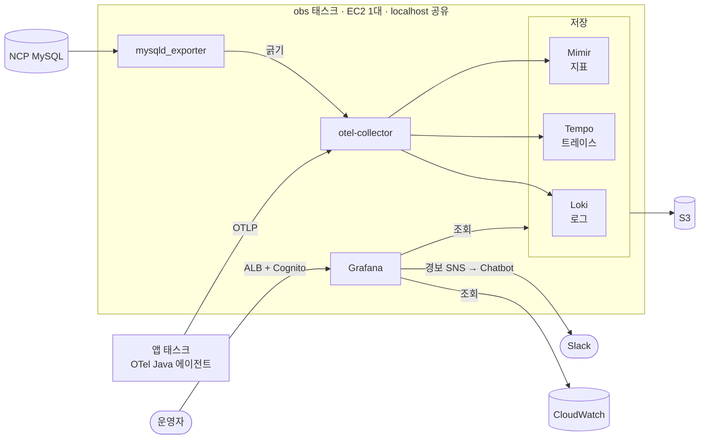
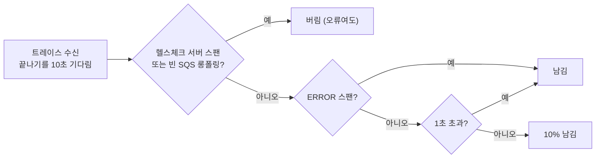
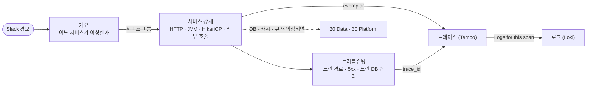

# nova 관측 스택 (LGTM)

nova 서비스의 로그 · 트레이스 · 지표를 한곳에서 보고 경보를 보내는 자체 호스팅 관측 스택이다.
앱의 OpenTelemetry Java 에이전트가 OTLP 로 보내면 Collector 가 받아 가공하고, Loki(로그) · Tempo(트레이스) · Mimir(지표)가 S3 에 저장한다. 조회와 경보는 Grafana 가 맡는다.

이 디렉터리는 그 설정 파일이다. Terraform(`../main.tf`)이 파일을 obs-config 버킷에 올리고, 태스크가 시작할 때 `config-init` 컨테이너가 내려받는다.
파일 해시가 작업 정의에 들어가므로 **설정을 고쳐 apply 하면 곧 재배포다.**

## 한눈에 보기

| 신호 | 들어오는 길 | Collector 처리 | 저장 | 보존 |
|---|---|---|---|---|
| 로그 | 앱 → OTLP | 리소스 속성 허용 목록, 개인정보 마스킹 | Loki → S3 | 90일 |
| 트레이스 | 앱 → OTLP | tail sampling(오류 · 1초 초과는 전부, 나머지 10%), 마스킹 | Tempo → S3 | 14일 |
| 지표 | 앱 → OTLP, Collector 가 긁는 것(MySQL · LGTM 자체 · 호스트) | 리소스 속성 허용 목록 | Mimir → S3 | 90일 |
| AWS 관리형 지표 | Grafana 가 CloudWatch 를 직접 조회 | — | CloudWatch | CloudWatch 기본 |



Collector 는 LGTM 구성 요소와 Grafana 의 `/metrics`, obs 호스트의 CPU · 메모리 · 디스크(`/hostfs`)도 긁어 Mimir 로 보낸다.

## 설계 결정

**1. 단일 바이너리 · 단일 태스크.**
지금 트래픽에서는 마이크로서비스 모드의 수평 확장이 필요 없다. 그래서 다섯 구성 요소를 EC2(t4g.large) 한 대의 ECS 태스크 하나에 모놀리식 모드로 띄운다.
컨테이너들은 localhost 를 같이 쓰므로 포트가 겹치지 않게 맞춘다(아래 "포트").
대가는 가용성이다. obs 가 내려가 있는 동안의 데이터는 잃고, Grafana 경보도 멈춘다. 그래서 obs 태스크와 인스턴스는 CloudWatch 경보(monitoring/cloudwatch 스택)가 따로 감시한다.

**2. 장기 저장은 S3, 로컬 디스크는 WAL 과 최근 블록만.**
데이터 EBS(100 GiB)에는 재시작할 때 되살릴 WAL 과 아직 올리지 않은 블록만 둔다. 보존 기간만큼의 데이터는 S3 에 있으므로 디스크 크기가 보존 기간에 묶이지 않는다.
정상 종료 때 메모리의 청크와 블록을 S3 로 올린다(`stopTimeout` 120초).
한 호스트의 디렉터리를 쓰기 때문에 배포는 이전 태스크를 내린 뒤 새 태스크를 띄운다. 그동안 몇 분은 수집이 끊긴다.

**3. 손실을 허용하는 경로.**
Collector 에는 디스크 큐가 없다. 메모리가 `memory_limiter`(768 MiB)를 넘으면 받기를 거부한다. 감사 기록이나 정본(outbox 등)의 근거로 쓰지 않는다.
빠지는 데이터는 숨기지 않고 지표(`otelcol_receiver_refused_*`, `*_discarded_*`)와 경보로 드러낸다.

**4. 샘플링은 Collector 에서, 트레이스가 끝난 뒤에.**
앱은 모두 보내고(`parentbased_always_on`), Collector 가 트레이스 전체를 보고 남길지 정한다.
앱에서 미리 자르면 오류가 난 트레이스가 버려진 쪽에 있을 수 있다. 끝난 뒤에 정하면 오류와 느린 요청은 빠짐없이 남는다.



헬스체크는 `url.path` 가 `/actuator/*` 인 서버 스팬, 빈 롱폴링은 오류 없이 메시지 0건으로 끝난 `ReceiveMessage` 다. 결정을 기다리는 트레이스는 메모리에 최대 5만 건 둔다. 넘치면 오래된 것부터 결정 없이 버린다.

**5. 개인정보는 저장하기 전에 지운다.**
조회할 때 가리면 Loki API 를 직접 부를 때 원문이 보인다. 그래서 Collector 에서 원문을 바꿔 저장하고, 되돌릴 수 없다(아래 "저장 전 마스킹").

**6. 카디널리티를 설정으로 묶는다.**
- Loki 인덱스 라벨은 `service_name` · `service_namespace` · `deployment_environment` 셋뿐이다. 요청마다 다른 값(trace_id, event_id)은 structured metadata 로 둔다.
- 리소스 속성은 허용 목록에 있는 것만 남긴다. AWS 리소스 감지가 붙이는 `aws.ecs.*` · `cloud.account.id` 에는 계정 ID 가 들어 있어 이것도 버린다.
- LGTM 자체 `/metrics` 는 대시보드와 경보에 쓰는 지표만 남긴다(`metric_relabel_configs` keep).

**7. 한 대에 맞춘 Mimir 쿼리 설정.**
쿼리 샤딩은 끈다. 코어가 몇 개 안 되는 한 대에서는 쪼개도 빨라지지 않고 대기열만 찬다.
테넌트 대기열은 1000으로 둔다. 대시보드 여러 개가 동시에 패널 수십 개를 조회해도 429 가 나지 않는다.

**8. 설정 파일에는 환경마다 다른 값을 넣지 않는다.**
버킷 · 보존 기간 · 엔드포인트는 환경 변수로 받는다(`-config.expand-env=true`). 이미지는 태그와 다이제스트로 고정한다.

## 파일

| 경로 | 내용 |
|---|---|
| `collector.yaml` | 수신(OTLP), 긁기(mysqld · LGTM 자체 · hostmetrics), 처리(memory_limiter → 리소스 허용 목록 → tail sampling · 마스킹 → batch), 내보내기(Loki · Tempo · Mimir) |
| `loki.yaml` | S3 저장, 보존 기간, 인덱스 라벨 지정, WAL, 삭제 요청 API 끔 |
| `tempo.yaml` | S3 저장, 보존 기간(compactor), WAL, 종료할 때 블록 업로드 |
| `mimir.yaml` | `-target=all`. S3 한 버킷에 블록 · ruler · alertmanager 를 접두사로 나눔, OTLP 이름 접미사, 쿼리 대기열 · 샤딩 |
| `grafana/provisioning/datasources/` | Loki · Tempo · Mimir(서로 링크로 이어짐), CloudWatch(태스크 역할) |
| `grafana/provisioning/dashboards/nova.yaml` | `grafana/dashboards/` 의 하위 디렉터리를 같은 이름의 Grafana 폴더로 읽는다 |
| `grafana/dashboards/` | 대시보드 JSON (아래 "대시보드") |
| `grafana/provisioning/alerting/` | `rules.yaml`(경보 규칙), `notify.yaml`(SNS 연락처 · 알림 경로 · Chatbot 메시지 템플릿) |
| `grafana/provisioning/plugins/none.yaml` | 빈 파일. S3 에는 빈 디렉터리가 없어 이 파일이 없으면 Grafana 가 기동할 때마다 오류 로그를 남긴다 |

## 대시보드

화면에서 고친 내용은 저장되지 않는다. JSON 파일이 원본이고, 파일을 지우면 대시보드도 지워진다.

| 폴더 | 대시보드 (uid) | 언제 보나 |
|---|---|---|
| `01 Overview` | 개요 (`nova-overview`) | 로그인 첫 화면. 서비스별 요청 수 · 5xx · P99 · 인스턴스 · 힙 · CPU 와 지금 울리는 경보 |
| `10 Services` | 서비스 상세 (`nova-service`) | 서비스 하나(`$service`)의 HTTP · 외부 호출 · JVM · HikariCP · 로그 · 트레이스 |
| `20 Data` | MySQL (`nova-mysql`) · Valkey (`nova-valkey`) · SQS (`nova-sqs`) | DB 연결 사용률 · 느린 쿼리, 캐시 적중률 · 메모리, 큐 적체 · DLQ |
| `30 Platform` | ECS · ALB · CloudFront (`nova-platform`) | 태스크 수 · 재시작, ALB 오류 · 응답 시간 · 비정상 대상, CloudFront 오류율 |
| `40 Troubleshooting` | 트러블슈팅 (`nova-troubleshooting`) | 느린 경로 · 5xx 경로, 느린 요청 · 느린 DB 쿼리 · 오류 트레이스, ERROR 로그 |
| `90 Observability` | LGTM 스택 · obs 호스트 (`nova-lgtm`) · OpenTelemetry Collector (`nova-otelcol`) | obs 자체가 데이터를 빠뜨리거나 디스크 · 메모리가 모자라지 않은지 |

- 폴더 앞 번호는 목록 순서다. Grafana 는 폴더를 이름순으로만 정렬한다. 사이에 폴더를 끼울 수 있게 10 단위로 띄운다.
- 장애를 볼 때는 아래 순서로 내려간다. 표의 서비스 이름, 패널 링크, exemplar 가 다음 화면으로 이어 준다.



- CloudWatch 를 읽는 대시보드(Valkey · SQS · Platform)는 5분마다 새로고침한다. GetMetricData 는 조회한 지표 수만큼 과금된다.
- `otelcol.json` 은 grafana.com 15983 rev 31 을 가져온 것이다. 원본과 다른 곳은 uid · `nova` 태그 · 데이터소스(Mimir) · job(`otelcol-contrib`) 기본값뿐이다. 새 리비전으로 바꿀 때도 이 네 곳만 다시 맞춘다.

## 경보

Grafana 가 1분마다 Mimir 를 조회해 판단하고 SNS → AWS Chatbot → Slack 으로 보낸다. 경보 이름과 job 이 같은 것끼리 묶고, 해결되지 않으면 4시간마다 다시 알린다.

| 규칙 | 조건 | 지속 | 등급 |
|---|---|---|---|
| HTTP 5xx 비율 | 서비스별 5xx 비율 > 5% | 5분 | critical |
| HTTP P99 응답 시간 | 서비스별 P99 > 2초 | 10분 | warning |
| JVM 힙 사용률 | 태스크별 힙 사용 / 한도 > 90% | 10분 | warning |
| 서비스 지표 끊김 | 지난 1시간 안에 지표를 보내던 서비스가 지금 `target_info` 를 보내지 않음 | 5분 | critical |
| MySQL exporter 연결 끊김 | `mysql_up` < 1 | 5분 | critical |
| MySQL 연결 사용률 | 연결 수 / max_connections > 80% | 10분 | warning |
| obs 수집 실패 | Collector 의 수신 거부 · 내보내기 실패 > 0 | 10분 | warning |
| obs 저장소 거부 | Loki · Tempo · Mimir 가 버린 로그 · 스팬 · 샘플 > 0 (job · reason 별) | 10분 | warning |
| obs 디스크 사용률 | obs 호스트 마운트별 사용률 > 80% | 15분 | warning |

- 트래픽이 없어 조회 결과가 비면 정상으로 본다(`noDataState: OK`). 조회 자체가 실패하면 Error 상태 알림이 따로 간다.
- Chatbot 은 SNS 메시지가 사용자 지정 알림 JSON 형식일 때만 내용을 그대로 보여 준다. `notify.yaml` 의 템플릿이 그 JSON 을 만든다.

## 앱 연동

에이전트는 be 이미지의 `/otel/javaagent.jar` 다. ecs 스택의 `otel.tf` 가 `otel_services`(지금은 `["*"]`, 배포하는 서비스 전부)에 아래 환경 변수를 넣는다.

```
JDK_JAVA_OPTIONS=-javaagent:/otel/javaagent.jar
OTEL_SERVICE_NAME=<svc>
OTEL_RESOURCE_ATTRIBUTES=deployment.environment=prod,service.namespace=nova
OTEL_LOGS_EXPORTER=otlp
OTEL_TRACES_EXPORTER=otlp
OTEL_METRICS_EXPORTER=otlp
OTEL_TRACES_SAMPLER=parentbased_always_on
OTEL_INSTRUMENTATION_MICROMETER_ENABLED=true
OTEL_EXPORTER_OTLP_ENDPOINT=http://otel.nova.local:4318
OTEL_EXPORTER_OTLP_PROTOCOL=http/protobuf
OTEL_INSTRUMENTATION_AWS_SDK_EXPERIMENTAL_USE_PROPAGATOR_FOR_MESSAGING=true
OTEL_INSTRUMENTATION_LOGBACK_APPENDER_EXPERIMENTAL_MDC_ATTRIBUTES_INCLUDED=traceId
OTEL_INSTRUMENTATION_COMMON_LOGGING_STRUCTURED_ATTRIBUTES_INCLUDED=event_id,aggregate_type,aggregate_id,event_type,destination
```

- `JAVA_TOOL_OPTIONS` 는 쓰지 않는다. 이미지의 힙 옵션이 그 변수에 들어 있어 덮어쓰면 사라진다.
- 엔드포인트와 프로토콜은 짝을 맞춘다. `otel.nova.local:4318` 은 `http/protobuf`, gRPC 는 `otel-grpc.nova.local:4317` 이다. 어긋나면 앱 로그에 실패가 한 줄 남을 뿐 아무것도 오지 않는다.
- MDC 는 `traceId`(요청 ID)만 넘긴다. `subject`(회원 ID)는 넘기지 않는다.

## 조회

**로그 (Loki).** 인덱스 라벨로 스트림을 고른 뒤 structured metadata 로 거른다.

```
{service_name="preorder", deployment_environment="prod"} | event_id="<uuid>"
{service_namespace="nova"} | aggregate_type="PREORDER" | aggregate_id="<uuid>"
```

**지표.** Mimir 에서 PromQL 로 본다. 이름은 Prometheus 관례(단위 · 종류 접미사)를 따른다. 예: `http.server.request.duration` → `http_server_request_duration_seconds_bucket`.
- `job` 은 `<service.namespace>/<service.name>`(예 `nova/preorder`)이다. `deployment_environment` · `service_namespace` 도 라벨로 붙는다. 그 밖의 리소스 속성은 `target_info` 에만 있다.
- `target_info` 에는 `service_namespace` 라벨이 없다. 앱만 고를 때는 `target_info{job=~"nova/.+"}` 를 쓴다.
- 앱 외 job: Collector `otelcol-contrib`, MySQL `mysqld`, LGTM 자체 `loki` · `tempo` · `mimir` · `grafana`, obs 호스트 `obs-host`.
- HikariCP 대기 · 사용 시간은 에이전트가 보내는 `db_client_connections_*_milliseconds` 를 초로 바꿔 그린다. semconv 안정 이름(`db_client_connection_*_seconds`)도 함께 조회해 에이전트를 올려도 패널이 비지 않는다.

**트레이스.** 로그 줄을 펼쳐 trace_id 의 Tempo 링크로 가거나, 지표 그래프의 exemplar 점에서 바로 간다. 스팬에서는 "Logs for this span" 으로 같은 trace_id 의 로그를 연다.

## 저장 전 마스킹

Collector 가 Loki · Tempo 에 넘기기 전에 개인정보 원문을 고정 표시로 바꾼다(`collector.yaml` 의 `transform/mask`, `transform/mask-spans`). **되돌릴 수 없다.**

| 대상 (이 순서로 적용) | 바뀐 모습 |
|---|---|
| MySQL 중복 키 값 `Duplicate entry '<값>' for key` (한 줄 안에서만) | `Duplicate entry '<masked>' for key` |
| 이메일 `local@domain.tld` · `local%40domain.tld` | `<masked:email>` |
| 국제 형식 휴대전화 `+82` · `%2B82` · `0082`, `(0)` 허용 | `<masked:phone>` |
| 휴대전화 `010` · `011` · `016`~`019`, 괄호 · 구분자(`-` `.` 공백) 허용 | `<masked:phone>` |

- **적용 범위**: 로그 본문(맵 · 목록 본문은 JSON 문자열로 바꾼 뒤 적용)과 로그 속성의 모든 문자열 값(`exception.message` · `exception.stacktrace` 포함).
- **트레이스**: 스팬 속성, 스팬 이벤트 속성(예외), 상태 메시지에 같은 패턴을 적용한다. URL 쿼리 문자열(`url.query` · `url.full` · `http.url` · `http.target`)은 토큰이 패턴에 걸리지 않으므로 값을 모두 지운다. SQL 리터럴은 에이전트가 `?` 로 바꿔 보낸다.
- **경계**: 번호 앞뒤가 16진수 문자이면 건드리지 않는다. 그래서 UUID · trace ID 안의 숫자는 걸리지 않는다.
- **`error_mode: ignore`**: 문 하나가 실패하면 그 문만 건너뛴다. `propagate` 로 두면 배치 전체를 버린다(503).
- **잡지 못하는 것**: 실명 · 주소 · 유선 전화 · 외국 번호, 16진수 글자에 바로 붙은 번호(`phone010…`), 같은 줄에 `for key` 가 없는 중복 키 값, 맵 · 목록 속성 안의 값, 바이트 본문, 스코프 속성.
- **오탐**: `0.0101234567` → `0.<masked:phone>`, 0 으로 채운 `010…` 10~11자리 숫자 ID.
- CloudWatch Logs(`awslogs`) 사본은 Collector 를 거치지 않으므로 원문이 남는다.
- 이것은 안전망이다. 1차 방어는 앱이 애초에 개인정보를 로그에 남기지 않는 것이다.

## 보안

- **OTLP 에는 TLS 와 토큰을 붙이지 않는다.** VPC 안 통신이고, 보낼 수 있는 쪽은 obs 보안 그룹이 정한다. 보내는 쪽이 저장된 로그를 읽을 경로는 없다. 대신 다음을 감수한다.
  - 보낼 수 있는 곳이면 로그를 지어내 넣을 수 있다. 로그의 진위는 보장하지 않는다.
  - 한 서비스가 많이 보내면 Collector 메모리 한도에 걸려 다른 서비스의 데이터도 버려진다.
- Grafana 는 ALB 에서 Cognito 로그인을 거친 뒤 같은 사용자 풀로 OAuth 로그인한다. 역할은 Cognito 그룹으로 정한다(`grafana-admin` → Admin, `grafana-editor` → Editor, 그 밖 → Viewer). 익명 접근 · 가입 · 플러그인 관리는 꺼져 있다.
- Loki · Tempo · Mimir API 에는 인증이 없다(`auth_enabled: false`). 태스크 안 localhost 에서만 닿는다. Loki 삭제 요청 API 는 끄고, 보존 기간이 지난 데이터는 compactor 가 지운다.
- 버킷 정책은 `nova-prod-obs` 역할만 객체에 접근하게 한다(s3 스택).
- 모든 컨테이너는 1024 위 포트만 쓴다. 리눅스 권한을 모두 버리고 권한 상승을 막는다. Tempo · Mimir 는 이미지 기본 사용자가 root 라 `user: 10001:10001` 로 돌린다.

## 운영

### 포트

| 컨테이너 | 포트 |
|---|---|
| otel-collector | 4317 (OTLP gRPC) · 4318 (OTLP HTTP) · 8888 (자체 지표, localhost) · 13133 (헬스체크) |
| loki | 3100 (HTTP) · 9096 (gRPC) |
| tempo | 3200 (HTTP) · 9097 (gRPC) · 14317 (OTLP gRPC, Collector 전용) |
| mimir | 9009 (HTTP: OTLP `/otlp`, PromQL `/prometheus`) · 9098 (gRPC) · 7947 (memberlist, 127.0.0.1) |
| grafana | 3000 |
| mysqld_exporter | 9104 |

Tempo · Mimir 의 링은 메모리에 둔다. Mimir 3 는 memberlist 를 띄우므로 기본 7946 대신 127.0.0.1:7947 에 묶는다.

### 환경 변수

설정 파일은 컨테이너의 `/config/` 에 놓인다. Collector 는 `--config=/config/collector.yaml`, Loki · Tempo · Mimir 는 `-config.file=/config/<이름>.yaml -config.expand-env=true` 로 띄운다.

| 컨테이너 | 변수 | 값 |
|---|---|---|
| otel-collector | `LOKI_OTLP_ENDPOINT` · `MIMIR_OTLP_ENDPOINT` | `http://localhost:3100/otlp` · `http://localhost:9009/otlp` |
| otel-collector | `TEMPO_OTLP_ENDPOINT` | `127.0.0.1:14317` (gRPC, TLS 없음). `localhost` 로 쓰면 ::1 부터 시도해 실패 로그가 남는다 |
| otel-collector | `MYSQLD_EXPORTER_TARGET` | `localhost:9104`. exporter 를 띄우지 않으면 빈 문자열이고, 그때는 긁지 않는다 |
| otel-collector | `OBS_DATA_MOUNT_PATH` | 데이터 EBS 마운트 경로(ecs 스택 출력 `obs_data_mount_path`). hostmetrics 가 이 디스크와 루트의 사용률을 본다. 호스트 `/` 는 `/hostfs` 에 읽기 전용으로 붙는다 |
| loki · tempo · mimir | `<LOKI·TEMPO·MIMIR>_S3_BUCKET` · `_S3_REGION` | s3 스택 출력의 버킷, `ap-northeast-2` |
| loki · tempo · mimir | `LOKI_RETENTION_PERIOD` · `TEMPO_RETENTION` · `MIMIR_RETENTION` | `2160h` · `336h` · `2160h` (`../variables.tf` 의 `obs_retention`). Loki · Tempo 버킷에는 이보다 긴 수명주기 만료(100일 · 30일)가 안전망으로 걸려 있다 |
| loki · tempo · mimir | `*_S3_ENDPOINT` · `*_FORCE_PATH_STYLE` · `*_INSECURE` 등 | 운영에서는 넘기지 않는다. MinIO 같은 S3 호환 저장소로 띄울 때 쓴다 |
| grafana | `LOKI_URL` · `TEMPO_URL` · `MIMIR_URL` | `http://localhost:3100` · `http://localhost:3200` · `http://localhost:9009/prometheus` |
| grafana | `SNS_TOPIC_ARN` · `AWS_REGION` | 알림 주제와 리전. 비어 있으면 연락처 검증에 실패해 Grafana 가 뜨지 않는다. 태스크 역할에 `sns:Publish` 가 필요하다 |
| grafana | `GF_SECURITY_ADMIN_PASSWORD` | Secrets Manager `nova-prod/ops/grafana/admin-password` |

### 작업 정의 제약 (`../main.tf`)

- 데이터 디렉터리는 데이터 EBS 를 bind mount 한다: loki `/loki`, tempo `/var/tempo`, mimir `/data`(셋 다 UID 10001), grafana `/var/lib/grafana`(UID 472).
- Collector 메모리는 1 GiB 이상 준다. tail sampling 이 결정 전 트레이스(최대 5만 건)를 메모리에 들고 있다.

### admin 비밀번호 교체

`GF_SECURITY_ADMIN_PASSWORD` 는 Grafana 를 처음 띄울 때만 적용된다. 이미 있는 admin 은 Grafana 컨테이너에서 바꾼다.

```
grafana cli admin reset-admin-password --password-from-stdin
```
