# nova 관측 스택

nova 의 로그, 트레이스, 지표, 프로파일을 한곳에 모으고 경보를 보내는 Grafana LGTM 스택이다. 관리형 서비스 대신 직접 운영한다.

> 경로는 모두 저장소 루트 기준이다. 이 스택의 Terraform 은 `terraform/aws/monitoring/lgtm/nova_apnortheast2/` 에, obs 설정 파일은 그 아래 `config/` 에 있다.

## 구성

<picture>
  <source media="(prefers-color-scheme: dark)" srcset="../../../../../../docs/architecture/img/observability-dark.png">
  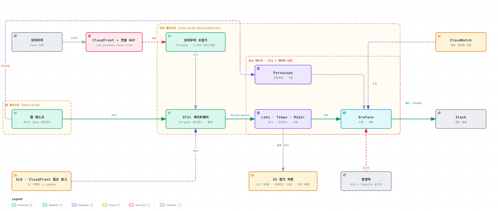
</picture>

- **OTel 게이트웨이**: 앱이 보낸 데이터를 받아 가공한 뒤 저장소로 넘긴다.
- **브라우저 수집기**: 프런트가 브라우저에서 보낸 데이터를 받아 게이트웨이로 넘긴다.
- **obs**: EC2 한 대에서 Loki, Tempo, Mimir, Pyroscope, Grafana 를 실행한다.

| 데이터 | 저장 | 보존 |
|---|---|---|
| 로그 | Loki → S3 | 90일 |
| 트레이스 | Tempo → S3 | 14일 |
| 지표 | Mimir → S3 | 90일 |
| 프로파일 | Pyroscope → 데이터 EBS | 7일 |

## 핵심 설계

### 1. 받는 쪽과 저장하는 쪽을 나눈다

obs 는 재배포할 때마다 몇 분씩 멈춘다. 데이터를 받는 Collector 가 obs 안에 있으면 그동안 앱이 보낸 데이터를 모두 잃는다.

그래서 받는 쪽인 게이트웨이를 별도 Fargate 서비스로 뺐다. obs 가 멈춘 동안 게이트웨이가 데이터를 메모리 큐에 모아 두고 최대 15분 동안 다시 보낸다.

<details>
<summary>자세히</summary>

Mimir 는 30분 늦게 도착한 샘플까지 받는다(`out_of_order_time_window`). 쌓아 둔 요청을 여러 개 한꺼번에 다시 보내면 샘플 순서가 섞이는데, 이 설정이 없으면 Mimir 가 그 샘플을 버린다. Mimir 를 2분 내렸다 올려서 확인했다.
대신 운영할 서비스가 하나 늘고 데이터가 한 단계를 더 거친다. obs Collector 가 긁는 LGTM 자체 지표와 MySQL, 호스트 지표는 긁을 대상도 같이 내려가므로 그동안 비어 있다.

</details>

### 2. 지표는 샘플링하기 전에 만든다

트레이스는 일부만 저장하므로, 저장된 트레이스로 요청 수와 지연을 세면 오류와 느린 요청이 실제보다 많게 나온다.

그래서 게이트웨이가 트레이스를 두 갈래로 보낸다. 한 갈래는 모든 스팬으로 지표를 만들고, 다른 갈래만 샘플링해서 저장한다.

<details>
<summary>자세히</summary>

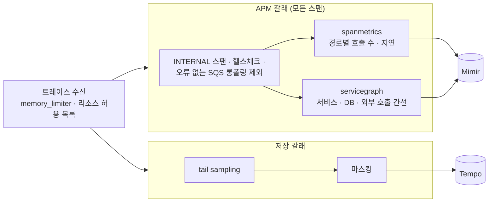

- span metrics(`traces_spanmetrics_*`)는 서버 · 클라이언트 · 메시지 스팬을 `span_name` · `span_kind` · `status_code` 와 HTTP 상태 · DB · 메시징 종류로 나눠 센다. 사용자 ID 같은 값은 차원에서 빼고, 조합이 2000개를 넘으면 넘친 몫을 overflow 시계열 하나로 합친다.
- 서비스 그래프(`traces_service_graph_*`)는 클라이언트 스팬과 서버 스팬을 짝지어 간선을 만든다. DB · SQS · 외부 API 처럼 계측되지 않은 상대는 `db.name` · `server.address` 같은 속성으로 가상 노드를 만든다. Grafana 서비스 맵(Tempo 데이터소스의 `serviceMap`)이 이 지표를 읽는다.
- 짝을 기다리는 간선(최대 5000개, 10초)과 지표 상태를 메모리에 두므로 게이트웨이에 4 GiB 를 준다.
- 샘플링된 트레이스로도 TraceQL 지표(`{...} | rate() by (span.http.route)`, `quantile_over_time`)를 볼 수 있다. Tempo 의 `local-blocks` 프로세서가 최근 블록에서 바로 계산하고 결과는 저장하지 않는다. Traces Drilldown 이 이 지표를 쓴다. 표본으로 계산한 값이므로 비율과 분포만 보고, 정확한 수는 span metrics 로 확인한다.

</details>

### 3. 남길 트레이스는 요청이 끝난 뒤에 고른다

앱이 미리 샘플링하면 오류 트레이스도 버려질 수 있다. 앱은 모두 보내고, 트레이스가 끝나면 게이트웨이가 남길지 정한다. 오류와 1초 넘은 요청은 모두 남기고 나머지는 10% 만 남긴다.

<details>
<summary>자세히</summary>

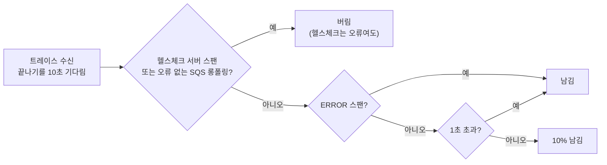

헬스체크는 `url.path` 가 `/actuator/*` 인 서버 스팬이고, 롱폴링은 오류 없이 끝난 `ReceiveMessage` 클라이언트 스팬이다. 에이전트가 이 스팬에 받은 메시지 수를 붙이지 않아서 빈 폴링과 메시지를 받은 폴링을 구분하지 못한다. 이 스팬의 길이는 메시지를 기다린 시간일 뿐이고, 메시지 처리는 컨슈머 스팬에 따로 남는다. 결정을 기다리는 트레이스는 메모리에 최대 5만 건까지 두고, 이를 넘으면 오래된 것부터 결정 없이 버린다.

</details>

### 4. 개인정보는 저장하기 전에 지운다

조회 화면에서만 가리면 Loki API 를 직접 호출할 때 원문이 그대로 보인다. 그래서 저장하기 전에 게이트웨이가 이메일, 전화번호 같은 값을 고정 표시로 바꾼다. 바꾼 값은 되돌릴 수 없다.

<details>
<summary>저장 전 마스킹 규칙</summary>

게이트웨이는 Loki · Tempo 로 넘기기 전에 개인정보 원문을 고정 표시로 바꾼다(`terraform/aws/monitoring/lgtm/nova_apnortheast2/gateway/collector.yaml` 의 `transform/mask`, `transform/mask-spans`). **되돌릴 수 없다.**

| 대상 (이 순서로 적용) | 결과 |
|---|---|
| MySQL 중복 키 값 `Duplicate entry '<값>' for key` (한 줄 안에서만) | `Duplicate entry '<masked>' for key` |
| 이메일 `local@domain.tld` · `local%40domain.tld` | `<masked:email>` |
| 국제 형식 휴대전화 `+82` · `%2B82` · `0082`, `(0)` 허용 | `<masked:phone>` |
| 휴대전화 `010` · `011` · `016`~`019`, 괄호 · 구분자(`-` `.` 공백) 허용 | `<masked:phone>` |

- **적용 범위**: 로그 본문, 그리고 로그 속성의 모든 문자열 값(`exception.message` · `exception.stacktrace` 포함)에 적용한다. 맵이나 목록인 본문은 JSON 문자열로 바꾼 뒤 적용한다.
- **트레이스**: 스팬 속성, 스팬 이벤트 속성(예외), 상태 메시지에도 같은 패턴을 적용한다. 엣지 요청 ID 헤더는 형식을 검사한다. `x-amz-cf-id` 는 CloudFront ID 형식(영숫자 · `_` `=` `-` 20~100자)일 때만 남기고, `x-amzn-trace-id` 는 `Root=1-<16진 8자리>-<16진 24자리>` 부분만 문자열 하나로 남기며, 나머지는 버린다. URL 쿼리 문자열(`url.query` · `url.full` · `http.url` · `http.target`)에 든 토큰은 패턴으로 찾을 수 없어서 값을 통째로 지운다. SQL 리터럴은 에이전트가 `?` 로 바꿔서 보낸다.
- **경계**: 번호 앞뒤가 16진수 문자면 건드리지 않으므로 UUID · trace ID 안의 숫자는 걸리지 않는다.
- **`error_mode: ignore`**: 문 하나가 실패하면 그 문만 건너뛴다. `propagate` 로 두면 배치 전체를 버린다(503).
- **잡지 못하는 것**: 실명 · 주소 · 유선 전화 · 외국 번호, 16진수 글자에 바로 붙은 번호(`phone010…`), 같은 줄에 `for key` 가 없는 중복 키 값, 맵 · 목록 속성 안의 값, 바이트 본문, 스코프 속성.
- **오탐**: `0.0101234567` → `0.<masked:phone>`, 0 으로 채운 `010…` 10~11자리 숫자 ID.
- CloudWatch Logs(`awslogs`) 사본은 Collector 를 거치지 않아서 원문이 남는다.
- 이 규칙은 안전망일 뿐이고, 앱이 처음부터 개인정보를 로그에 남기지 않아야 한다.

</details>

<details>
<summary>그 밖의 설계 결정</summary>

**단일 바이너리를 한 태스크로 실행한다.**

지금 트래픽에는 마이크로서비스 모드의 수평 확장이 필요 없다. 다섯 구성 요소를 모놀리식 모드로, 관측 클러스터의 EC2 한 대에서 ECS 태스크 하나로 실행한다.
컨테이너들이 localhost 를 같이 쓰므로 포트가 겹치지 않게 맞췄다("참고 > 포트").
대신 가용성이 떨어진다. obs 가 내려가 있는 동안에는 조회와 Grafana 경보가 멈춘다. 그래서 obs 태스크와 인스턴스는 CloudWatch 경보(`terraform/aws/monitoring/cloudwatch/nova_apnortheast2/`)로 따로 감시한다.
앱 데이터는 수신 쪽을 obs 밖으로 빼서 잃지 않게 했다(핵심 설계 1).

**장기 데이터는 S3 에 두고, 로컬 디스크에는 WAL 과 최근 블록만 둔다.**

데이터 EBS(100 GiB)에는 재시작할 때 복구할 WAL 과 아직 올리지 않은 블록만 있다. 보존 기간 동안의 데이터는 S3 에 있으므로 디스크 크기가 보존 기간에 따라 늘지 않는다.
정상 종료할 때는 메모리의 청크와 블록을 S3 로 올린다(`stopTimeout` 120초).
호스트 디렉터리 하나를 쓰므로 배포할 때는 이전 태스크를 내린 뒤에 새 태스크를 올린다. 그사이 몇 분 동안은 저장소를 쓸 수 없다.

**데이터 손실은 허용하되 드러낸다.**

게이트웨이에는 디스크 큐가 없다(Fargate 디스크는 태스크와 함께 사라진다). 메모리 사용량이 `memory_limiter`(3072 MiB)를 넘으면 수신을 거부하고, 15분 넘게 보내지 못한 데이터는 버린다. 이 데이터를 감사 기록이나 정본(outbox 등)의 근거로 쓰면 안 된다.
빠진 데이터는 지표(`otelcol_receiver_refused_*`, `*_discarded_*`)와 경보로 드러낸다.

**카디널리티는 설정으로 제한한다.**

- Loki 인덱스 라벨은 `service_name` · `service_namespace` · `deployment_environment` 셋뿐이다. 요청마다 달라지는 값(trace_id, event_id)은 structured metadata 에 넣는다.
- 리소스 속성은 허용 목록에 있는 것만 남긴다. AWS 리소스 감지가 붙이는 `aws.ecs.*` · `cloud.account.id` 에는 계정 ID 가 들어 있어 이것도 버린다.
- LGTM 자체 `/metrics` 는 대시보드와 경보에 쓰는 지표만 남긴다(`metric_relabel_configs` keep).

</details>

## 장애를 볼 때

경보를 받으면 개요에서 시작해 서비스, 경로, 트레이스 순서로 범위를 좁힌다. 화면에서 서비스 이름, 경로, exemplar 를 누르면 다음 화면으로 넘어간다.

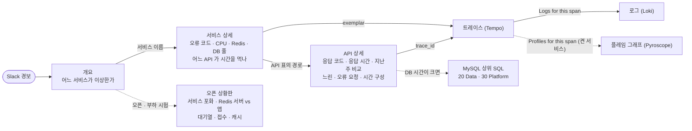

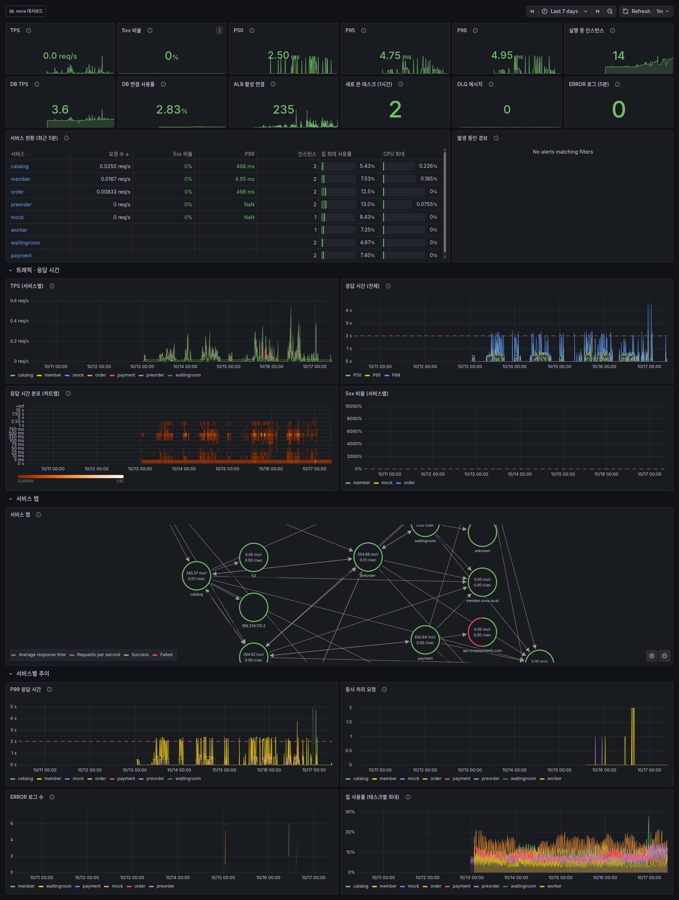

> 화면은 2026-10-22 21:45~22:02 부하 시험 구간이다(프런트만 최근 7일). 서비스 · API 상세는 waitingroom, `GET /api/v1/preorders/queue` 를 골랐다.

<details>
<summary>대시보드 화면 (11개)</summary>

**SLO**

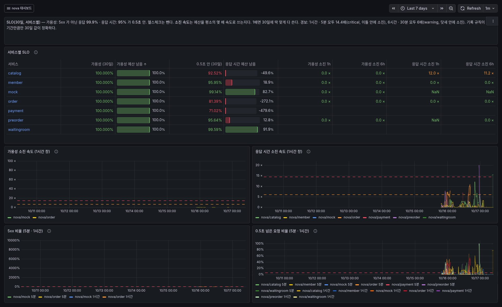

**오픈 상황판**

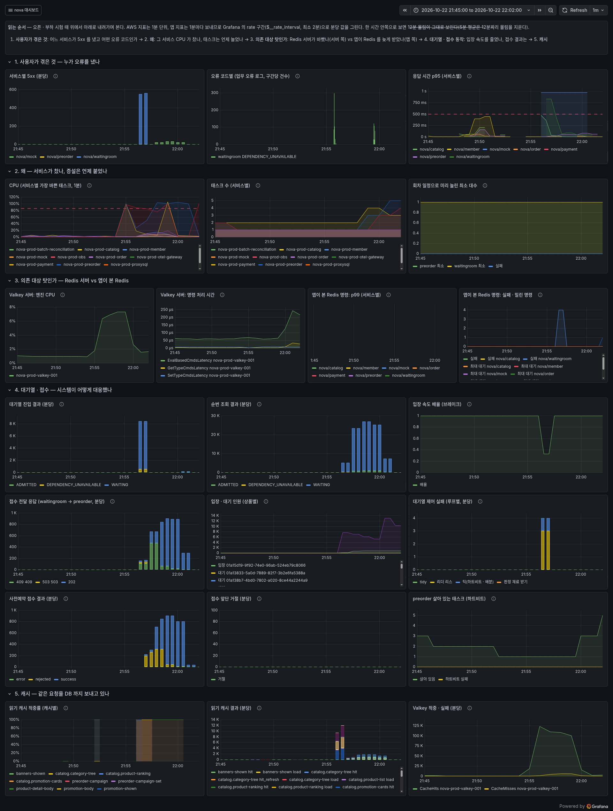

**서비스 상세**

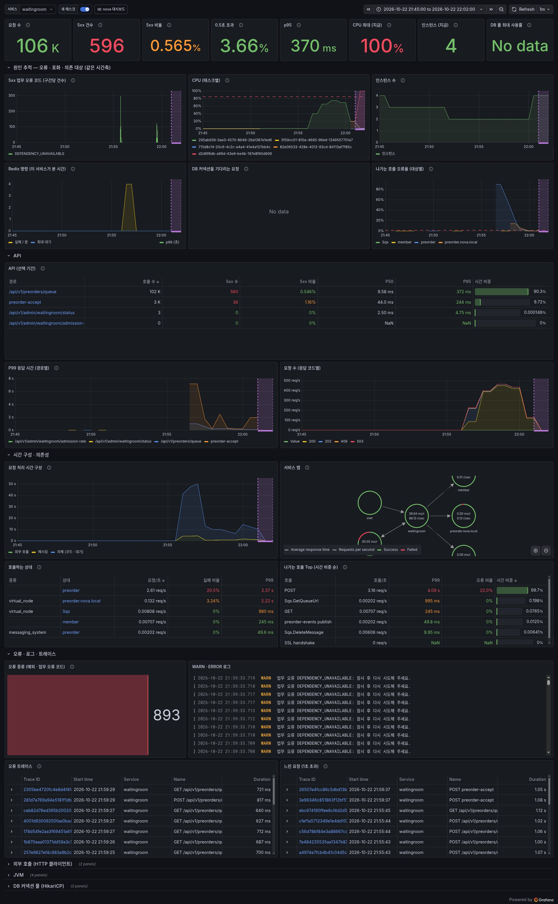

**API 상세**

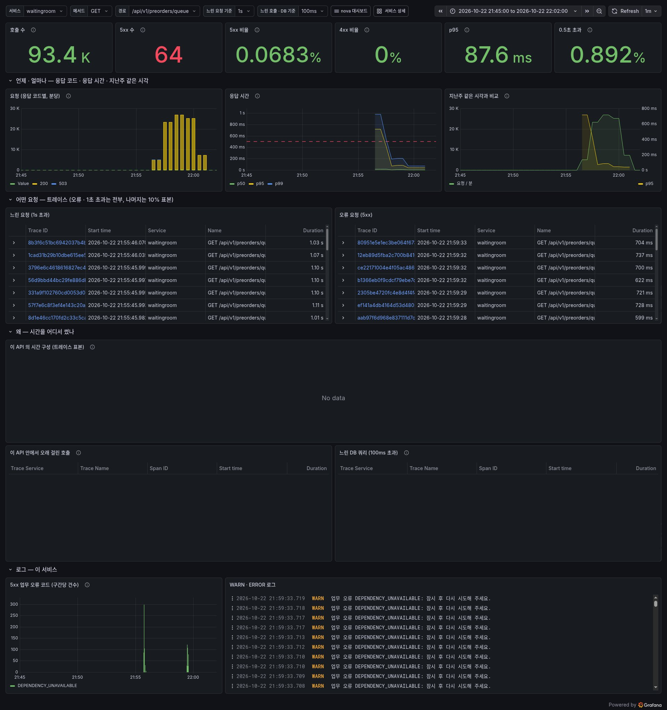

**MySQL**

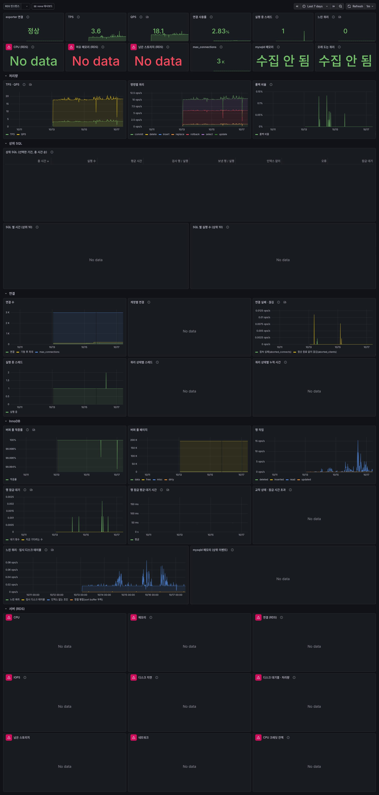

**SQS · 비동기 흐름**

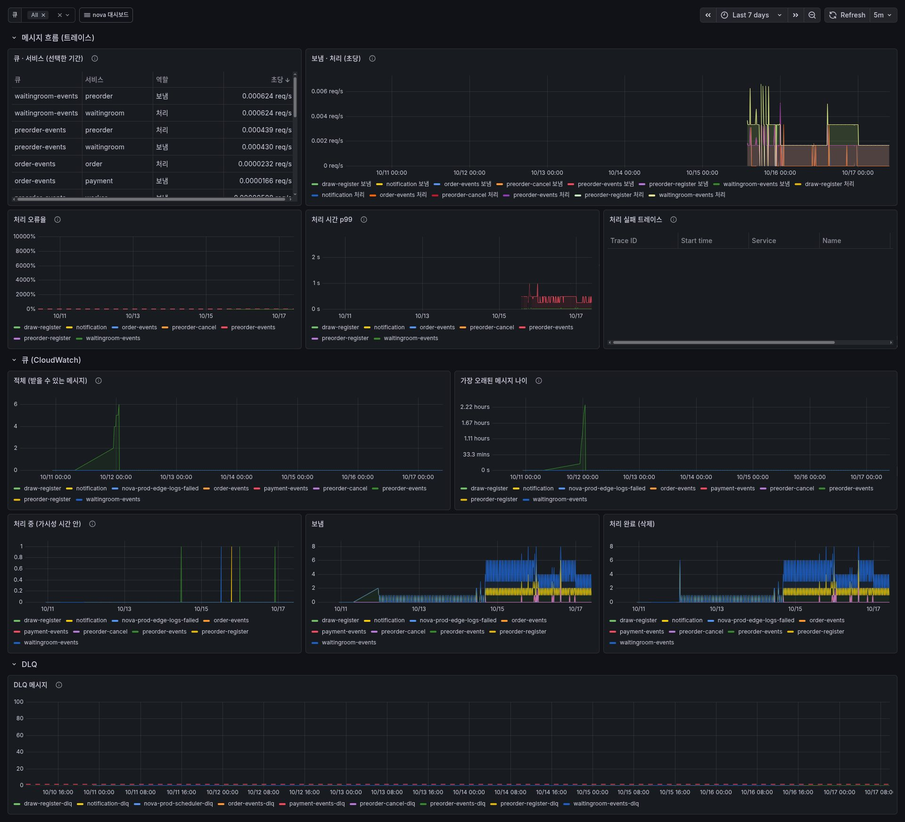

**Valkey**

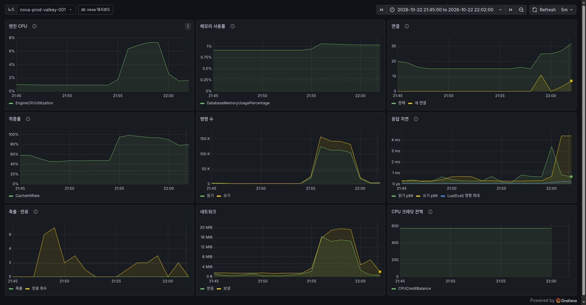

**ECS · 컴퓨팅**

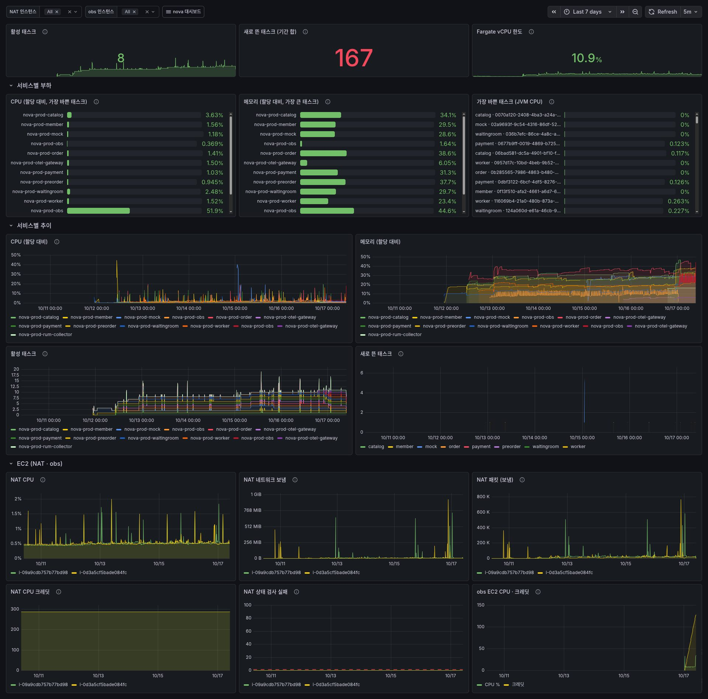

**엣지 · 보안**

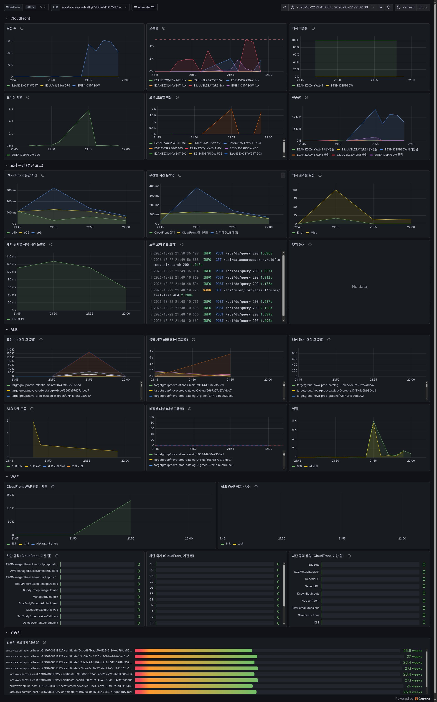

**프런트 (실사용자)**

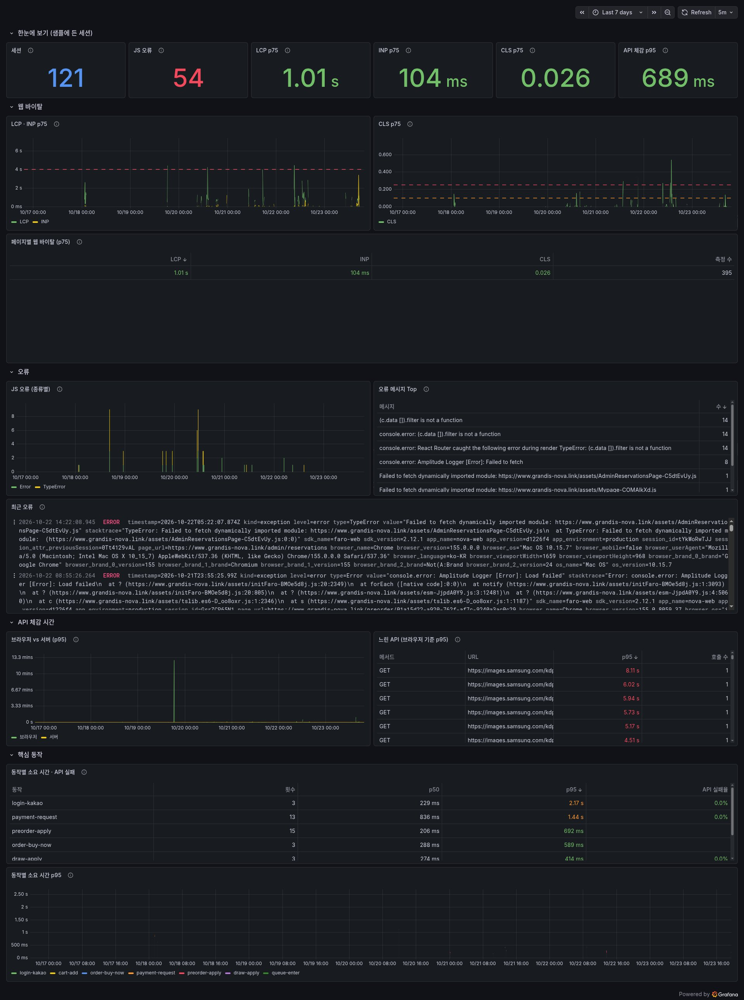

**LGTM 스택 · obs 호스트**

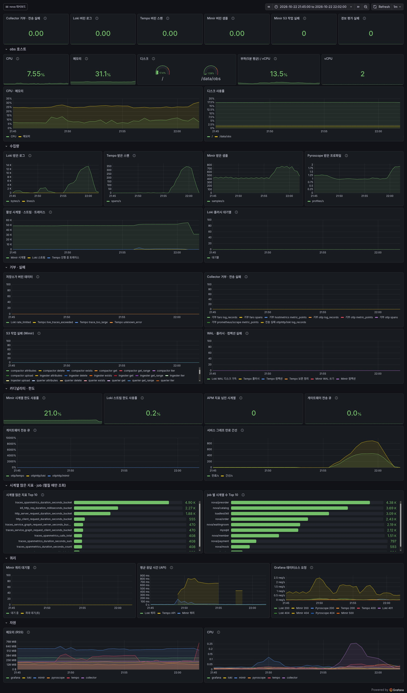

</details>

<details>
<summary>대시보드 목록과 읽는 법</summary>

화면에서 고친 내용은 저장되지 않는다. JSON 파일이 원본이고, 파일을 지우면 대시보드도 지워진다.

| 폴더 | 대시보드 (uid) | 언제 보나 |
|---|---|---|
| `01 Overview` | 개요 (`nova-overview`) | 로그인 첫 화면. "지금 문제가 있나, 어느 서비스인가"만 답한다. 선택 기간의 요청 수 · 5xx 건수와 비율 · 0.5초 초과 비율 · 지금 5xx 를 내는 서비스 수, 서비스 현황 표(분당 요청 · 5xx 비율 · 0.5초 초과 · p95 · CPU 최대 · 인스턴스 · 힙, 5xx 순, 누르면 서비스 상세), 울리는 경보, 서비스별 5xx · CPU 최대 · 인스턴스 수 · 요청 · p95 를 같은 시간축으로. 원인은 서비스 상세 · 오픈 상황판에서 본다. SLO (`nova-slo`): 서비스별 30일 가용성 · 응답 시간, 남은 오류 예산, 소진 속도 |
| `05 Business` | 업무 (`nova-business`) | 예약 접수가 실제로 되는지 본다. 접수 중인 회차, 일반 회원 신규 예약, 최근 20분 접수 상태(접수 중인데 0건이면 "멈춤 의심"), 거절 · 오류 비율, 결과별 · 경로별 신규 예약, 예약 상태별 수, 결제 기한 지난 예약, DLQ · 오픈 알림 대기. 오픈 상황판 (`nova-open`): 오픈 · 부하 시험 때 사용자 오류에서 원인까지 분 단위로 따라간다(앱 지표는 1분마다 보내 rate 구간(최소 2분)으로 분당 값을 그린다) — ① 서비스별 5xx · 오류 코드 · p95 ② 서비스 CPU · 태스크 수 · 미리 늘린 최소 대수 ③ Valkey 서버(엔진 CPU · 명령 처리 시간)와 앱이 본 Redis(Lettuce 명령 p99 · 실패 · 밀린 명령)를 나란히 ④ 대기열 진입 · 순번 조회 결과, 입장 속도 배율, 접수 전달 응답(5xx · 응답 없음), 입장 · 대기 인원, 제어 실패, 접수 결과, 앞단 거절, preorder 하트비트 ⑤ 읽기 캐시 적중률 · 결과, Valkey 적중 · 실패 |
| `10 Services` | 서비스 상세 (`nova-service`) | 서비스 하나(`$service`). 맨 위 숫자(선택 기간 요청 수 · 5xx 건수 · 비율 · 0.5초 초과 · p95, 지금 CPU 최대 · 인스턴스 · DB 풀) → 원인 추적(5xx 업무 오류 코드 · 태스크별 CPU · 인스턴스 수 · 이 서비스가 본 Redis 명령 시간 · DB 커넥션 대기 · 나가는 호출 오류율(대상 서비스 · DB 별)) → API 표(선택 기간 호출 수 · 5xx 수 · 비율 · P50 · P95 · 시간 비중, 호출 수 순) → 처리 시간 구성 · 서비스 맵 · 호출 상대 → 오류 종류(예외 · 업무 오류 코드) · 로그 · 트레이스. JVM · 외부 호출 · HikariCP 는 접힌 행에 있다 |
| `20 Data` | MySQL (`nova-mysql`) · Valkey (`nova-valkey`) · SQS · 비동기 흐름 (`nova-sqs`) | RDS MySQL: 지금 exporter 연결 · 연결 사용률 · 실행 중 스레드 · 오래 도는 쿼리 · 행 잠금 대기 · CPU · 스토리지 → DB 가 바쁜가(TPS · QPS · CPU · CPU 크레딧 잔액과 초과 사용(t4g Unlimited 과금) · 계정(서비스)별 연결 · 쿼리 상태별 스레드) → 무엇이 느린가(상위 SQL · 행 잠금 · 교착 · 버퍼 풀 적중률) → 디스크 · 메모리(접힘). Valkey: 엔진 CPU · 메모리 · 적중률 · 명령 수 · 응답 지연(Lua 포함) · 축출. SQS: 큐마다 보내는 서비스와 처리하는 서비스, 처리 오류율 · 처리 시간(트레이스) · 적체 · 가장 오래된 메시지 · 공정 큐의 몰린 상품 그룹 수 · DLQ |
| `30 Platform` | 컴퓨팅 · 계정 (`nova-compute`) · 엣지 · 보안 (`nova-edge`) | 서비스별 할당 대비 CPU · 메모리(1분)와 가장 바쁜 태스크, 실행 중 · 새로 뜬 태스크, 접힌 줄에 NAT · obs EC2 와 계정 · 비용(Fargate vCPU 한도, 알림 전달 실패, Logs 수집량, S3 크기) / CloudFront(캐시 적중률 · 오리진 지연 · 오류 코드), 접근 로그로 본 요청 구간(CloudFront 응답 시간 · 구간별 시간 · 캐시 결과 · 엣지 위치별, 느린 요청과 5xx 로그에서 앱 트레이스로), ALB 대상 그룹별, 접힌 줄에 WAF 차단(규칙 · 국가 · 공격 유형) · 인증서 만료 |
| `40 API` | API 상세 (`nova-api`) | API 하나(서비스 · 메서드 · 경로). 선택 기간 호출 수 · 5xx 수 · 비율 · 4xx 비율 · p95 · 0.5초 초과 → 응답 코드별 요청 · p50/p95/p99 · 지난주 같은 시각 비교 → 느린 · 오류 트레이스 → 시간 구성 · 이 API 안에서 오래 걸린 호출 · 느린 DB 쿼리 → 서비스의 5xx 업무 오류 코드 · WARN/ERROR 로그. 서비스 상세의 API 표에서 경로를 누르면 온다 |
| `60 Frontend` | 프런트 · 실사용자 (`nova-frontend`) | 브라우저(Faro)가 보낸 데이터로 본 사용자 체감 성능. 세션 · JS 오류 · LCP · INP · CLS p75, 페이지별 웹 바이탈, 오류 종류 · 메시지 Top · 최근 오류, 브라우저와 서버가 잰 API p95, 느린 API, 접힌 줄에 핵심 동작(버튼 이름)별 소요 시간 · API 실패율. 세션을 샘플링하므로 수치는 전체가 아니다 |
| `90 Observability` | LGTM 스택 · obs 호스트 (`nova-lgtm`) | obs 가 데이터를 빠뜨리지 않는지, 디스크 · 메모리가 모자라지 않는지. 카디널리티 · 한도(시계열 · 스트림 한도 사용률, 시계열 많은 지표 · job Top 10, 게이트웨이 전송 큐) |

- Grafana 는 폴더를 이름순으로만 정렬해서 폴더 이름 앞에 번호를 붙였다. 사이에 폴더를 끼울 수 있게 10 단위로 띄운다.
- 서비스 상세와 API 상세의 숫자는 무엇으로 셌는지에 따라 정확도가 다르다.
  - 요청 수, 지연, API 표는 앱의 HTTP 지표로 세고, 시간 구성과 나가는 호출, 서비스 맵은 Collector 가 샘플링 전 스팬으로 만든 지표로 센다. 둘 다 샘플링과 상관없이 세지만, 헬스체크(`/actuator`)와 `/**` 요청, 오류 없는 SQS 롱폴링처럼 일부러 뺀 것은 들어가지 않는다.
  - 오류 트레이스와 느린 요청 표는 Tempo 에 남은 트레이스만 보여 준다. 오류와 1초 넘은 요청은 남기고 나머지는 10% 만 남긴다. 다만 결정을 기다리는 트레이스가 5만 건을 넘으면 오래된 것부터 결정 없이 버려지므로, 몰릴 때는 오류나 느린 요청도 빠질 수 있다.
- 0.5초 초과 비율은 히스토그램 버킷 경계(0.5초)로 세므로 근사가 없다.
- 이미지 태그가 `:latest` 라서 버전 라벨이 없다. 대신 새 태스크가 처음 지표를 보낸 시점(`target_info` 에 새로 보인 instance)을 보라색 구간으로 표시해 배포나 교체 시점을 가늠한다. obs 재배포 뒤처럼 수집이 몇 분 끊겼다가 돌아온 태스크도 같이 표시된다.
- API 표는 `/**` 를 API 로 보지 않는다. Spring 은 어느 컨트롤러에도 맞지 않는 요청(없는 경로, 스캐너, 대개 404)을 이 이름으로 묶는다.
- 경로 변수에는 정규식 문자가 든 값(`/orders/{id}`)도 있다. PromQL 에서는 `http_route=~"$route"` 로 쓴다. All 을 둔 변수는 Grafana 가 값을 정규식에 맞게 이스케이프해서 넣는다.
  TraceQL 에는 Grafana 가 값을 그대로 넣고, 큰따옴표 문자열은 `\*` 같은 이스케이프를 받지 않는다. 그래서 ``span.http.route=~`${route:regex}` `` 처럼 regex 형식으로 만든 값을 백틱 문자열에 넣는다.
- CloudWatch 를 읽는 대시보드(Valkey · SQS · Platform)는 5분마다 새로고침한다. GetMetricData 는 조회한 지표 수만큼 과금된다.
  개요와 MySQL 대시보드는 주로 Mimir 지표를 읽어서 1분마다 새로고침한다. 개요는 자주 여는 화면이라 CloudWatch 패널을 두지 않는다(ALB · DLQ 는 엣지 · SQS 대시보드).
  오픈 상황판은 예외로 1분마다 새로고침한다. 오픈 · 부하 시험 동안 1~2분짜리 몰림을 따라가려고 여는 화면이라 늦으면 쓸모가 없다. CloudWatch 패널 6개(ECS CPU · 태스크 수, Valkey 4개)는 노드 · 서비스 수만큼 지표를 읽으므로 평소에는 열어 두지 않는다.
- 태스크 수는 두 가지로 본다. 활성 태스크는 `AWS/ECS` 의 `LiveTaskCount`(뜨는 중 · 내려가는 중 포함)이고, 새로 뜬 태스크는 `target_info` 에 처음 보인 instance 수다. 새로 뜬 태스크에는 배포 · 스케일 아웃 · 장애 재시작이 모두 들어간다.
  태스크가 뜨지 못하면 CloudWatch 경보(태스크 0개 · ECS 이벤트)가 알린다.
- CloudFront 배포는 `Product=nova` 태그로, NAT · obs 인스턴스는 이름 태그로 찾는다. 대시보드에 ID 를 적지 않았으므로 리소스를 다시 만들거나 ASG 가 인스턴스를 교체해도 대시보드가 그대로 동작한다.

</details>

## 경보

Grafana 가 1분마다 평가해서 SNS, AWS Chatbot 을 거쳐 Slack 으로 보낸다. critical 은 울릴 때와 풀릴 때 모두, warning 은 울릴 때만 보낸다(`notify.yaml` 의 경로). 중심은 SLO 예산을 얼마나 빨리 쓰는지 보는 소진 속도 경보다. 메시지마다 [경보 대응](#경보-대응) 링크가 붙는다.

<details>
<summary>SLO 와 소진 속도 경보</summary>

서비스(job)마다 30일 창으로 목표 두 가지를 정한다. 아래 값은 예시로 둔 기본값이고, 서비스별 값은 팀과 함께 정한다.

| SLO | 목표 | 예산(30일 동안 허용하는 실패) |
|---|---|---|
| 가용성 | 5xx 가 아닌 응답 99.9% | 0.1% |
| 응답 시간 | 95% 가 0.5초 이내 | 5% (0.5초는 히스토그램 버킷 경계라 근사가 없다) |

- 헬스체크(`/actuator`)는 뺀다.
- 응답 시간을 보는 패널(0.5초 초과, 느린 요청 표, 시간 구성, 엣지 응답 시간)에서는 실시간 알림 연결(`GET /api/v1/notifications/stream`, SSE)도 뺀다. 연결 하나가 최대 30분 동안 열려 있어서 그대로 두면 모두 느린 요청이 된다. 응답 시간 SLO 도 분자와 분모 모두에서 이 연결을 뺀다. 요청 수와 5xx 에는 남겨 둔다. API 상세는 경로 하나를 골라 보는 화면이라 빼지 않는다. 게이트웨이의 tail sampling 에서도 빼지 않아서 연결마다 트레이스 하나가 1초 초과로 남는다.
- **기록 규칙**(`slo.yaml` 의 `nova-slo-rec`): 5분 · 30분 · 1시간 · 6시간 창마다 요청 · 5xx · 0.5초 초과 요청의 초당 수를 1분마다 미리 계산해 Mimir 에 기록한다(`nova:http_requests:rate1h` 등). Grafana 가 관리하는 기록 규칙이다. 경보와 SLO 대시보드가 이 값을 읽으므로 긴 창을 매번 다시 계산하지 않는다.
- **소진 속도 경보**: 예산을 평소 속도의 몇 배로 쓰는지 본다. 긴 창과 짧은 창이 모두 기준을 넘어야 울린다. 문제가 끝나면 짧은 창이 먼저 기준 아래로 내려가므로 경보가 빨리 풀린다.

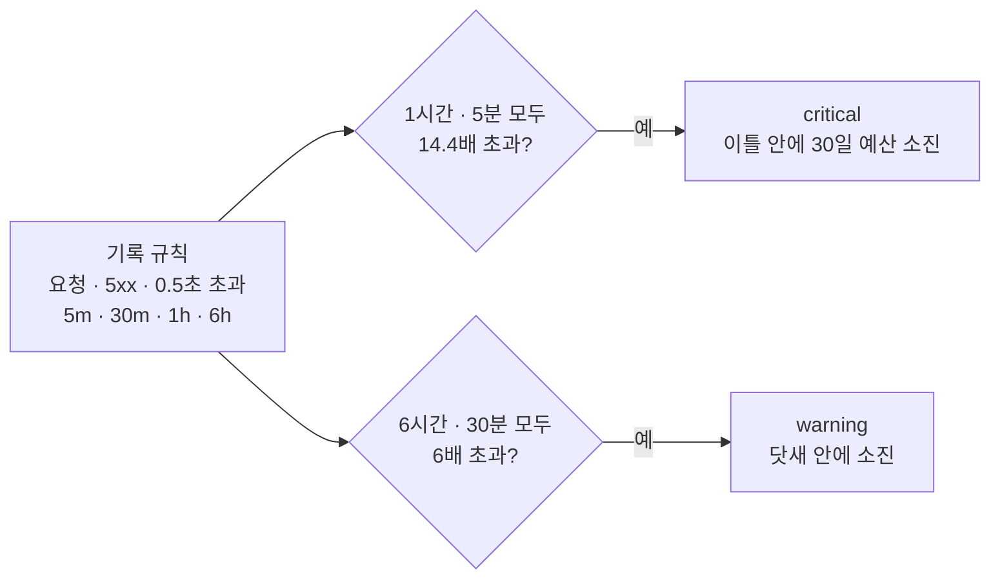

- 긴 창의 요청이 1시간에 60건 미만이면 소진 속도 경보를 평가하지 않는다. 요청이 적은 서비스에서 오류 몇 건 때문에 경보가 울리지 않게 한다.
- **평소 대비 경보**: 트래픽이 시간대마다 크게 달라서(지난 7일 중 58% 의 시간이 요청 0건) 고정 기준으로는 알아채기 어려운 변화를 본다. 기준선은 지난 3주 같은 요일 · 같은 시각의 가운데 값이다. 한 주에만 튄 값(부하 시험 · 수집 요청)이 평소가 되지 않게 평균 대신 가운데 값을 쓰고, 3주치가 모두 있을 때만 평가한다. 요청이 30분에 300건 미만인 한가한 시간대 · 서비스는 보지 않는다. 기준선은 원본 HTTP 지표(90일 보존)로 계산한다.

</details>

<details>
<summary>경보 규칙 전체</summary>

| 규칙 | 조건 | 지속 | 등급 |
|---|---|---|---|
| SLO 가용성 예산 빠르게 소진 | 5xx 비율이 1시간 · 5분 모두 예산의 14.4배(1.44%) 초과 | 2분 | critical |
| SLO 가용성 예산 소진 | 6시간 · 30분 모두 6배(0.6%) 초과 | 15분 | warning |
| SLO 응답 시간 예산 빠르게 소진 | 0.5초 넘은 요청 비율이 1시간 · 5분 모두 14.4배(72%) 초과 | 2분 | critical |
| SLO 응답 시간 예산 소진 | 6시간 · 30분 모두 6배(30%) 초과 | 15분 | warning |
| 요청 급감 (평소 대비) | 최근 30분 요청 < 평소(3주 가운데 값)의 30% (평소 30분 300건 이상, 3주치 모두 있을 때만) | 20분 | warning |
| 응답 시간 급증 (평소 대비) | 최근 30분 P99 > 평소(3주 가운데 값)의 2배 그리고 0.5초 이상 (최근 30분 300건 이상, 3주치 모두 있을 때만) | 15분 | warning |
| JVM 힙 사용률 | 태스크별 힙 사용 / 한도 > 90% | 10분 | warning |
| 메시지 처리 오류율 | 큐별 처리 스팬 중 오류 비율 > 5% (10분에 6건 넘게 처리한 큐만) | 10분 | warning |
| 포기한 예약 동기화 작업 | 작업 종류(`jobType`)별 DEAD_LETTER 작업 수 `preorder_sync_dead_letter` > 0 | 1분 | warning |
| 회차 증설 실패 | preorder 가 최소 대수를 바꾸지 못한 횟수 `preorder_scaling_failures_total` 10분 3번 이상(외삽을 감안해 > 2.5) | 5분 | warning |
| 결제 DLQ 대기 | payment 가 DB 로 옮긴 DLQ 메시지 중 처리를 기다리는 수 `payment_dlq_waiting` > 0 | 1분 | warning |
| 버린 환불 요청 | 관리자가 버린 payment DLQ 환불 요청 `payment_dlq_discarded_total{eventType="ORDER_REFUND_REQUESTED"}` 1시간 1건 이상(> 0.5) | 1분 | warning |
| 결제 복구 사람 확인 | payment 복구가 끝내지 못한 거래 `payment_recovery_attention_total` 1시간 1건 이상(외삽을 감안해 > 0.5), 유형 · 대상 · 사유별 | 1분 | warning |
| 프런트 JS 오류 급증 | 브라우저 오류 15분 > 30건 그리고 지난주 같은 시각의 3배 초과 (Loki) | 5분 | warning |
| 프런트 LCP 악화 | LCP p75 30분 > 4초 (측정 30건 이상일 때만, Loki) | 15분 | warning |
| 서비스 지표 끊김 | 지난 1시간 안에 지표를 보내던 서비스가 지금 `target_info` 를 보내지 않음 | 5분 | critical |
| MySQL 수집 끊김 | `mysql_up` 또는 exporter 수집 대상의 `up` < 1 (exporter 를 띄운 환경만) | 5분 | critical |
| MySQL 연결 사용률 | 연결 수 / max_connections > 80% | 10분 | warning |
| MySQL 오래 도는 쿼리 | 상태별 실행 중 쿼리 시간 합 > 60초 | 2분 | warning |
| obs 수집 실패 | Collector 의 수신 거부 · 내보내기 실패 · 큐가 가득 차 버린 양 > 0 | 10분 | warning |
| obs 저장소 거부 | Loki · Tempo · Mimir 가 버린 로그 · 스팬 · 샘플 > 0 (job · reason 별) | 10분 | warning |
| obs 디스크 사용률 | obs 호스트 마운트별 사용률 > 80% | 15분 | warning |
| obs 저장 한도 근접 | Mimir 활성 시계열 / 15만, Loki 스트림 / 5000 > 70% | 15분 | warning |
| Loki 수집량 급증 | 최근 1시간 수집 바이트 > 지난주 같은 시각의 3배 그리고 초당 10 KiB 이상 | 30분 | warning |
| APM 지표 라벨 조합 넘침 | span metrics 의 `otel_metric_overflow="true"` 시계열이 생김 | 5분 | warning |
| 게이트웨이 전송 큐 적체 | 내보내기별 큐 사용률 > 50% | 10분 | warning |

- 5xx 비율에는 고정 기준(5분 5%) 경보를 두지 않는다. SLO 가용성 소진 속도 경보가 더 일찍(1.44%) 울리면서도 덜 자주 울린다. 규칙은 파일에서 빼도 Grafana 에 남으므로 `rules.yaml` 의 `deleteRules` 로 지운다.
- 트래픽이 없어 조회 결과가 비면 정상으로 본다(`noDataState: OK`). 조회가 실패하면 Error 상태 알림이 따로 간다.
- 엣지는 CloudWatch 경보(`terraform/aws/monitoring/cloudwatch/nova_apnortheast2/certs_alb.tf`)로 감시한다. 인증서 만료 14일 전(ALB · CloudFront 인증서, 트래픽과 무관)과 ALB 가 직접 만든 4xx 비율 50% 초과(원본 확인 헤더 · 리스너 규칙 어긋남)에 울린다. 4xx 경보는 5분 요청이 20건 이상일 때만 판단하고 15분 연속 넘어야 울리며, 기준값은 `alb_elb_4xx_ratio_threshold` 다.
- RDS 의 CPU, 여유 메모리, 남은 스토리지 경보는 cloudwatch 스택의 `rds_instance_ids` 에 인스턴스 식별자를 넣어야 만들어진다. 지금은 비어 있어서 이 경보가 없다.
- ECS 서비스 상태도 CloudWatch 로 감시한다(`terraform/aws/monitoring/cloudwatch/nova_apnortheast2/`). 서비스별 "태스크 0개" 경보(`AWS/ECS` `LiveTaskCount` < 1, 5분)와 ECS 이벤트 경보(`terraform/aws/monitoring/cloudwatch/nova_apnortheast2/ecs_events.tf`)가 있다. 증설 경보(순간 폭주 `<서비스>-burst-*`: 증설을 시작할 때만 알림, 증설 한계 `<서비스>-at-max`: 최대 대수에서 CPU 가 3분 높음)는 기준값인 max 와 함께 바뀌도록 ecs 모듈(`terraform/aws/ecs/_modules/service/burst.tf`)에 있다. 서비스가 직접 돌려준 5xx(`<서비스>-5xx`: 1분에 50건 이상이고 요청의 2% 초과, 최근 2분 중 한 번)도 대상 그룹이 있는 ecs 모듈(`alb.tf`)에 있어, 어느 서비스가 사용자에게 오류를 냈는지 이름으로 온다. 계정 전체 `alb-5xx` 는 ALB 가 직접 만든 5xx(대상 없음 · 시간 초과)만 센다.
  ECS 이벤트 경보는 배포 실패(되돌림), 태스크 배치 · 설정 실패, 태스크 비정상 종료를 알린다. 비정상 종료는 필수 컨테이너 종료 · 기동 실패 · 헬스체크 실패이고, 배포 · 스케일 인 · Spot 회수는 뺀다.
- Chatbot 은 SNS 메시지가 사용자 지정 알림 JSON 형식이어야 내용을 그대로 보여 준다. `notify.yaml` 의 템플릿이 이 JSON 을 만든다.

</details>

## 참고

<details>
<summary>앱 연동 (에이전트 환경 변수, 프로파일)</summary>

에이전트는 be 이미지에 든 `/otel/javaagent.jar` 다. `terraform/aws/ecs/nova_apnortheast2/otel.tf` 가 `otel_services`(지금은 `["*"]`, 배포하는 모든 서비스)에 든 서비스에 아래 환경 변수를 넣는다.

```
JDK_JAVA_OPTIONS=-javaagent:/otel/javaagent.jar
OTEL_SERVICE_NAME=<svc>
OTEL_RESOURCE_ATTRIBUTES=deployment.environment=prod,service.namespace=nova
OTEL_LOGS_EXPORTER=otlp
OTEL_TRACES_EXPORTER=otlp
OTEL_METRICS_EXPORTER=otlp
OTEL_TRACES_SAMPLER=parentbased_always_on
OTEL_INSTRUMENTATION_MICROMETER_ENABLED=true
OTEL_EXPORTER_OTLP_ENDPOINT=http://otel-gateway.nova.local:4318
OTEL_EXPORTER_OTLP_PROTOCOL=http/protobuf
OTEL_INSTRUMENTATION_AWS_SDK_EXPERIMENTAL_USE_PROPAGATOR_FOR_MESSAGING=true
OTEL_INSTRUMENTATION_LOGBACK_APPENDER_EXPERIMENTAL_MDC_ATTRIBUTES_INCLUDED=traceId
OTEL_INSTRUMENTATION_COMMON_LOGGING_STRUCTURED_ATTRIBUTES_INCLUDED=event_id,aggregate_type,aggregate_id,event_type,destination
OTEL_INSTRUMENTATION_HTTP_SERVER_EMIT_EXPERIMENTAL_TELEMETRY=true
OTEL_INSTRUMENTATION_HTTP_SERVER_CAPTURE_REQUEST_HEADERS=x-amz-cf-id,x-amzn-trace-id
```

- `JAVA_TOOL_OPTIONS` 는 쓰지 않는다. 이미지의 힙 옵션이 이 변수에 들어 있어서 덮어쓰면 사라진다.
- 엔드포인트와 프로토콜을 짝지어 쓴다. `otel-gateway.nova.local:4318` 은 `http/protobuf`, gRPC 는 `otel-gateway-grpc.nova.local:4317` 이다. 둘이 어긋나면 앱 로그에 실패 메시지 한 줄만 남고 데이터는 전혀 오지 않는다.
- MDC 는 `traceId`(요청 ID)만 넘긴다. `subject`(회원 ID)는 넘기지 않는다.
- **프로파일**: `application/<서비스>/service.yml` 에서 `profiling: true` 로 둔 서비스만 켠다(기본 false). obs 의 프로파일 인바운드(4041, 수신 전용 프록시)도 같은 값을 보고 그 서비스에만 연다. 이미지에 확장 jar(`/otel/pyroscope-otel.jar`)가 있어야 한다.
  ```
  OTEL_JAVAAGENT_EXTENSIONS=/otel/pyroscope-otel.jar
  OTEL_PYROSCOPE_START_PROFILING=true
  PYROSCOPE_SERVER_ADDRESS=http://pyroscope.<네임스페이스>:4040
  PYROSCOPE_PROFILER_EVENT=itimer   # Fargate 는 perf_events 를 막는다
  ```
  - 앱은 `pyroscope.<네임스페이스>:4040`(Service Connect 별칭)으로 보내지만 실제로는 수신 전용 프록시(4041)로 들어간다. Pyroscope 4040 은 조회 API 도 열어 두므로, 앱에 이 포트를 열면 Grafana 인증 없이 다른 서비스의 프로파일을 읽을 수 있다. obs 보안 그룹도 4041 만 연다.
  - 확장이 프로파일 샘플에는 스팬 ID 를, 스팬에는 `pyroscope.profile.id` 를 붙인다. Tempo 의 trace-to-profiles 는 이 두 값으로 스팬에서 그 시간대의 플레임 그래프를 연다.
- 실험 텔레메트리는 동시 처리 요청 수(`http_server_active_requests`)를 보려고 켰다. 함께 켜지는 요청 · 응답 본문 크기 히스토그램은 쓰지 않아서 Collector 가 버린다(`filter/unused-metrics`).
- Micrometer HTTP 지표(`http.server.requests` · `http.client.requests`)의 `uri` 태그는 Collector 가 `?` 앞의 경로 템플릿만 남기고, 그래서 같은 라벨이 된 데이터 포인트를 하나로 합친다(카운터 · 히스토그램은 더하고 `.max` 게이지는 큰 쪽, `transform/metric-uri`). Spring HTTP 인터페이스는 목록 쿼리 파라미터를 원소마다 `{queryParam-x[0]}…` 로 펼쳐 `uri` 에 넣어서, 원소 수마다 시계열이 생기고 2048자를 넘으면 Mimir 가 거부한다. 더하지 않고 라벨만 바꾸면 누적값 여럿이 한 시계열에 번갈아 들어가 `rate()` 가 틀어진다.
- 부하 시험 k6 지표(`service.name = k6`, terraform/aws/loadtest)는 판정에 쓰지 않는 내장 지표(`http_req_waiting` 등 Trend 6개 · `iteration_duration` · `group_duration` · `data_*`)를 버리고(`filter/k6`), 속성은 `status` · `method` · `name` · `scenario` · `expected_response` · `test_id` · `instance` · `error_code` · `check` · `condition`(Rate 지표의 zero · nonzero)과 스크립트 지표의 `outcome`(entry · rush 결과) · `code`(업무 오류 코드) · `flow` · `reason` · `pool` 만 남긴다. URL 원문이 든 `name`(스크립트가 `tags.name` 을 빠뜨린 것)은 `(unnamed)` 하나로 모으고, 같은 라벨이 된 것은 합친다(카운터 · 히스토그램은 더하고 게이지는 큰 쪽, `transform/k6`). 운영과 같은 Mimir 테넌트의 시계열 한도(15만)를 나눠 쓰므로 k6 스크립트가 실수해도 시계열이 늘지 않게 하는 안전망이다.
- 요청 헤더 두 개를 스팬 속성(`http.request.header.x-amz-cf-id` · `x-amzn-trace-id`)으로 남겨 CloudFront · ALB 로그의 요청 ID 와 트레이스를 잇는다. 클라이언트가 같은 이름의 헤더를 보내면 그 값이 섞일 수 있어서 Collector 가 AWS 형식에 맞는 값만 남긴다(위 "저장 전 마스킹 규칙").

</details>

<details>
<summary>조회 예시 (LogQL, PromQL, TraceQL)</summary>

**로그 (Loki).** 인덱스 라벨로 스트림을 고른 뒤 structured metadata 로 거른다.

```
{service_name="preorder", deployment_environment="prod"} | event_id="<uuid>"
{service_namespace="nova"} | aggregate_type="PREORDER" | aggregate_id="<uuid>"
{service_name="cloudfront"} | http_response_status_code >= 500
{service_name="alb"} | aws_xray_trace_id="Root=1-<…>"
```

- ALB · CloudFront 접근 로그는 `service_name` 이 `alb`, `cloudfront` 인 스트림에 있다. 로그 파일이 몇 분 늦게 올라오므로 실시간으로는 보이지 않는다.
- 쿼리 문자열, 쿠키, User-Agent 는 저장하지 않고 사용자 IP 는 /24 대역까지만 남긴다. 원본이 필요하면 로그 버킷을 본다.
- 앱 트레이스와는 요청 ID 로 잇는다. CloudFront 의 `aws_cloudfront_request_id` 는 앱 스팬의 `x-amz-cf-id` 헤더와, ALB 의 `aws_xray_trace_id` 는 `x-amzn-trace-id` 헤더와 값이 같다.

**지표.** Mimir 에서 PromQL 로 본다. 이름은 Prometheus 관례(단위 · 종류 접미사)를 따른다. 예: `http.server.request.duration` → `http_server_request_duration_seconds_bucket`.
- `job` 은 `<service.namespace>/<service.name>`(예 `nova/preorder`)이다. `deployment_environment` · `service_namespace` 도 라벨로 붙는다. 그 밖의 리소스 속성은 `target_info` 에만 있다.
- `target_info` 에는 `service_namespace` 라벨이 없다. 앱만 고를 때는 `target_info{job=~"nova/.+"}` 를 쓴다.
- 앱 외 job: 게이트웨이 `otel-gateway`, obs Collector `otelcol-contrib`, MySQL `mysqld`, LGTM 자체 `loki` · `tempo` · `mimir` · `grafana`, obs 호스트 `obs-host`.
- HikariCP 대기 · 사용 시간은 에이전트가 보내는 `db_client_connections_*_milliseconds` 를 초로 바꿔 그린다. semconv 안정 이름(`db_client_connection_*_seconds`)도 같이 조회하므로 에이전트를 올려도 패널이 비지 않는다.

**트레이스.** 로그 줄을 펼쳐 trace_id 의 Tempo 링크로 가거나, 지표 그래프의 exemplar 점에서 바로 간다. 스팬에서는 "Logs for this span" 으로 같은 trace_id 의 로그를 연다.

**APM 지표.** 샘플링하기 전의 모든 스팬으로 센 값이다. `job` 은 앱 지표와 같다.

```
# 경로별 초당 호출 (서버 스팬)
sum by (span_name) (rate(traces_spanmetrics_calls_total{job="nova/preorder", span_kind="SPAN_KIND_SERVER"}[5m]))
# preorder 가 부르는 상대(서비스 · DB · 외부)별 실패 비율
sum by (server) (rate(traces_service_graph_request_failed_total{client="preorder"}[5m]))
  / sum by (server) (rate(traces_service_graph_request_total{client="preorder"}[5m]))
```

**TraceQL 지표.** Tempo 에 남은 트레이스로 계산한다. 아래 식을 Explore 의 Tempo TraceQL 편집기에 그대로 넣거나 Traces Drilldown 에서 본다.

```
{resource.service.name="preorder" && kind=server} | quantile_over_time(duration, .99) by (span.http.route)
{span.http.request.header.x-amz-cf-id != nil && status=error} | rate()
```

</details>

<details>
<summary>보안</summary>

- **OTLP 에는 TLS 와 토큰을 쓰지 않는다.** VPC 안에서만 통신하고, 누가 보낼 수 있는지는 obs 보안 그룹으로 정한다. 보내는 쪽이 저장된 로그를 읽을 경로도 없다. 다음 위험은 감수한다.
  - 보낼 수 있는 곳에서는 가짜 로그를 넣을 수 있으므로 로그의 진위는 보장하지 않는다.
  - 한 서비스가 많이 보내면 Collector 메모리 한도에 걸려 다른 서비스의 데이터도 버려진다.
- Grafana 는 ALB 에서 Cognito 로그인을 거친 뒤 같은 사용자 풀로 OAuth 로그인한다. 역할은 Cognito 그룹으로 정한다(`grafana-admin` → Admin, `grafana-editor` → Editor, 그 밖 → Viewer). 익명 접근 · 가입 · 플러그인 관리는 꺼 두었다.
- Loki · Tempo · Mimir API 에는 인증이 없고(`auth_enabled: false`), 태스크 안의 localhost 에서만 접근할 수 있다. Loki 의 삭제 요청 API 는 껐고, 보존 기간이 지난 데이터는 compactor 가 지운다.
- 버킷 정책은 `nova-prod-obs` 역할만 객체에 접근하게 한다(`terraform/aws/s3/grandis-nova/obs.tf`).
- 모든 컨테이너는 1024 넘는 포트만 쓰고, 리눅스 권한을 모두 버리고 권한 상승을 막는다. Tempo · Mimir 는 이미지 기본 사용자가 root 라서 `user: 10001:10001` 로 실행한다.

</details>

<details>
<summary>OTel 게이트웨이 운영 (<code>terraform/aws/monitoring/lgtm/nova_apnortheast2/gateway.tf</code>)</summary>

앱이 보내는 OTLP 를 obs 태스크 밖에서 받는 Collector 다. obs 는 호스트 디렉터리를 쓰므로 재배포할 때 몇 분 동안 비지만, 게이트웨이는 별도 서비스라 그동안에도 데이터를 받는다.

- 관측 클러스터(`nova-prod-observability`)에서 실행된다. 앱 클러스터와 Service Connect 네임스페이스가 같아서 앱은 그대로 `otel-gateway` 이름으로 보낸다.
- Fargate(온디맨드, 1 vCPU, 4 GiB)로 실행하고 롤링 배포한다. Spot 은 회수되면 다음 태스크가 뜰 때까지 수집이 멈추므로 쓰지 않는다.
- 설정은 `terraform/aws/monitoring/lgtm/nova_apnortheast2/gateway/collector.yaml` 내용을 환경 변수로 넘긴다(`--config=env:COLLECTOR_CONFIG`). S3 에서 내려받지 않으므로 태스크 역할이 필요 없고, 설정이 바뀌면 다시 배포된다.
- obs 의 Loki · Tempo · Mimir 로 Service Connect 를 거쳐 보낸다. 보내지 못한 데이터는 내보내기별 메모리 전송 큐(바이트 기준 128 MiB, 셋 합 384 MiB)에 모아 두고 15분까지 다시 보낸다. 큐가 차면 새로 들어오는 데이터를 버린다(`otelcol_exporter_enqueue_failed_*`).
  디스크 큐는 쓰지 않는다. Fargate 디스크는 태스크와 함께 사라지므로 게이트웨이가 교체되면 디스크 큐도 잃는다. 대비할 상황은 obs 가 재배포되는 동안이라 메모리 큐로 충분하다.
- 게이트웨이를 배포할 때는 두 태스크가 1~2분 함께 떠 있어서 한 트레이스의 스팬이 두 태스크로 나뉠 수 있고, 그러면 tail sampling 결정이 어긋날 수 있다.
- 게이트웨이 자체 지표는 obs 가 긁을 수 없어서 30초마다 Mimir 로 직접 보낸다(`job="otel-gateway"`).
- 태스크가 없으면 CloudWatch 경보(`nova-prod-otel-gateway-no-tasks`)가 울린다. `AWS/ECS` `LiveTaskCount` 가 0 이거나 데이터가 끊기면 장애로 본다.
- **게이트웨이와 obs 를 같은 apply 에서 재배포하지 않는다.** obs 가 내려간 사이에 게이트웨이 태스크가 교체되면 옛 태스크의 큐에 쌓인 데이터가 사라진다. 그래서 `terraform/aws/monitoring/lgtm/nova_apnortheast2/gateway/` 변경과 `config/` · obs 작업 정의 변경은 PR 을 나눈다.
- 앱은 `otel-gateway.<네임스페이스>:4318` 로 보낸다(`terraform/aws/ecs/nova_apnortheast2/otel.tf` 의 `OTEL_EXPORTER_OTLP_ENDPOINT`).
- **Lambda 처럼 ECS 밖에서 보내는 쪽은 `otel-ingest.<네임스페이스>:4318` 을 쓴다.** Service Connect 이름은 ECS 태스크 안에서만 풀리므로, 게이트웨이 태스크 IP 를 가리키는 DNS 레코드(TTL 10초)를 따로 등록했다.
  롤링 배포 중 몇 초 동안은 요청이 내려간 태스크로 갈 수 있어서 보내는 쪽이 재시도해야 한다. 이 이름은 Service Connect 이름(`otel-gateway`)과 겹치면 안 된다.
- **Service Connect 별칭은 태스크가 뜰 때 정해진다.** 그 뒤에 생긴 이름은 이미 떠 있는 태스크에서 풀리지 않는다(`no such host`).
  obs 가 `loki` · `tempo-otlp` · `mimir` 를 새로 노출하거나 이름을 바꾸면 게이트웨이를 다시 배포한다(`update-service --force-new-deployment`). 게이트웨이를 새로 만들 때도 마찬가지다.
- 별칭은 IPv4(127.255.0.x)와 IPv6(2600:f0f0::x) 주소로 풀린다. 태스크에 IPv6 경로가 없어서 gRPC(Tempo) 연결은 IPv6 시도에서 `network is unreachable` 경고를 남기고 IPv4 로 접속한다. 이 경고는 내보내기 실패가 아니다.

</details>

<details>
<summary>브라우저 수집기 운영 (<code>terraform/aws/monitoring/lgtm/nova_apnortheast2/rum.tf</code>)</summary>

프런트(Grafana Faro SDK)가 브라우저에서 `https://rum.grandis-nova.link/collect` 로 바로 보내는 데이터를 받는 Collector 다.

- 경로: CloudFront(`terraform/aws/edge/grandis-nova/rum.tf`, 전용 WAF) → ALB(Host · 원본 확인 헤더 · `/collect` 규칙) → 수집기 12347 → 게이트웨이 `otel-gateway.<네임스페이스>:4318`.
- **게이트웨이와 따로 둔다.** 인터넷에서 누구나 보낼 수 있는 입구라서, 요청이 몰려도 수집기의 작은 큐(200 묶음, 1분 재시도)에서만 데이터가 버려지고 앱 데이터가 지나는 게이트웨이는 영향을 받지 않게 했다.
- 게이트웨이 · obs 와 같은 관측 클러스터(`nova-prod-observability`)에서 실행된다.
- 막는 것: WAF(`POST /collect` 만, Content-Length 250KB 미만, IP 당 5분 3000건), CORS(`www.grandis-nova.link` · `grandis-nova.link`), 앱 이름(`nova-web` 이 아니면 버림). CORS 는 다른 사이트의 브라우저만 막고, 직접 보내는 요청은 막지 못한다.
- URL 쿼리 · 해시를 지운다(로그 본문 · 속성, 스팬 · 스팬 이벤트 속성). 프런트의 `beforeSend` 가 먼저 지우므로 여기서는 안전망이다. 이메일 · 전화번호는 게이트웨이가 지운다("저장 전 마스킹 규칙"). URL 밖에 있는 토큰은 여기서 지우지 못하므로 프런트에서 아예 보내지 않는다.
- Fargate 0.25 vCPU · 512 MiB(`memory_limiter` 384 MiB)로 실행하고 롤링 배포한다. CPU 평균 60% 를 기준으로 1~3대 사이에서 늘고 준다. 상한 3대는 실측 전 추정치다(한 대가 초당 수백 요청을 처리하고, 판매 오픈 때 예상 유입은 그 1/4~1/2).
  대수를 늘려도 브라우저 로그(전체 양의 대부분)는 Loki 수집 한도(테넌트 초당 4 MB, 앱 로그와 공유)를 넘을 수 없다. 트레이스는 Tempo 로 간다. 대수는 자체 지표와 Loki 수집량을 보고 조정한다. 자체 지표는 게이트웨이를 거쳐 Mimir 로 간다(`job="rum-collector"`). 태스크가 없으면 CloudWatch 경보(`nova-prod-rum-collector-no-tasks`)가 울리고, 앱 관측에는 영향이 없다.
- Loki 에서는 모두 `service_name="nova-web"` 스트림 하나에 모이고, 나머지 정보는 본문(logfmt)에 들어 있다. 기록 종류는 `kind` 로 나뉜다. 웹 바이탈은 `measurement`(`type=web-vitals`, `value_lcp` · `value_inp` · `value_cls`), 오류는 `exception`, 핵심 동작은 `event`(`event_name=faro.user.action`, `event_data_userActionName` · `event_data_userActionDuration` ms), API 호출은 `event`(`event_name=faro.tracing.fetch`)다. 페이지는 `view_name`(경로 패턴)으로 구분한다. 이 데이터는 `60 Frontend` 에서 본다.
- 브라우저 기록의 `traceID=…` 는 Loki 데이터소스의 "브라우저 트레이스" 링크로 Tempo 에서 연다. 브라우저 스팬 아래에 그 요청의 서버 스팬이 이어진다.
- CORS 허용 헤더를 지정하면 기본값이 사라지므로, Faro 가 보내는 `content-type` · `content-encoding` · `x-faro-session-id` · `idempotency-key` 를 모두 허용 목록에 넣었다. Faro 에 `apiKey` 를 설정하면 `x-api-key` 헤더가 붙어 요청이 막힌다.

</details>

<details>
<summary>obs 작업 정의 (<code>terraform/aws/monitoring/lgtm/nova_apnortheast2/main.tf</code>)</summary>

- 데이터 디렉터리는 데이터 EBS 를 bind mount 한다: loki `/loki`, tempo `/var/tempo`, mimir `/data`, pyroscope `/data`(넷 다 UID 10001), grafana `/var/lib/grafana`(UID 472). 디렉터리 목록은 ecs 스택의 `obs_data_dirs` 에 있고, obs 인스턴스가 부팅할 때 만든다. 디렉터리를 추가하면 인스턴스가 한 번 교체된다.
- Pyroscope 는 ecs 스택에 `pyroscope` 디렉터리가 있을 때만 실행한다. 압축용 임시 디렉터리를 `TMPDIR=/data` 로 옮겨 루트 파일시스템을 읽기 전용으로 둔다.
- 컨테이너 메모리 한도는 `terraform/aws/monitoring/lgtm/nova_apnortheast2/main.tf` 의 `obs_memory` 한 곳에서 정한다. 컨테이너 한도의 합은 태스크 메모리(`obs_task_memory`)를, 태스크 메모리는 인스턴스가 ECS 에 등록한 메모리를 넘으면 안 된다. 한도는 7일간 최대 RSS 의 1.4~2.5배로 정한다. Go 프로세스는 한도의 90% 를 `GOMEMLIMIT` 로 지정해 한도에 가까워지면 GC 를 더 자주 돌린다. 한 컨테이너가 한도를 넘으면 그 컨테이너만 재시작된다(`restartPolicy`). 재시작이 잦으면 LGTM 대시보드의 메모리(RSS)를 보고 `obs_memory` 를 다시 나눈다.
- obs Collector 는 긁기만 하므로 192 MiB 만 준다(`memory_limiter` 160 MiB). tail sampling 과 servicegraph 는 게이트웨이(4 GiB, `memory_limiter` 3072 MiB)에서 처리한다.
- Grafana 는 기동할 때 Drilldown 앱(Traces · Logs · Metrics · Profiles)을 grafana.com 에서 받는다. `GF_PLUGINS_PREINSTALL` 로 버전을 고정해 재배포할 때마다 화면이 바뀌지 않게 했다. 버전을 올릴 때는 이 값을 바꾼다.

</details>

<details>
<summary>포트</summary>

| 컨테이너 | 포트 |
|---|---|
| otel-collector (obs, 긁기 전용) | 8888 (자체 지표, localhost) · 13133 (헬스체크) |
| (게이트웨이, 별도 서비스) otel-collector | 4317 · 4318 (Service Connect `otel-gateway-grpc` · `otel-gateway`) · 13133 |
| loki · tempo · mimir 의 게이트웨이 수신 | 3100 · 14317 · 9009 (Service Connect `loki` · `tempo-otlp` · `mimir`). obs 보안 그룹이 게이트웨이 SG 에만 연다 |
| loki | 3100 (HTTP) · 9096 (gRPC) |
| tempo | 3200 (HTTP) · 9097 (gRPC) · 14317 (OTLP gRPC, 게이트웨이 전용) |
| mimir | 9009 (HTTP: OTLP `/otlp`, PromQL `/prometheus`) · 9098 (gRPC) · 7947 (memberlist, 127.0.0.1) |
| grafana | 3000 |
| mysqld_exporter | 9104 |
| pyroscope | 4040 (HTTP, 태스크 안에서만) · 9094 (gRPC) · 9099 (raft, 127.0.0.1) · 7948 (memberlist, 127.0.0.1) |
| pyroscope-ingest | 4041 (수신 전용 프록시, Service Connect `pyroscope` 의 대상) |

Tempo · Mimir 의 링은 메모리에 둔다. Mimir 3 는 memberlist 를 켜므로 기본 7946 대신 127.0.0.1:7947 에 바인딩한다.

</details>

<details>
<summary>환경 변수와 설정 값 주입</summary>

설정 파일은 컨테이너의 `/config/` 에 있다. Collector 는 `--config=/config/collector.yaml`, Loki · Tempo · Mimir 는 `-config.file=/config/<이름>.yaml -config.expand-env=true` 로 실행한다.

| 컨테이너 | 변수 | 값 |
|---|---|---|
| otel-collector | `MIMIR_OTLP_ENDPOINT` | `http://localhost:9009/otlp` |
| otel-collector | `MYSQLD_EXPORTER_TARGET` | `localhost:9104`. exporter 가 없으면 빈 문자열이고 긁지 않는다 |
| otel-collector | `PYROSCOPE_TARGET` | `localhost:4040`. Pyroscope 가 없으면 빈 문자열이고 긁지 않는다 |
| otel-collector | `OBS_DATA_MOUNT_PATH` | 데이터 EBS 마운트 경로(ecs 스택 출력 `obs_data_mount_path`). hostmetrics 가 이 디스크와 루트의 사용률을 본다. 호스트 `/` 는 `/hostfs` 에 읽기 전용으로 마운트한다 |
| loki · tempo · mimir | `<LOKI·TEMPO·MIMIR>_S3_BUCKET` · `_S3_REGION` | s3 스택 출력의 버킷, `ap-northeast-2` |
| loki · tempo · mimir | `LOKI_RETENTION_PERIOD` · `TEMPO_RETENTION` · `MIMIR_RETENTION` | `2160h` · `336h` · `2160h` (`terraform/aws/monitoring/lgtm/nova_apnortheast2/variables.tf` 의 `obs_retention`). Loki · Tempo 버킷에는 이보다 긴 수명주기 만료(100일 · 30일)를 안전망으로 걸어 두었다 |
| loki · tempo · mimir | `*_S3_ENDPOINT` · `*_FORCE_PATH_STYLE` · `*_INSECURE` 등 | 운영에서는 넘기지 않는다. MinIO 같은 S3 호환 저장소를 쓸 때 넘긴다 |
| grafana | `LOKI_URL` · `TEMPO_URL` · `MIMIR_URL` · `PYROSCOPE_URL` | `http://localhost:3100` · `http://localhost:3200` · `http://localhost:9009/prometheus` · `http://localhost:4040` |
| grafana | `SNS_TOPIC_ARN` · `AWS_REGION` | 알림 주제와 리전. 비어 있으면 연락처 검증에 실패해 Grafana 가 뜨지 않는다. 태스크 역할에 `sns:Publish` 가 있어야 한다 |
| grafana | `GF_SECURITY_ADMIN_PASSWORD` | Secrets Manager `nova-prod/ops/grafana/admin-password` |

버킷 · 보존 기간 · 엔드포인트는 환경 변수로 받는다(`-config.expand-env=true`). 이미지는 태그와 다이제스트로 고정한다.

</details>

<details>
<summary>Mimir 쿼리 설정</summary>

쿼리 샤딩은 껐다. 코어가 몇 개 없는 서버 한 대에서는 쿼리를 쪼개도 빨라지지 않고 대기열만 찬다.
테넌트 대기열 한도(`max_outstanding_requests_per_tenant`)는 1000이다. 대시보드 몇 개를 동시에 열어 패널 수십 개가 한꺼번에 조회해도 넉넉한 값이다. 한도를 넘은 조회는 HTTP 429 로 실패하므로 LGTM 대시보드의 "Mimir 쿼리 대기열"로 확인한다.

</details>

<details>
<summary>DB 지표 (mysqld_exporter)</summary>

exporter 는 rds 스택 출력 네 개(`db_address` · `db_port` · `exporter_username` · `exporter_secret_arn`)로 DB 에 접속한다.
비밀 이름이 `nova-prod/db/exporter` 규칙을 따라야 obs 실행 역할이 읽을 수 있다(`terraform/aws/iam/grandis-nova/obs.tf`).

exporter 계정에는 `PROCESS` · `REPLICATION CLIENT` · `SELECT` 를 준다. 기본 수집기에 더해 다이제스트별 SQL 통계(상위 SQL), mysqld 메모리, 계정 · 상태별 연결(processlist), 교착 상태 · 잠금 시간 초과(innodb_metrics)를 켠다(`main.tf` 의 `obs_mysqld_collectors`).

RDS 는 파라미터 그룹에서 `performance_schema` 를 켜야 상위 SQL 이 나온다. 정적 파라미터라 바꾸려면 재부팅해야 하므로 인스턴스를 만들 때 켜 둔다.
다이제스트 지표는 SQL 형태마다 한 벌씩 생긴다. 그래서 최근 하루 동안 관측된 것 중 시간 순으로 100개만 모으고, 대시보드에서 쓰지 않는 항목은 Collector 가 버린다(`collector.yaml` 의 mysqld `metric_relabel_configs`).

</details>

<details>
<summary>Grafana admin 비밀번호 교체</summary>

`GF_SECURITY_ADMIN_PASSWORD` 는 Grafana 를 처음 띄울 때만 적용된다. 이미 있는 admin 의 비밀번호는 Grafana 컨테이너 안에서 아래 명령으로 바꾼다.

```
grafana cli admin reset-admin-password --password-from-stdin
```

</details>

<details>
<summary>파일</summary>

| 경로 | 내용 |
|---|---|
| `terraform/aws/monitoring/lgtm/nova_apnortheast2/gateway/collector.yaml` | OTel 게이트웨이(별도 ECS 서비스). 수신(OTLP), 처리(memory_limiter → 리소스 허용 목록 → 트레이스는 APM 지표 · tail sampling 두 갈래 → 마스킹 → batch), 내보내기(Loki · Tempo · Mimir, 메모리 큐 · 15분 재시도). 자체 지표는 Mimir 로 직접 보낸다. `config/` 밖에 두어 이 파일을 고쳐도 obs 태스크가 다시 뜨지 않는다 |
| `terraform/aws/monitoring/lgtm/nova_apnortheast2/rum/collector.yaml` | 브라우저 수집기(별도 ECS 서비스, 관측 클러스터). faro 수신(CORS 는 프런트 출처만) → 앱 이름이 `nova-web` 이 아니면 버림 → URL 쿼리 · 해시 삭제 → 게이트웨이. `config/` 밖에 두어 이 파일을 고쳐도 obs 태스크가 다시 뜨지 않는다 |
| `terraform/aws/monitoring/lgtm/nova_apnortheast2/config/collector.yaml` | obs Collector. 긁기(자신 · mysqld · LGTM 자체 · Pyroscope · hostmetrics) → Mimir. 받는 포트가 없다 |
| `terraform/aws/monitoring/lgtm/nova_apnortheast2/config/loki.yaml` | S3 저장, 보존 기간, 인덱스 라벨 지정, WAL, 삭제 요청 API 끔 |
| `terraform/aws/monitoring/lgtm/nova_apnortheast2/config/pyroscope-ingest.nginx.conf` | 앱이 닿는 수신 전용 프록시. `POST /ingest` 만 Pyroscope 로 넘기고 나머지(조회 API 등)는 403 |
| `terraform/aws/monitoring/lgtm/nova_apnortheast2/config/pyroscope.yaml` | 단일 바이너리, 파일시스템 저장(데이터 EBS, 7일), 같은 태스크와 겹치지 않는 포트(gRPC 9094 · memberlist 7948) |
| `terraform/aws/monitoring/lgtm/nova_apnortheast2/config/tempo.yaml` | S3 저장, 보존 기간(compactor), WAL, 종료할 때 블록 업로드, TraceQL 지표(`local-blocks`) |
| `terraform/aws/monitoring/lgtm/nova_apnortheast2/config/mimir.yaml` | `-target=all`. S3 한 버킷에 블록 · ruler · alertmanager 를 접두사로 나눔, OTLP 이름 접미사, 쿼리 대기열 · 샤딩, 늦은 샘플 30분 허용(게이트웨이가 다시 보낸 지표 순서가 섞여도 받음) |
| `terraform/aws/monitoring/lgtm/nova_apnortheast2/config/grafana/provisioning/datasources/` | Loki · Tempo · Mimir(서로 링크로 이어짐, Tempo 서비스 맵은 Mimir 를 읽음), CloudWatch(태스크 역할) |
| `terraform/aws/monitoring/lgtm/nova_apnortheast2/config/grafana/provisioning/dashboards/nova.yaml` | `grafana/dashboards/` 의 하위 디렉터리를 같은 이름의 Grafana 폴더로 읽는다 |
| `terraform/aws/monitoring/lgtm/nova_apnortheast2/config/grafana/dashboards/` | 대시보드 JSON ("대시보드 목록과 읽는 법") |
| `terraform/aws/monitoring/lgtm/nova_apnortheast2/config/grafana/provisioning/alerting/` | `rules.yaml`(경보 규칙), `slo.yaml`(SLO 기록 규칙 · 소진 속도 경보 · 평소 대비 경보), `notify.yaml`(SNS 연락처 · 알림 경로 · Chatbot 메시지 템플릿) |
| `terraform/aws/monitoring/lgtm/nova_apnortheast2/config/grafana/provisioning/plugins/none.yaml` | 빈 설정. 앱 플러그인은 `GF_PLUGINS_PREINSTALL` 로 받는다. S3 에는 빈 디렉터리가 없어 이 파일이 없으면 Grafana 가 기동할 때마다 오류 로그를 남긴다 |

</details>

## 경보 대응

경보 메시지의 "대응 순서" 링크를 누르면 이 절로 온다. 경보마다 먼저 볼 화면과 확인 순서를 적었다.

### SLO 가용성 예산 소진

1. SLO 대시보드에서 어느 서비스가 예산을 쓰는지, 1시간 · 6시간 소진 속도가 오르는 중인지 본다.
2. 서비스 상세의 원인 추적 줄에서 5xx 업무 오류 코드 · 태스크 CPU · 인스턴스 수를 같은 시각으로 본다. API 표의 5xx 수로 몰린 경로를 찾는다. 인스턴스 수가 막 바뀐 직후라면 배포나 새 태스크 예열이 원인일 가능성이 크다.
3. API 표에서 그 경로를 눌러 API 상세의 오류 요청 트레이스를 열고, 붉은 스팬과 로그를 차례로 보며 원인을 찾는다. DB · 외부 호출 오류라면 MySQL 대시보드나 의존 서비스를 본다.
4. 배포가 원인이면 이전 이미지로 되돌린다. critical 경보는 지금 속도라면 이틀 안에 30일 예산을 다 쓴다는 뜻이다.

### SLO 응답 시간 예산 소진

1. 서비스 상세의 API 표에서 P95 · 시간 비중이 큰 경로를 찾는다.
2. API 상세의 시간 구성(DB · 외부 · 자체)과 "이 API 안에서 오래 걸린 호출" · 느린 DB 쿼리로 어디에서 시간이 걸리는지 본다.
3. DB 비중이 크면 MySQL 대시보드의 상위 SQL 과 잠금을 보고, 자체 비중이 크면 HikariCP 대기 · JVM GC · CPU(프로파일을 켰다면 플레임 그래프)를 본다.

### 요청 급감

1. 개요 · 엣지 대시보드에서 CloudFront 요청 수와 ALB 요청 수를 같이 본다. CloudFront 는 그대로인데 ALB 요청만 줄었으면 WAF 차단 · 원본 확인 헤더 · 리스너 규칙을 확인한다.
2. 둘 다 줄었으면 클라이언트(앱 · 프런트 배포)를 먼저 본다. DNS · 인증서 문제라면 CloudWatch 의 인증서 · ALB 4xx 경보도 함께 울린다.
3. 판매 오픈처럼 트래픽이 평소와 다른 날에는 사일런스를 걸어 둔다.

### 응답 시간 급증

1. 서비스 상세의 API 표에서 P95 가 큰 경로를 찾고, API 상세의 "지난주 같은 시각과 비교"로 평소보다 느린지 본다.
2. 같은 화면에서 응답 시간과 시간 구성을 "SLO 응답 시간 예산 소진"과 같은 순서로 본다. 트래픽이 평소보다 많으면 태스크 수와 CPU 를 확인한다.

### 메시지 처리 오류율

1. SQS · 비동기 흐름 대시보드에서 어느 큐인지, 보내는 양이 갑자기 늘었는지 본다.
2. "처리 실패 트레이스"에서 트레이스를 열어 처리 스팬의 예외를 본다. 보낸 서비스의 요청부터 처리까지 한 트레이스로 이어진다.
3. DLQ 에 쌓였으면 원인을 고친 뒤 원래 큐로 옮긴다(redrive).

### 포기한 예약 동기화 작업

worker 가 외부 예약 등록(`REGISTER`) · 취소(`CANCEL`)를 재시도 끝에 포기하면 메시지가 그 큐의 DLQ 로 간다.
preorder 가 그 메시지를 바로 가져가 작업을 DEAD_LETTER 로 바꾸므로 SQS DLQ 경보에는 보이지 않고 이 경보로 알 수 있다. 작업을 처리하면 0 으로 내려가 풀린다.

1. 관리자 API `GET /api/v1/admin/preorders/sync-jobs?status=DEAD_LETTER&groupByError=true` 로 어떤 작업이 어떤 오류로 멈췄는지 본다.
2. 외부 쪽 원인(Mock 장애 · 계약 오류)을 고친 뒤 `POST /api/v1/admin/preorders/sync-jobs/{id}/reprocess` 로 다시 보낸다. 외부에서 이미 처리됐으면 취소 작업은 `POST /api/v1/admin/preorders/sync-jobs/{id}/resolve` 로 수동 완료한다. 본문에 이유(5~500자)를 넣는다: `{"reason": "..."}`.
3. 취소(`CANCEL`)는 외부에 예약이 남아 있을 수 있으니 외부 상태를 먼저 확인한다.

### 회차 증설 실패

preorder 는 1분마다 회차 일정을 보고 waitingroom 과 preorder 의 최소 대수(MinCapacity)를 맞춘다. 이 호출이 계속 실패하고 있다는 뜻이다.

1. preorder 로그에서 "최소 대수를 맞추지 못했다"를 찾아 예외를 본다. `AccessDenied` 면 태스크 역할의 `scaling` 정책, 대상이 없다는 오류면 ECS 서비스 · 오토스케일링 대상 이름(`nova.scaling.*.service`)을 확인한다.
2. 오픈이 15분 안에 있으면 고치기 전에 콘솔이나 CLI 로 두 서비스의 최소 대수를 직접 올린다. 앱이 다음 주기에 계산한 값으로 다시 맞추므로 되돌릴 필요는 없다.
3. "최대 대수를 넘어 최대로 맞춘다" 경고가 함께 있으면 service.yml 의 `scaling.max` 를 올린다.

### 결제 DLQ 대기

payment-events 메시지가 재수신 한도를 넘겨 DLQ 로 갔고, payment 가 그 메시지를 `payment_dead_letter_events` 표로 옮겼다. 지금 이 큐의 메시지는 환불 요청(`ORDER_REFUND_REQUESTED`)뿐이다. 남아 있으면 그 주문은 취소 중에 멈춰 있다. 메시지를 옮기므로 CloudWatch 의 `payment-events-dlq` 경보는 거의 울리지 않는다.

1. 관리자 화면의 이벤트 DLQ(결제) 또는 `GET /api/v1/admin/orders/payment-dead-letters?status=OPEN` 으로 건을 본다. 사유가 `PROCESSING_FAILED` 면 `messageId` 로 payment 로그에서 처리 실패 예외를 찾는다.
2. 원인(DB 장애 · 배포 오류 등)이 풀렸으면 `POST .../{deadLetterId}/redrive` 또는 `POST .../redrive-batch` 로 되돌린다. 결과는 행의 상태(`SUCCEEDED` · `REDRIVE_FAILED`)로 남는다.
3. `UNREADABLE_BODY` 면 되돌려도 다시 실패한다. `UNKNOWN_EVENT_TYPE` 은 payment 가 그 종류를 받도록 배포된 뒤라면 되돌릴 수 있다. 환불 요청을 버리기 전에는 그 주문의 결제 상태부터 확인한다 — order 에는 환불 요청을 다시 보내는 길이 없다. 버린 뒤의 절차는 [버린 환불 요청](#버린-환불-요청)을 따른다.

### 버린 환불 요청

관리자가 payment DLQ 에서 환불 요청(`ORDER_REFUND_REQUESTED`)을 버렸다. order 에는 환불 요청을 다시 보내는 길이 없어서, 그 주문은 취소 중에 멈춘 채 환불되지 않는다.

1. payment 로그에서 "환불 요청을 버렸다"를 찾아 `aggregateId`(주문 id) · 버린 사람 · `note` 를 본다.
2. 그 주문의 결제가 환불됐는지 토스 상점 관리자에서 확인한다. 이미 환불됐으면(상점 관리자에서 직접 취소 등) 끝이다.
3. 환불되지 않았으면 상점 관리자에서 환불하고, 주문 · 결제 기록 정리는 개발자가 한다(앱에 아직 관리자 기능이 없다).

### 결제 복구 사람 확인

payment 의 복구 작업이 결제 승인(CAPTURE) · 환불(REFUND) 한 건에서 사람이 봐야 하는 결론을 냈다. 사유가 `REFUND_REJECTED` 가 아니면 에스컬레이션이다 — 거래는 상태가 그대로 남고 다시 집히지 않으며, 주문 · 응모는 결제 확인 중 · 취소 중에 멈춘다. `REFUND_REJECTED` 는 환불이 실패로 확정돼 주문에 통지됐지만, 같은 대상의 환불이 다시 열리지 않아 돈이 돌아가지 않은 채다. 어느 쪽이든 결제사 기록부터 본다.

1. payment 로그에서 "결제 복구 중단" 또는 "환불 실패 — 사람 확인 필요"를 찾아 `transactionId` · `target` · `code` 를 본다. 승인 건은 `orderId`(결제사 주문 번호)도 함께 찍힌다.
2. 토스 상점 관리자에서 결제사 주문 번호로 결제 상태를 확인한다. 환불 건은 로그에 주문 번호가 없다(환불 행에는 결제사 주문 번호가 없다). `target` 의 대상으로 `payment_transactions` 에서 같은 대상의 `SUCCEEDED` CAPTURE 행을 찾아 `provider_order_id` 를 쓴다.
3. 사유(`reason`)별로 본다.
   - `TIMED_OUT`: 첫 전송부터 승인 1시간 · 환불 24시간이 지나도 결과를 몰랐다. 토스 장애 · 조회 실패 말고도 상점 설정 오류나 payment 처리 예외가 되풀이돼도 이 사유가 된다 — 같은 `transactionId` 의 앞선 ERROR · WARN 로그로 원인을 가른다. 결제 상태는 2 에서 본 것이 결론이다.
   - `RESULT_MISMATCH`: 결제사 응답이 우리 기록(금액 · 승인 시각 · 주문 번호 · 전액 취소)과 맞지 않다. 자동으로 확정하지 않으니 개발자가 본다.
   - `UNEXPECTED_STATE`: 조회 상태가 부분 취소 · 입금 대기 같은 자동 확정하지 않는 값이거나, 환불할 결제가 결제사에 없다.
   - `REFUND_REJECTED`: 결제사가 환불을 거절해 실패로 확정했다. `code` 가 거절 사유다. 같은 대상의 환불은 다시 열리지 않으니 상점 관리자에서 직접 환불할지 정한다.
4. 아직 앱에서 거래 · 주문을 푸는 관리자 기능이 없다. 결론을 정한 뒤 주문 · 결제 기록 정리는 개발자가 한다.

### JVM 힙 사용률

1. 서비스 상세의 JVM 행에서 힙 · GC 시간 비율을 본다. GC 가 계속 도는데도 힙 사용량이 내려가지 않으면 누수일 가능성이 크다.
2. 특정 태스크만 높으면 그 태스크를 교체하고, 모두 높으면 메모리 설정(`service.yml` 의 memory)이나 최근 배포를 본다.

### 서비스 지표 끊김

1. ECS · 컴퓨팅 대시보드에서 그 서비스의 실행 태스크 수 · 재시작을 본다. 태스크가 0개면 CloudWatch 의 태스크 0개 경보도 울린다.
2. 태스크는 실행 중인데 지표만 없으면 게이트웨이나 obs 에 문제가 있다. 게이트웨이 태스크(CloudWatch `nova-prod-otel-gateway-no-tasks`)와 obs 수집 실패 경보, LGTM 대시보드를 확인한다.

### 프런트 JS 오류 급증

1. 프런트 대시보드의 "오류 메시지 Top" 에서 늘어난 메시지와 페이지를 찾는다. 앱 버전(`app_version`)이 바뀐 직후라면 프런트 배포부터 확인한다.
2. "최근 오류" 줄을 펼쳐 스택 · 브라우저를 본다. 한 브라우저 · OS 에만 몰리면 호환성 문제다.
3. API 실패가 원인이면 같은 시각의 서비스 5xx · 엣지 5xx 를 본다. 오류 수는 세션 샘플로 센 값이라 절대값보다 지난주 대비 증가 폭을 본다.

### 프런트 LCP 악화

1. 프런트 대시보드의 "페이지별 웹 바이탈" 에서 어느 페이지인지 본다.
2. 같은 시각에 "브라우저 vs 서버" 의 서버 p95 도 올랐으면 API 문제다(응답 시간 급증 · API 상세). 서버 값이 그대로면 이미지 · 번들 크기 · CDN 을 본다.
3. 엣지 대시보드의 CloudFront 응답 시간 · 캐시 결과로 정적 자원이 느린지 본다.

### obs 수집 실패

LGTM 대시보드의 "거부 · 실패" 줄에서 수신기 · 신호(로그, 트레이스, 지표)별로 어디서 거부나 내보내기 실패가 났는지 보고, "카디널리티 · 한도" 줄의 게이트웨이 전송 큐를 본다. 큐가 차 있으면(`otelcol_exporter_queue_size`) obs 가 데이터를 받지 못하는 상태다. `memory_limiter` 때문에 거부했다면 수신량이 갑자기 늘었는지 보고, 내보내기에 실패했다면 Loki · Tempo · Mimir 가 정상인지 본다.

### obs 저장소 거부

LGTM 대시보드의 "저장소가 버린 데이터"에서 reason 을 본다. reason 이 한도(속도 · 라벨 수)라면 수집량 패널에서 무엇이 늘었는지 찾는다.

### obs 디스크 사용률

LGTM 대시보드에서 루트와 데이터 EBS 중 어느 마운트가 찼는지 본다. 데이터 EBS 라면 S3 로 올리지 못한 WAL 과 블록이 쌓이지 않았는지(저장소 거부 · 내보내기 실패)부터 확인한다.

### obs 저장 한도 근접

한도에 닿으면 새 시계열과 스트림이 조용히 버려지고, obs 저장소 거부 경보가 온다.

1. LGTM 대시보드 "카디널리티 · 한도" 의 시계열 많은 지표 · job Top 10 에서 무엇이 늘었는지 본다.
2. 앱 지표라면 값 종류가 많은 라벨(URL 원문 · ID)이 붙지 않았는지 보고, 긁어 오는 대상이라면 `collector.yaml` 의 긁기 허용 목록을 본다.
3. 정상적인 증가라면 한도를 올린다. 이때 `mimir.yaml` · `loki.yaml` 의 값, `rules.yaml` 경보 식의 분모, `lgtm.json` 의 패널 식을 함께 바꾼다.

### Loki 수집량 급증

Explore 에서 `sum by (service_name) (bytes_over_time({service_namespace="nova"}[5m]))` 로 어느 서비스에서 늘었는지 찾는다. 같은 줄이 반복되면(오류 루프 · 디버그 로그) 앱을 고쳐야 한다. 수집 한도(4 MB/s)에 닿으면 obs 저장소 거부(`rate_limited`) 경보도 함께 온다.

### APM 지표 라벨 조합 넘침

span metrics 라벨(서비스 · 스팬 이름 · 종류 · 상태 · HTTP 상태 · DB · 메시징 시스템) 조합이 게이트웨이 상한(2000)을 넘었다. 넘친 조합은 시계열 하나로 합쳐지므로 서비스 상세의 시간 구성과 나가는 호출이 부정확해진다.
스팬 이름에 경로 템플릿 대신 원문 URL 이 들어오는 서비스가 있는지 시계열 많은 지표 Top 10 과 Tempo 에서 확인한다. 정상적인 증가라면 `terraform/aws/monitoring/lgtm/nova_apnortheast2/gateway/collector.yaml` 의 `aggregation_cardinality_limit` 를 올린다.

### 게이트웨이 전송 큐 적체

obs 의 Loki · Tempo · Mimir 가 데이터를 받지 못하고 있다. obs 태스크가 떠 있는지(CloudWatch `nova-prod-obs-no-tasks`), 받는 쪽에 오류가 있는지(obs 저장소 거부 · LGTM 대시보드) 본다. 큐가 가득 차면 obs 수집 실패 경보가 버려진 양과 함께 온다.

### MySQL 수집 끊김

1. MySQL 대시보드의 exporter 연결 · 수집 오류를 본다. DB 자체가 내려갔으면 SLO 가용성 경보도 같이 온다(요청이 1시간 60건 이상인 서비스만).
2. DB 는 정상인데 수집만 끊겼으면 exporter 계정 · 비밀(`nova-prod/db/exporter`) · 보안 그룹을 본다.

### MySQL 연결 사용률

MySQL 대시보드의 계정별 연결로 어느 서비스가 연결을 많이 쓰는지 본다. 서비스 상세의 HikariCP 사용 · 대기도 같이 보고, 태스크 수 × 풀 크기가 max_connections 를 넘지 않는지 확인한다.

### MySQL 오래 도는 쿼리

MySQL 대시보드의 쿼리 상태별 스레드 · 상위 SQL 로 오래 실행 중인 쿼리를 찾는다. 잠금 대기라면 잠금 패널을 본다.
