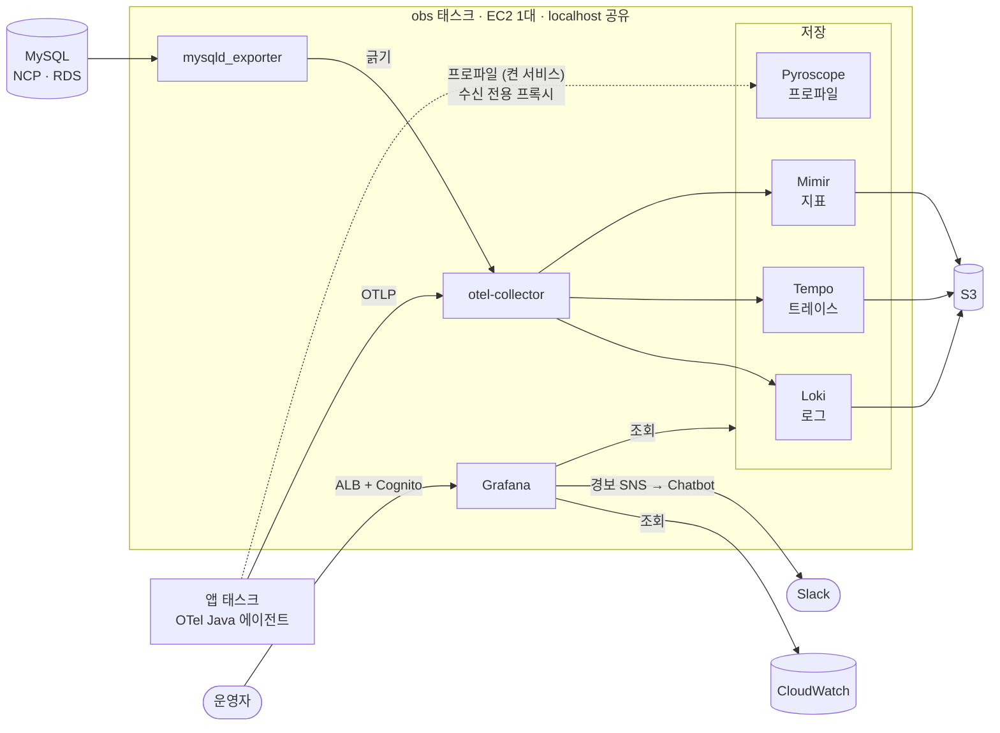
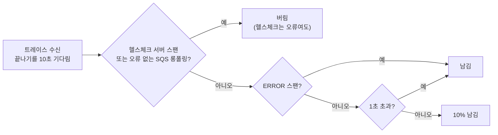
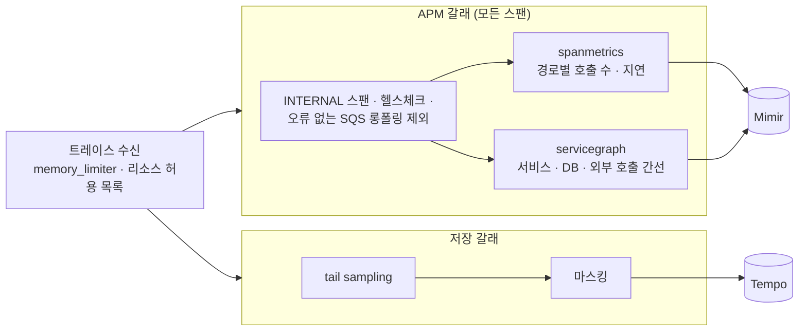
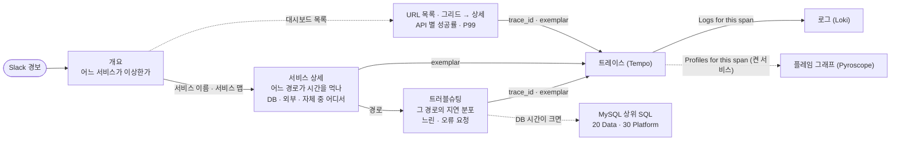
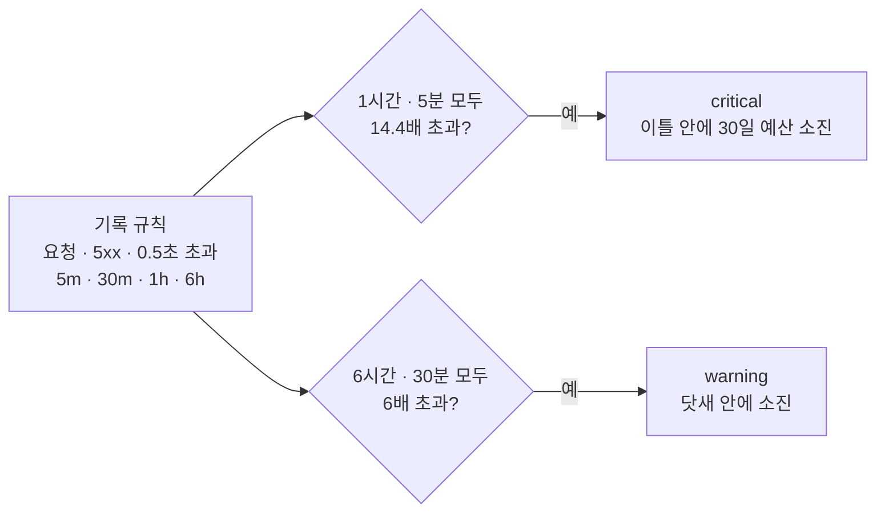

# nova 관측 스택 (LGTM)

nova 서비스의 로그 · 트레이스 · 지표를 한곳에서 보고 경보를 보내는 자체 호스팅 관측 스택이다.
앱의 OpenTelemetry Java 에이전트가 OTLP 로 보내면 Collector 가 받아 가공하고, Loki(로그) · Tempo(트레이스) · Mimir(지표)가 S3 에 저장한다. 조회와 경보는 Grafana 가 맡는다.

이 디렉터리는 그 설정 파일이다. Terraform(`../main.tf`)이 파일을 obs-config 버킷에 올리고, 태스크가 시작할 때 `config-init` 컨테이너가 내려받는다.
파일 해시가 작업 정의에 들어가므로 **설정을 고쳐 apply 하면 곧 재배포다.**

## 한눈에 보기

| 신호 | 들어오는 길 | Collector 처리 | 저장 | 보존 |
|---|---|---|---|---|
| 로그 | 앱 → OTLP | 리소스 속성 허용 목록, 개인정보 마스킹 | Loki → S3 | 90일 |
| 트레이스 | 앱 → OTLP | tail sampling(오류 · 1초 초과는 전부, 나머지 10%), 마스킹 | Tempo → S3 | 14일 |
| 지표 | 앱 → OTLP, Collector 가 긁는 것(MySQL · LGTM 자체 · 호스트), Collector 가 트레이스로 만든 것(span metrics · 서비스 그래프) | 리소스 속성 허용 목록 | Mimir → S3 | 90일 |
| 프로파일 | 앱 → Pyroscope (켠 서비스만) | — | Pyroscope → 데이터 EBS | 7일 |
| AWS 관리형 지표 | Grafana 가 CloudWatch 를 직접 조회 | — | CloudWatch | CloudWatch 기본 |



Collector 는 LGTM 구성 요소와 Grafana 의 `/metrics`, obs 호스트의 CPU · 메모리 · 디스크(`/hostfs`)도 긁어 Mimir 로 보낸다.

## 설계 결정

**1. 단일 바이너리 · 단일 태스크.**
지금 트래픽에서는 마이크로서비스 모드의 수평 확장이 필요 없다. 그래서 다섯 구성 요소를 EC2(t4g.large) 한 대의 ECS 태스크 하나에 모놀리식 모드로 띄운다.
컨테이너들은 localhost 를 같이 쓰므로 포트가 겹치지 않게 맞춘다(아래 "포트").
대가는 가용성이다. obs 가 내려가 있는 동안의 데이터는 잃고, Grafana 경보도 멈춘다. 그래서 obs 태스크와 인스턴스는 CloudWatch 경보(monitoring/cloudwatch 스택)가 따로 감시한다.

**2. 장기 저장은 S3, 로컬 디스크는 WAL 과 최근 블록만.**
데이터 EBS(100 GiB)에는 재시작할 때 되살릴 WAL 과 아직 올리지 않은 블록만 둔다. 보존 기간만큼의 데이터는 S3 에 있으므로 디스크 크기가 보존 기간에 묶이지 않는다.
정상 종료 때 메모리의 청크와 블록을 S3 로 올린다(`stopTimeout` 120초).
한 호스트의 디렉터리를 쓰기 때문에 배포는 이전 태스크를 내린 뒤 새 태스크를 띄운다. 그동안 몇 분은 수집이 끊긴다.

**3. 손실을 허용하는 경로.**
Collector 에는 디스크 큐가 없다. 메모리가 `memory_limiter`(1152 MiB)를 넘으면 받기를 거부한다. 감사 기록이나 정본(outbox 등)의 근거로 쓰지 않는다.
빠지는 데이터는 숨기지 않고 지표(`otelcol_receiver_refused_*`, `*_discarded_*`)와 경보로 드러낸다.

**4. 샘플링은 Collector 에서, 트레이스가 끝난 뒤에.**
앱은 모두 보내고(`parentbased_always_on`), Collector 가 트레이스 전체를 보고 남길지 정한다.
앱에서 미리 자르면 오류가 난 트레이스가 버려진 쪽에 있을 수 있다. 끝난 뒤에 정하면 오류와 느린 요청은 빠짐없이 남는다.



헬스체크는 `url.path` 가 `/actuator/*` 인 서버 스팬, 롱폴링은 오류 없이 끝난 `ReceiveMessage` 클라이언트 스팬이다. 에이전트가 이 스팬에 받은 메시지 수를 붙이지 않아 빈 폴링과 가르지 않는다. 길이는 메시지를 기다린 시간일 뿐이고, 메시지 처리는 컨슈머 스팬으로 따로 남는다. 결정을 기다리는 트레이스는 메모리에 최대 5만 건 둔다. 넘치면 오래된 것부터 결정 없이 버린다.

**5. APM 지표는 샘플링 전에 만든다.**
Tempo 에 남는 트레이스는 일부라서, 거기서 센 요청 수 · 지연은 오류와 느린 요청 쪽으로 기운다. 그래서 Collector 가 트레이스를 두 갈래로 복제해 한쪽에서는 모든 스팬으로 지표를 만들고, 다른 쪽에서만 샘플링한다.



- span metrics(`traces_spanmetrics_*`)는 서버 · 클라이언트 · 메시지 스팬을 `span_name` · `span_kind` · `status_code` 와 HTTP 상태 · DB · 메시징 종류로 나눠 센다. 사용자 ID 같은 값은 차원에 넣지 않고, 조합이 2000개를 넘으면 나머지는 overflow 한 줄로 묶는다.
- 서비스 그래프(`traces_service_graph_*`)는 클라이언트 스팬과 서버 스팬을 짝지어 간선을 만든다. 상대가 계측되지 않은 DB · SQS · 외부 API 는 `db.name` · `server.address` 같은 속성으로 가상 노드를 세운다. Grafana 서비스 맵(Tempo 데이터소스의 `serviceMap`)이 이 지표를 읽는다.
- 대가는 Collector 메모리다. 짝을 기다리는 간선(최대 5000개, 10초)과 지표 상태를 들고 있어 Collector 에 1.5 GiB 를 준다.
- 샘플링된 트레이스로도 TraceQL 지표(`{...} | rate() by (span.http.route)`, `quantile_over_time`)를 볼 수 있다. Tempo 의 `local-blocks` 프로세서가 최근 블록에서 바로 계산하며 따로 저장하지 않는다. Traces Drilldown 이 이것을 쓴다. 샘플링된 표본이라 비율 · 분포를 볼 때 쓰고, 정확한 수는 span metrics 로 본다.

**6. 개인정보는 저장하기 전에 지운다.**
조회할 때 가리면 Loki API 를 직접 부를 때 원문이 보인다. 그래서 Collector 에서 원문을 바꿔 저장하고, 되돌릴 수 없다(아래 "저장 전 마스킹").

**7. 카디널리티를 설정으로 묶는다.**
- Loki 인덱스 라벨은 `service_name` · `service_namespace` · `deployment_environment` 셋뿐이다. 요청마다 다른 값(trace_id, event_id)은 structured metadata 로 둔다.
- 리소스 속성은 허용 목록에 있는 것만 남긴다. AWS 리소스 감지가 붙이는 `aws.ecs.*` · `cloud.account.id` 에는 계정 ID 가 들어 있어 이것도 버린다.
- LGTM 자체 `/metrics` 는 대시보드와 경보에 쓰는 지표만 남긴다(`metric_relabel_configs` keep).

**8. 한 대에 맞춘 Mimir 쿼리 설정.**
쿼리 샤딩은 끈다. 코어가 몇 개 안 되는 한 대에서는 쪼개도 빨라지지 않고 대기열만 찬다.
테넌트 대기열 한도(`max_outstanding_requests_per_tenant`)는 1000이다. 대시보드 몇 개를 동시에 열어 패널 수십 개가 한꺼번에 조회해도 여유가 있는 값이다. 한도를 넘은 조회는 HTTP 429 로 실패하므로 LGTM 대시보드의 "Mimir 쿼리 대기열"로 지켜본다.

**9. 설정 파일에는 환경마다 다른 값을 넣지 않는다.**
버킷 · 보존 기간 · 엔드포인트는 환경 변수로 받는다(`-config.expand-env=true`). 이미지는 태그와 다이제스트로 고정한다.

## 파일

| 경로 | 내용 |
|---|---|
| `collector.yaml` | 수신(OTLP), 긁기(mysqld · LGTM 자체 · hostmetrics), 처리(memory_limiter → 리소스 허용 목록 → 트레이스는 APM 지표 · tail sampling 두 갈래 → 마스킹 → batch), 내보내기(Loki · Tempo · Mimir) |
| `loki.yaml` | S3 저장, 보존 기간, 인덱스 라벨 지정, WAL, 삭제 요청 API 끔 |
| `pyroscope-ingest.nginx.conf` | 앱이 닿는 수신 전용 프록시. `POST /ingest` 만 Pyroscope 로 넘기고 나머지(조회 API 등)는 403 |
| `pyroscope.yaml` | 단일 바이너리, 파일시스템 저장(데이터 EBS, 7일), 같은 태스크와 겹치지 않는 포트(gRPC 9094 · memberlist 7948) |
| `tempo.yaml` | S3 저장, 보존 기간(compactor), WAL, 종료할 때 블록 업로드, TraceQL 지표(`local-blocks`) |
| `mimir.yaml` | `-target=all`. S3 한 버킷에 블록 · ruler · alertmanager 를 접두사로 나눔, OTLP 이름 접미사, 쿼리 대기열 · 샤딩 |
| `grafana/provisioning/datasources/` | Loki · Tempo · Mimir(서로 링크로 이어짐, Tempo 서비스 맵은 Mimir 를 읽음), CloudWatch(태스크 역할) |
| `grafana/provisioning/dashboards/nova.yaml` | `grafana/dashboards/` 의 하위 디렉터리를 같은 이름의 Grafana 폴더로 읽는다 |
| `grafana/dashboards/` | 대시보드 JSON (아래 "대시보드") |
| `grafana/provisioning/alerting/` | `rules.yaml`(경보 규칙), `slo.yaml`(SLO 기록 규칙 · 소진 속도 경보 · 평소 대비 경보), `notify.yaml`(SNS 연락처 · 알림 경로 · Chatbot 메시지 템플릿) |
| `grafana/provisioning/plugins/none.yaml` | 빈 설정. 앱 플러그인은 `GF_PLUGINS_PREINSTALL` 로 받는다. S3 에는 빈 디렉터리가 없어 이 파일이 없으면 Grafana 가 기동할 때마다 오류 로그를 남긴다 |

## 대시보드

화면에서 고친 내용은 저장되지 않는다. JSON 파일이 원본이고, 파일을 지우면 대시보드도 지워진다.

| 폴더 | 대시보드 (uid) | 언제 보나 |
|---|---|---|
| `01 Overview` | 개요 (`nova-overview`) | 로그인 첫 화면. TPS · 5xx · P50/P95/P99 · 응답 시간 히트맵, DB TPS · 연결 사용률 · ALB 연결 · 모자란 태스크 · DLQ · ERROR 로그, 서비스별 현황과 지금 울리는 경보, 서비스 맵, 서비스별 P99 · 동시 처리 요청. SLO (`nova-slo`): 서비스별 30일 가용성 · 응답 시간, 남은 오류 예산, 소진 속도 |
| `10 Services` | 서비스 상세 (`nova-service`) | 서비스 하나(`$service`)의 APM 화면. Apdex · 엔드포인트 표(시간 비중 순) · 처리 시간 구성(DB · 외부 · 메시징 · 자체) · 서비스 맵과 호출 상대 · 지난주 대비 · 오류 그룹. JVM · 외부 호출 · HikariCP 는 접힌 행 |
| `20 Data` | MySQL (`nova-mysql`) · Valkey (`nova-valkey`) · SQS (`nova-sqs`) | DB TPS · 연결 사용률 · 상위 SQL · 잠금과 RDS 서버 자원, 캐시 적중률 · 메모리, 큐 적체 · DLQ |
| `30 Platform` | ECS · 컴퓨팅 (`nova-compute`) · 엣지 · 보안 (`nova-edge`) · 계정 · 비용 (`nova-account`) | 서비스별 할당 대비 CPU · 메모리와 가장 바쁜 태스크, 목표 미달 · 재시작 · 배포, NAT · obs EC2 / CloudFront(캐시 적중률 · 오리진 지연 · 오류 코드), WAF 차단(규칙 · 국가 · 공격 유형), ALB 대상 그룹별, 인증서 만료 / Fargate 한도, 알림 전달 실패, Logs 수집량, S3 크기 |
| `40 Troubleshooting` | 트러블슈팅 (`nova-troubleshooting`) | 서비스 · 경로 하나로 좁혀 ① 지난주 대비 · 새 태스크 ② 서비스 맵 · 느린 엔드포인트 ③ 지연 분포 · 느린/오류 트레이스 ④ 시간 구성 · 느린 DB 쿼리 ⑤ 오류 그룹 · 로그 |
| `50 URLs` | URL 목록 (`nova-url`) · URL 그리드 (`nova-url-grid`) · URL 상세 (`nova-url-detail`) | 실제 요청으로 본 API(메서드 + 경로)별 값. 목록은 API × 시간 히트맵, API 표(요청 수 · 지난주 대비 증감 · 성공률 · 4xx · 1초 초과 비율 · P95 · P99 · P99 증감), 새로 생긴 · 사라진 API(최근 7일), 서비스 시간대 잔디, 경로마다 펼쳐 보는 행. 그리드는 API 마다 카드. 상세는 401 · 403 · 404 · 429 수, 응답 코드별 요청량, 지연 분포, 요청량 · P99 · 성공률 지난주 대비, 시간 구성(트레이스 표본), 날짜 × 시각(KST) 잔디, 느린/오류 트레이스 |
| `90 Observability` | LGTM 스택 · obs 호스트 (`nova-lgtm`) · OpenTelemetry Collector (`nova-otelcol`) | obs 자체가 데이터를 빠뜨리거나 디스크 · 메모리가 모자라지 않은지 |

- 폴더 앞 번호는 목록 순서다. Grafana 는 폴더를 이름순으로만 정렬한다. 사이에 폴더를 끼울 수 있게 10 단위로 띄운다.
- 장애를 볼 때는 아래 순서로 내려간다. 표의 서비스 이름 · 경로, 서비스 맵의 노드, exemplar 가 다음 화면으로 이어 준다.



- 서비스 상세의 숫자는 무엇으로 셌는지에 따라 믿는 정도가 다르다.
  - 요청 수 · 지연 · Apdex · 엔드포인트 표는 앱의 HTTP 지표, 시간 구성 · 나가는 호출 · 서비스 맵은 Collector 가 샘플링 전 스팬으로 센 지표라 모든 요청이 들어 있다.
  - 오류 · 느린 트레이스 표는 Tempo 에 남은 것이다. 오류와 1초 초과는 전부, 나머지는 10% 다.
- Apdex 의 T 는 0.25초다. 만족 ≤ 0.25초, 허용 ≤ 1초가 히스토그램 버킷 경계와 맞아 근사 없이 센다.
- 이미지가 `:latest` 라 버전 라벨이 없다. 대신 새 태스크가 처음 지표를 보낸 때(`target_info` 의 새 instance)를 보라색 구간으로 표시해 배포 · 교체 시점을 본다. 수집이 몇 분 끊겼다 돌아온 태스크(obs 재배포 뒤)도 같이 표시되는 한계가 있다.

- URL 화면은 `/**` 를 API 로 보지 않는다. 어떤 컨트롤러에도 맞지 않은 요청(없는 경로 · 스캐너, 대개 404)을 Spring 이 이 이름으로 묶는다. 목록 화면에 "등록되지 않은 경로 요청" 수로만 따로 센다.
- 1초 초과 비율은 히스토그램 버킷 경계(1초)로 세어 근사가 없다. 증감은 지난주 같은 구간 대비 배수이고, 지난주에 요청이 없으면 비운다.
- 경로 변수에는 정규식 문자가 든 값(`/orders/{id}`)이 있다. PromQL 은 `http_route=~"$route"` 로 쓴다. All 을 둔 변수는 Grafana 가 값을 정규식 이스케이프해 넣는다.
  TraceQL 은 Grafana 가 값을 그대로 넣고 큰따옴표 문자열은 `\*` 같은 이스케이프를 받지 않는다. 그래서 ``span.http.route=~`${route:regex}` `` 처럼 regex 형식을 백틱 문자열에 넣는다.
- CloudWatch 를 읽는 대시보드(Valkey · SQS · Platform)는 5분마다 새로고침한다. GetMetricData 는 조회한 지표 수만큼 과금된다.
  개요와 MySQL 은 Mimir 지표가 주라 1분이다. 개요는 자주 열리는 화면이라 CloudWatch 패널을 셋(ALB 연결 · 모자란 태스크 · DLQ)만 둔다.
- CloudFront 배포는 `Product=nova` 태그, NAT · obs 인스턴스는 이름 태그로 고른다. ID 를 대시보드에 적지 않아 다시 만들어지거나 ASG 가 교체해도 따라간다.
- `otelcol.json` 은 grafana.com 15983 rev 31 을 가져온 것이다. 원본과 다른 곳은 uid · `nova` 태그 · 데이터소스(Mimir) · job(`otelcol-contrib`) 기본값뿐이다. 새 리비전으로 바꿀 때도 이 네 곳만 다시 맞춘다.

## 경보

Grafana 가 1분마다 Mimir 를 조회해 판단하고 SNS → AWS Chatbot → Slack 으로 보낸다. 경보 이름과 job 이 같은 것끼리 묶고, 해결되지 않으면 4시간마다 다시 알린다.
Slack 메시지에는 경보마다 아래 "경보 대응" 항목으로 가는 링크(`runbook_url`)가 붙는다.

### SLO

서비스(job)마다 30일 창으로 두 가지를 약속한다. 목표값은 기본값으로 둔 예시다 — 서비스별 값은 팀과 정한다.

| SLO | 목표 | 예산(30일 동안 허용하는 실패) |
|---|---|---|
| 가용성 | 5xx 가 아닌 응답 99.9% | 0.1% |
| 응답 시간 | 95% 가 0.5초 안 | 5% (0.5초는 히스토그램 버킷 경계라 근사가 없다) |

- 헬스체크(`/actuator`)는 뺀다.
- **기록 규칙**(`slo.yaml` 의 `nova-slo-rec`): 5분 · 30분 · 1시간 · 6시간 창의 요청 · 5xx · 0.5초 초과의 초당 수를 1분마다 미리 계산해 Mimir 에 쓴다(`nova:http_requests:rate1h` 등). Grafana 관리 기록 규칙이다. 경보와 SLO 대시보드가 이것을 읽어 매번 긴 창을 다시 계산하지 않는다.
- **소진 속도 경보**: 예산을 평소의 몇 배 속도로 쓰는지 본다. 긴 창과 짧은 창이 모두 넘을 때만 울려, 문제가 끝나면 짧은 창 덕분에 빨리 해소된다.



- 긴 창에 요청이 1시간 60건 미만이면 소진 속도 경보를 보지 않는다. 요청이 적은 서비스에서 몇 건의 오류로 비율이 튀어 울리는 것을 막는다.
- **평소 대비 경보**: 트래픽이 시간대에 따라 크게 달라(지난 7일 중 58% 의 시간이 요청 0건) 고정 기준이 맞지 않는 것을 본다. 기준선은 지난 3주 같은 요일 · 같은 시각의 평균이고, 3주치가 없으면 지난주 하나다. 원본 HTTP 지표(90일 보존)로 계산한다.

### 규칙

| 규칙 | 조건 | 지속 | 등급 |
|---|---|---|---|
| SLO 가용성 예산 빠르게 소진 | 5xx 비율이 1시간 · 5분 모두 예산의 14.4배(1.44%) 초과 | 2분 | critical |
| SLO 가용성 예산 소진 | 6시간 · 30분 모두 6배(0.6%) 초과 | 15분 | warning |
| SLO 응답 시간 예산 빠르게 소진 | 0.5초 넘은 요청 비율이 1시간 · 5분 모두 14.4배(72%) 초과 | 2분 | critical |
| SLO 응답 시간 예산 소진 | 6시간 · 30분 모두 6배(30%) 초과 | 15분 | warning |
| 요청 급감 (평소 대비) | 최근 30분 요청 < 평소의 30% (평소 30분 30건 이상인 시간대만) | 20분 | warning |
| 응답 시간 급증 (평소 대비) | 최근 30분 P99 > 평소의 2배 그리고 0.5초 이상 | 15분 | warning |
| HTTP P99 응답 시간 | 서비스별 P99 > 2초 | 10분 | warning |
| JVM 힙 사용률 | 태스크별 힙 사용 / 한도 > 90% | 10분 | warning |
| 서비스 지표 끊김 | 지난 1시간 안에 지표를 보내던 서비스가 지금 `target_info` 를 보내지 않음 | 5분 | critical |
| MySQL 수집 끊김 | `mysql_up` 또는 exporter 수집 대상의 `up` < 1 (exporter 를 띄운 환경만) | 5분 | critical |
| MySQL 연결 사용률 | 연결 수 / max_connections > 80% | 10분 | warning |
| MySQL 오래 도는 쿼리 | 상태별 실행 중 쿼리 시간 합 > 60초 (RDS 만) | 2분 | warning |
| obs 수집 실패 | Collector 의 수신 거부 · 내보내기 실패 > 0 | 10분 | warning |
| obs 저장소 거부 | Loki · Tempo · Mimir 가 버린 로그 · 스팬 · 샘플 > 0 (job · reason 별) | 10분 | warning |
| obs 디스크 사용률 | obs 호스트 마운트별 사용률 > 80% | 15분 | warning |

- 5xx 비율은 고정 기준(5분 5%) 경보를 두지 않는다. SLO 가용성 소진 속도 경보가 더 일찍(1.44%), 더 적게 울린다. 파일에서 규칙을 빼도 Grafana 는 지우지 않으므로 `rules.yaml` 의 `deleteRules` 로 지운다.
- 트래픽이 없어 조회 결과가 비면 정상으로 본다(`noDataState: OK`). 조회 자체가 실패하면 Error 상태 알림이 따로 간다.
- 트래픽이 없어도 알아야 하는 엣지 문제는 CloudWatch 경보가 본다(monitoring/cloudwatch 스택 `certs_alb.tf`): 인증서 만료 14일 전(ALB · CloudFront 인증서), ALB 가 직접 만든 4xx 비율(원본 확인 헤더 · 리스너 규칙 어긋남).
- RDS 의 CPU · 여유 메모리 · 남은 스토리지도 CloudWatch 경보(`rds_instance_ids`)가 맡는다.
- Chatbot 은 SNS 메시지가 사용자 지정 알림 JSON 형식일 때만 내용을 그대로 보여 준다. `notify.yaml` 의 템플릿이 그 JSON 을 만든다.

## 경보 대응

경보 메시지의 "대응 순서" 링크가 여기로 온다. 먼저 볼 화면과 확인 순서다.

### SLO 가용성 예산 소진

1. SLO 대시보드에서 어느 서비스가 예산을 쓰는지, 1시간 · 6시간 소진 속도가 오르는 중인지 본다.
2. 서비스 상세 → 응답 코드 · 엔드포인트 표에서 5xx 가 몰린 경로를 찾는다. 새 태스크(보라색 구간) 직후라면 배포를 의심한다.
3. 트러블슈팅에서 그 경로의 오류 요청 트레이스 → 붉은 스팬 → 로그로 원인을 본다. DB · 외부 호출 오류면 MySQL · 의존 서비스로 간다.
4. 배포가 원인이면 이전 이미지로 되돌린다. critical 은 지금 속도면 이틀 안에 30일 예산을 다 쓴다는 뜻이다.

### SLO 응답 시간 예산 소진

1. URL 목록 · 서비스 상세에서 1초 초과 비율 · P99 가 오른 경로를 찾는다.
2. 상세의 시간 구성(DB · 외부 · 자체)과 "이 URL 안에서 오래 걸린 호출"로 어디서 시간을 쓰는지 본다.
3. DB 가 크면 MySQL 대시보드의 상위 SQL · 잠금, 자체가 크면 HikariCP 대기 · JVM GC · CPU(프로파일을 켰다면 플레임 그래프)를 본다.

### 요청 급감

1. 개요 · 엣지 대시보드에서 CloudFront 요청 수와 ALB 요청 수를 같이 본다. CloudFront 는 그대로인데 ALB 가 줄었으면 WAF 차단 · 원본 확인 헤더 · 리스너 규칙을 본다.
2. 둘 다 줄었으면 클라이언트(앱 · 프런트 배포) 쪽이다. DNS · 인증서 문제면 CloudWatch 의 인증서 · ALB 4xx 경보도 함께 울린다.
3. 판매 오픈처럼 평소와 다른 날은 사일런스로 막는다.

### 응답 시간 급증

1. URL 목록의 P99 증감 열로 어느 API 가 평소보다 느린지 본다.
2. 그 API 상세의 지연 분포 · 시간 구성으로 SLO 응답 시간 예산 소진과 같은 순서로 본다. 트래픽이 평소보다 많으면 태스크 수 · CPU 를 본다.

### HTTP P99 응답 시간

응답 시간 급증과 같은 순서로 본다. 이 경보는 평소와 상관없이 2초를 넘은 것이다.

### JVM 힙 사용률

1. 서비스 상세의 JVM 행에서 힙 · GC 시간 비율을 본다. GC 가 계속 돌면서 힙이 안 내려가면 누수다.
2. 특정 태스크만 높으면 그 태스크를 교체하고, 모두 높으면 메모리 설정(`service.yml` 의 memory)이나 최근 배포를 본다.

### 서비스 지표 끊김

1. ECS · 컴퓨팅 대시보드에서 그 서비스의 실행 태스크 수 · 재시작을 본다. 태스크가 0 이면 CloudWatch 의 태스크 0개 경보도 울린다.
2. 태스크는 도는데 지표만 없으면 Collector(obs) 쪽이다. obs 수집 실패 · LGTM 대시보드를 본다.

### obs 수집 실패

OpenTelemetry Collector 대시보드에서 거부 · 내보내기 실패가 어느 신호(로그 · 트레이스 · 지표)인지 본다. 메모리 한도(`memory_limiter`)로 거부하면 수신량이 갑자기 늘었는지, 내보내기 실패면 Loki · Tempo · Mimir 가 살아 있는지 본다.

### obs 저장소 거부

LGTM 대시보드의 "저장소가 버린 데이터"에서 reason 을 본다. 한도(속도 · 라벨 수)면 무엇이 늘었는지 수집량 패널로 찾는다.

### obs 디스크 사용률

LGTM 대시보드에서 어느 마운트(루트 · 데이터 EBS)인지 본다. 데이터 EBS 면 S3 로 올리지 못한 WAL · 블록이 쌓였는지(저장소 거부 · 내보내기 실패) 먼저 본다.

### MySQL 수집 끊김

1. MySQL 대시보드의 exporter 연결 · 수집 오류를 본다. DB 자체가 내려갔으면 앱 5xx 경보도 같이 온다.
2. DB 는 살아 있는데 수집만 끊겼으면 exporter 계정 · 비밀(`nova-prod/db/exporter`) · 보안 그룹을 본다.

### MySQL 연결 사용률

MySQL 대시보드에서 계정별 연결로 어느 서비스가 연결을 쥐고 있는지 본다. 서비스 상세의 HikariCP 사용 · 대기와 함께 보고, 태스크 수 × 풀 크기가 max_connections 를 넘지 않는지 확인한다.

### MySQL 오래 도는 쿼리

MySQL 대시보드의 쿼리 상태별 스레드 · 상위 SQL 로 오래 도는 쿼리를 찾는다. 잠금 대기면 잠금 패널을 본다.

## 앱 연동

에이전트는 be 이미지의 `/otel/javaagent.jar` 다. ecs 스택의 `otel.tf` 가 `otel_services`(지금은 `["*"]`, 배포하는 서비스 전부)에 아래 환경 변수를 넣는다.

```
JDK_JAVA_OPTIONS=-javaagent:/otel/javaagent.jar
OTEL_SERVICE_NAME=<svc>
OTEL_RESOURCE_ATTRIBUTES=deployment.environment=prod,service.namespace=nova
OTEL_LOGS_EXPORTER=otlp
OTEL_TRACES_EXPORTER=otlp
OTEL_METRICS_EXPORTER=otlp
OTEL_TRACES_SAMPLER=parentbased_always_on
OTEL_INSTRUMENTATION_MICROMETER_ENABLED=true
OTEL_EXPORTER_OTLP_ENDPOINT=http://otel.nova.local:4318
OTEL_EXPORTER_OTLP_PROTOCOL=http/protobuf
OTEL_INSTRUMENTATION_AWS_SDK_EXPERIMENTAL_USE_PROPAGATOR_FOR_MESSAGING=true
OTEL_INSTRUMENTATION_LOGBACK_APPENDER_EXPERIMENTAL_MDC_ATTRIBUTES_INCLUDED=traceId
OTEL_INSTRUMENTATION_COMMON_LOGGING_STRUCTURED_ATTRIBUTES_INCLUDED=event_id,aggregate_type,aggregate_id,event_type,destination
OTEL_INSTRUMENTATION_HTTP_SERVER_EMIT_EXPERIMENTAL_TELEMETRY=true
OTEL_INSTRUMENTATION_HTTP_SERVER_CAPTURE_REQUEST_HEADERS=x-amz-cf-id,x-amzn-trace-id
```

- `JAVA_TOOL_OPTIONS` 는 쓰지 않는다. 이미지의 힙 옵션이 그 변수에 들어 있어 덮어쓰면 사라진다.
- 엔드포인트와 프로토콜은 짝을 맞춘다. `otel.nova.local:4318` 은 `http/protobuf`, gRPC 는 `otel-grpc.nova.local:4317` 이다. 어긋나면 앱 로그에 실패가 한 줄 남을 뿐 아무것도 오지 않는다.
- MDC 는 `traceId`(요청 ID)만 넘긴다. `subject`(회원 ID)는 넘기지 않는다.
- **프로파일(NV-540)**: `application/<서비스>/service.yml` 에 `profiling: true` 인 서비스에만 켠다(기본 false). 같은 값으로 obs 의 프로파일 인바운드(4041, 수신 전용 프록시)도 그 서비스에만 열린다. 이미지에 확장 jar(`/otel/pyroscope-otel.jar`)가 있어야 해서 be 이미지에 넣은 뒤 한 서비스씩 켠다.
  ```
  OTEL_JAVAAGENT_EXTENSIONS=/otel/pyroscope-otel.jar
  OTEL_PYROSCOPE_START_PROFILING=true
  PYROSCOPE_SERVER_ADDRESS=http://pyroscope.<네임스페이스>:4040
  PYROSCOPE_PROFILER_EVENT=itimer   # Fargate 는 perf_events 를 막는다
  ```
  - 앱은 `pyroscope.<네임스페이스>:4040`(Service Connect 별칭)으로 보내고, 실제로는 수신 전용 프록시(4041)에 닿는다. Pyroscope 4040 은 조회 API 도 내서 앱에 열면 Grafana 인증 없이 다른 서비스의 프로파일을 읽을 수 있기 때문이다. obs 보안 그룹도 4041 만 연다.
  - 확장이 프로파일 샘플에 스팬 ID 를, 스팬에 `pyroscope.profile.id` 를 붙인다. Tempo 의 trace-to-profiles 가 이 둘로 스팬 → 그 시간의 플레임 그래프를 연다.
- 실험 텔레메트리는 동시 처리 요청(`http_server_active_requests`)을 위해 켠다. 같이 켜지는 요청 · 응답 본문 크기 히스토그램은 쓰지 않아 Collector 가 버린다(`filter/unused-metrics`).
- 요청 헤더 두 개를 스팬 속성(`http.request.header.x-amz-cf-id` · `x-amzn-trace-id`)으로 남긴다. CloudFront · ALB 로그의 요청 ID 와 트레이스를 잇는 열쇠다. 클라이언트가 같은 이름의 헤더를 보내면 그 값이 섞여 들어올 수 있어, Collector 가 AWS 형식만 남긴다(아래 "저장 전 마스킹").

## 조회

**로그 (Loki).** 인덱스 라벨로 스트림을 고른 뒤 structured metadata 로 거른다.

```
{service_name="preorder", deployment_environment="prod"} | event_id="<uuid>"
{service_namespace="nova"} | aggregate_type="PREORDER" | aggregate_id="<uuid>"
```

**지표.** Mimir 에서 PromQL 로 본다. 이름은 Prometheus 관례(단위 · 종류 접미사)를 따른다. 예: `http.server.request.duration` → `http_server_request_duration_seconds_bucket`.
- `job` 은 `<service.namespace>/<service.name>`(예 `nova/preorder`)이다. `deployment_environment` · `service_namespace` 도 라벨로 붙는다. 그 밖의 리소스 속성은 `target_info` 에만 있다.
- `target_info` 에는 `service_namespace` 라벨이 없다. 앱만 고를 때는 `target_info{job=~"nova/.+"}` 를 쓴다.
- 앱 외 job: Collector `otelcol-contrib`, MySQL `mysqld`, LGTM 자체 `loki` · `tempo` · `mimir` · `grafana`, obs 호스트 `obs-host`.
- HikariCP 대기 · 사용 시간은 에이전트가 보내는 `db_client_connections_*_milliseconds` 를 초로 바꿔 그린다. semconv 안정 이름(`db_client_connection_*_seconds`)도 함께 조회해 에이전트를 올려도 패널이 비지 않는다.

**트레이스.** 로그 줄을 펼쳐 trace_id 의 Tempo 링크로 가거나, 지표 그래프의 exemplar 점에서 바로 간다. 스팬에서는 "Logs for this span" 으로 같은 trace_id 의 로그를 연다.

**APM 지표.** 샘플링 전 모든 스팬에서 센 값이다. `job` 은 앱 지표와 같다.

```
# 경로별 초당 호출 (서버 스팬)
sum by (span_name) (rate(traces_spanmetrics_calls_total{job="nova/preorder", span_kind="SPAN_KIND_SERVER"}[5m]))
# preorder 가 부르는 상대(서비스 · DB · 외부)별 실패 비율
sum by (server) (rate(traces_service_graph_request_failed_total{client="preorder"}[5m]))
  / sum by (server) (rate(traces_service_graph_request_total{client="preorder"}[5m]))
```

**TraceQL 지표.** Tempo 에 남은 트레이스로 계산한다. Explore 의 Tempo TraceQL 편집기에 그대로 넣거나 Traces Drilldown 에서 본다.

```
{resource.service.name="preorder" && kind=server} | quantile_over_time(duration, .99) by (span.http.route)
{span.http.request.header.x-amz-cf-id != nil && status=error} | rate()
```

## 저장 전 마스킹

Collector 가 Loki · Tempo 에 넘기기 전에 개인정보 원문을 고정 표시로 바꾼다(`collector.yaml` 의 `transform/mask`, `transform/mask-spans`). **되돌릴 수 없다.**

| 대상 (이 순서로 적용) | 바뀐 모습 |
|---|---|
| MySQL 중복 키 값 `Duplicate entry '<값>' for key` (한 줄 안에서만) | `Duplicate entry '<masked>' for key` |
| 이메일 `local@domain.tld` · `local%40domain.tld` | `<masked:email>` |
| 국제 형식 휴대전화 `+82` · `%2B82` · `0082`, `(0)` 허용 | `<masked:phone>` |
| 휴대전화 `010` · `011` · `016`~`019`, 괄호 · 구분자(`-` `.` 공백) 허용 | `<masked:phone>` |

- **적용 범위**: 로그 본문(맵 · 목록 본문은 JSON 문자열로 바꾼 뒤 적용)과 로그 속성의 모든 문자열 값(`exception.message` · `exception.stacktrace` 포함).
- **트레이스**: 스팬 속성, 스팬 이벤트 속성(예외), 상태 메시지에 같은 패턴을 적용한다. 엣지 요청 ID 헤더는 형식으로 거른다. `x-amz-cf-id` 는 CloudFront ID 형식(영숫자 · `_` `=` `-` 20~100자)일 때만, `x-amzn-trace-id` 는 `Root=1-<16진 8자리>-<16진 24자리>` 부분만 문자열 하나로 남기고 나머지는 버린다. URL 쿼리 문자열(`url.query` · `url.full` · `http.url` · `http.target`)은 토큰이 패턴에 걸리지 않으므로 값을 모두 지운다. SQL 리터럴은 에이전트가 `?` 로 바꿔 보낸다.
- **경계**: 번호 앞뒤가 16진수 문자이면 건드리지 않는다. 그래서 UUID · trace ID 안의 숫자는 걸리지 않는다.
- **`error_mode: ignore`**: 문 하나가 실패하면 그 문만 건너뛴다. `propagate` 로 두면 배치 전체를 버린다(503).
- **잡지 못하는 것**: 실명 · 주소 · 유선 전화 · 외국 번호, 16진수 글자에 바로 붙은 번호(`phone010…`), 같은 줄에 `for key` 가 없는 중복 키 값, 맵 · 목록 속성 안의 값, 바이트 본문, 스코프 속성.
- **오탐**: `0.0101234567` → `0.<masked:phone>`, 0 으로 채운 `010…` 10~11자리 숫자 ID.
- CloudWatch Logs(`awslogs`) 사본은 Collector 를 거치지 않으므로 원문이 남는다.
- 이것은 안전망이다. 1차 방어는 앱이 애초에 개인정보를 로그에 남기지 않는 것이다.

## 보안

- **OTLP 에는 TLS 와 토큰을 붙이지 않는다.** VPC 안 통신이고, 보낼 수 있는 쪽은 obs 보안 그룹이 정한다. 보내는 쪽이 저장된 로그를 읽을 경로는 없다. 대신 다음을 감수한다.
  - 보낼 수 있는 곳이면 로그를 지어내 넣을 수 있다. 로그의 진위는 보장하지 않는다.
  - 한 서비스가 많이 보내면 Collector 메모리 한도에 걸려 다른 서비스의 데이터도 버려진다.
- Grafana 는 ALB 에서 Cognito 로그인을 거친 뒤 같은 사용자 풀로 OAuth 로그인한다. 역할은 Cognito 그룹으로 정한다(`grafana-admin` → Admin, `grafana-editor` → Editor, 그 밖 → Viewer). 익명 접근 · 가입 · 플러그인 관리는 꺼져 있다.
- Loki · Tempo · Mimir API 에는 인증이 없다(`auth_enabled: false`). 태스크 안 localhost 에서만 닿는다. Loki 삭제 요청 API 는 끄고, 보존 기간이 지난 데이터는 compactor 가 지운다.
- 버킷 정책은 `nova-prod-obs` 역할만 객체에 접근하게 한다(s3 스택).
- 모든 컨테이너는 1024 위 포트만 쓴다. 리눅스 권한을 모두 버리고 권한 상승을 막는다. Tempo · Mimir 는 이미지 기본 사용자가 root 라 `user: 10001:10001` 로 돌린다.

## 운영

### 포트

| 컨테이너 | 포트 |
|---|---|
| otel-collector | 4317 (OTLP gRPC) · 4318 (OTLP HTTP) · 8888 (자체 지표, localhost) · 13133 (헬스체크) |
| loki | 3100 (HTTP) · 9096 (gRPC) |
| tempo | 3200 (HTTP) · 9097 (gRPC) · 14317 (OTLP gRPC, Collector 전용) |
| mimir | 9009 (HTTP: OTLP `/otlp`, PromQL `/prometheus`) · 9098 (gRPC) · 7947 (memberlist, 127.0.0.1) |
| grafana | 3000 |
| mysqld_exporter | 9104 |
| pyroscope | 4040 (HTTP, 태스크 안에서만) · 9094 (gRPC) · 9099 (raft, 127.0.0.1) · 7948 (memberlist, 127.0.0.1) |
| pyroscope-ingest | 4041 (수신 전용 프록시, Service Connect `pyroscope` 의 대상) |

Tempo · Mimir 의 링은 메모리에 둔다. Mimir 3 는 memberlist 를 띄우므로 기본 7946 대신 127.0.0.1:7947 에 묶는다.

### 환경 변수

설정 파일은 컨테이너의 `/config/` 에 놓인다. Collector 는 `--config=/config/collector.yaml`, Loki · Tempo · Mimir 는 `-config.file=/config/<이름>.yaml -config.expand-env=true` 로 띄운다.

| 컨테이너 | 변수 | 값 |
|---|---|---|
| otel-collector | `LOKI_OTLP_ENDPOINT` · `MIMIR_OTLP_ENDPOINT` | `http://localhost:3100/otlp` · `http://localhost:9009/otlp` |
| otel-collector | `TEMPO_OTLP_ENDPOINT` | `127.0.0.1:14317` (gRPC, TLS 없음). `localhost` 로 쓰면 ::1 부터 시도해 실패 로그가 남는다 |
| otel-collector | `MYSQLD_EXPORTER_TARGET` | `localhost:9104`. exporter 를 띄우지 않으면 빈 문자열이고, 그때는 긁지 않는다 |
| otel-collector | `PYROSCOPE_TARGET` | `localhost:4040`. Pyroscope 를 띄우지 않으면 빈 문자열이고, 그때는 긁지 않는다 |
| otel-collector | `OBS_DATA_MOUNT_PATH` | 데이터 EBS 마운트 경로(ecs 스택 출력 `obs_data_mount_path`). hostmetrics 가 이 디스크와 루트의 사용률을 본다. 호스트 `/` 는 `/hostfs` 에 읽기 전용으로 붙는다 |
| loki · tempo · mimir | `<LOKI·TEMPO·MIMIR>_S3_BUCKET` · `_S3_REGION` | s3 스택 출력의 버킷, `ap-northeast-2` |
| loki · tempo · mimir | `LOKI_RETENTION_PERIOD` · `TEMPO_RETENTION` · `MIMIR_RETENTION` | `2160h` · `336h` · `2160h` (`../variables.tf` 의 `obs_retention`). Loki · Tempo 버킷에는 이보다 긴 수명주기 만료(100일 · 30일)가 안전망으로 걸려 있다 |
| loki · tempo · mimir | `*_S3_ENDPOINT` · `*_FORCE_PATH_STYLE` · `*_INSECURE` 등 | 운영에서는 넘기지 않는다. MinIO 같은 S3 호환 저장소로 띄울 때 쓴다 |
| grafana | `LOKI_URL` · `TEMPO_URL` · `MIMIR_URL` · `PYROSCOPE_URL` | `http://localhost:3100` · `http://localhost:3200` · `http://localhost:9009/prometheus` · `http://localhost:4040` |
| grafana | `SNS_TOPIC_ARN` · `AWS_REGION` | 알림 주제와 리전. 비어 있으면 연락처 검증에 실패해 Grafana 가 뜨지 않는다. 태스크 역할에 `sns:Publish` 가 필요하다 |
| grafana | `GF_SECURITY_ADMIN_PASSWORD` | Secrets Manager `nova-prod/ops/grafana/admin-password` |

### DB 지표 (mysqld_exporter)

exporter 는 `database` 원격 상태의 출력 네 개(`db_address` · `db_port` · `exporter_username` · `exporter_secret_arn`)로 DB 에 붙는다. 어느 플랫폼의 DB 스택이든 이 출력을 내면 된다.
비밀은 `nova-prod/db/exporter` 이름 규칙을 따라야 obs 실행 역할이 읽는다(iam 스택 `obs.tf`).

켜는 수집기는 `obs_mysql_platform`(`ncp` · `rds`)으로 고른다.

| 값 | 계정 권한 | 더 켜는 것 |
|---|---|---|
| `ncp` | READ (PROCESS · REPLICATION CLIENT 없음) | 없음. 그 권한이 필요한 기본 수집기를 끈다 |
| `rds` | `PROCESS` · `REPLICATION CLIENT` · `SELECT` | 다이제스트별 SQL 통계(상위 SQL), mysqld 메모리, 계정 · 상태별 연결(processlist), 교착 상태 |

RDS 는 파라미터 그룹에서 `performance_schema` 가 켜져 있어야 상위 SQL 이 나온다. 정적 값이라 바꾸면 재부팅이 필요하므로 인스턴스를 만들 때 켠다.
다이제스트 지표는 SQL 형태마다 한 벌씩 생긴다. 최근 하루 동안 본 것 중 시간 순 100개만 모으고, 화면이 쓰지 않는 항목은 Collector 가 버린다(`collector.yaml` 의 mysqld `metric_relabel_configs`).

### 작업 정의 제약 (`../main.tf`)

- 데이터 디렉터리는 데이터 EBS 를 bind mount 한다: loki `/loki`, tempo `/var/tempo`, mimir `/data`, pyroscope `/data`(넷 다 UID 10001), grafana `/var/lib/grafana`(UID 472). 디렉터리는 ecs 스택의 `obs_data_dirs` 가 정하고 obs 인스턴스가 부팅할 때 만든다. 디렉터리를 더하면 인스턴스가 한 번 교체된다.
- Pyroscope 는 ecs 스택에 `pyroscope` 디렉터리가 있을 때만 띄운다. 압축 작업 임시 디렉터리를 `TMPDIR=/data` 로 돌려 루트 파일시스템을 읽기 전용으로 둔다. 메모리 512 MiB 는 Loki 한도(2048 → 1536)에서 덜어 냈다. 실제 obs 사용은 그보다 훨씬 적다.
- Collector 메모리는 1.5 GiB 를 준다. tail sampling 이 결정 전 트레이스(최대 5만 건)를, servicegraph 가 짝을 기다리는 간선을 메모리에 들고 있다. `memory_limiter` 는 이 값의 75%(1152 MiB)다.
- Grafana 는 기동할 때 Drilldown 앱(Traces · Logs · Metrics · Profiles)을 grafana.com 에서 받는다. `GF_PLUGINS_PREINSTALL` 로 버전을 고정해 재배포마다 화면이 바뀌지 않게 한다. 올릴 때는 이 값을 바꾼다.

### admin 비밀번호 교체

`GF_SECURITY_ADMIN_PASSWORD` 는 Grafana 를 처음 띄울 때만 적용된다. 이미 있는 admin 은 Grafana 컨테이너에서 바꾼다.

```
grafana cli admin reset-admin-password --password-from-stdin
```
